# Chapter 1: Introduction to Robots and Robotic Arms

> 📌 **Overview**: This chapter helps absolute beginners get to know robots and robotic arms. It answers three basic questions: "**What is a robot**", "**What categories of robots are there**", and "**Why start with a robotic arm**". It explains several groups of robotics terms that run through the later chapters, covering mechanical structure and geometry (joints/links/end effector, degrees of freedom/payload/workspace, coordinate frame systems), hardware (actuators and sensors), and disciplinary methods (kinematics/dynamics/control). It also presents the recommended tools and environment for robotic arm development.

## 1 Development history and classification

### 1.1 What is a robot: from science fiction to reality

The word "robot" first appeared in the 1920 play *Rossum's Universal Robots* by the Czech writer Karel Čapek, and its root comes from *robota* (meaning "forced labor, drudgery"). But what truly brought robots from science fiction into reality was the birth of the **industrial robot**:

- **1954**: The American George Devol applied for a patent for the first programmable manipulator, laying the foundation for the industrial robot idea of "replacing human hands with programs".
- **1961**: The **Unimate** robotic arm went to work on a General Motors assembly line in the United States, becoming the world's **first industrial robot to be truly put into production**, handling die-cast parts.

Since then, robotics has evolved along **two directions**: one pursues **industrial precision and payload** (manufacturing scenarios such as welding, painting, and assembly); the other pursues **autonomy and adaptability** (unstructured scenarios such as mobility, perception, and decision-making). In essence, all the kinds of robots we see today come from the extension and fusion of these two directions.

#### 1.1.1 How to tell whether something is a robot

Moving does not make something a robot. A widely accepted criterion is: **a robot is a machine that can complete physical tasks autonomously or semi-autonomously through perception, decision-making, and execution**. It must have all three characteristics at the same time: **programmable (actions can be changed), movable (produces physical displacement or manipulation), and perceptive (obtains feedback from the environment or itself)**. In other words, only something that **moves according to a program through "perception—decision—execution"** is a robot; something that "acts according to a fixed process" is called an automated machine.

| Device category | Is it a robot | Key criterion |
|:---:|:---:|:---:|
| Robotic arm | ✅ | Programmable, movable, and has position feedback — all three present |
| Home robot vacuum | ✅ | Programmable, mobile, and has sensors (fall prevention, path finding) |
| Automated teller machine (ATM) | ❌ | Fixed actions; its motion logic cannot be changed by programming, so it is automation equipment |
| Ordinary washing machine | ❌ | Only a timed cycle; no environmental perception and no motion mechanism |

### 1.2 How robots are classified

There are many kinds of robots, and there is no single correct classification. Three common perspectives are: **what it does (application domain), how it moves (mode of locomotion), and what it looks like (configuration and biomimicry)**.

> 💡 Learning these classifications is not about memorizing concepts; it is about being able to make a quick judgment when you encounter a robot. For example, when you see a **wheeled robot**, you can associate it with "mapping, localization, and navigation", with the advantages of being "simple, reliable, and low-cost", common in scenarios such as floor cleaning and logistics delivery. Conversely, if you need to design a **field inspection robot**, you would give priority to **tracked** or **legged** types — obstacle-crossing capability is the key. **Classification is essentially a "quick reference table for robots".**

#### 1.2.1 By application domain

Dividing robots by the industry and scenario they serve is the classification perspective closest to "purpose". Following the definitions of the International Federation of Robotics (IFR), they can be divided into four major categories: industrial, agricultural, service (personal/domestic + professional service), and special-purpose.

| Category | Main characteristics | Advantages | Disadvantages | Example |
|:---:|:---:|:---:|:---:|:---:|
| Industrial robot | For manufacturing; structured environment, high repeatability | Fast, accurate, can work 24 hours | Poor environmental adaptability; requires safety protection | 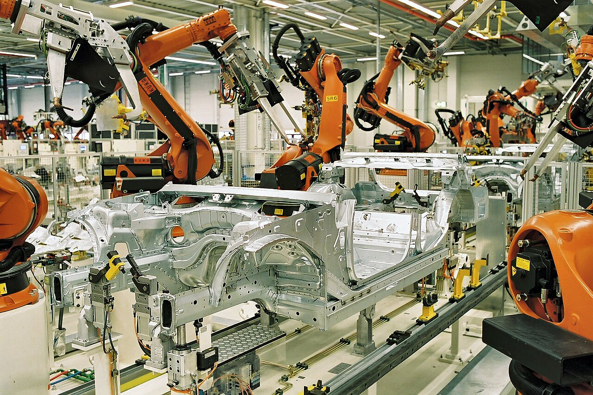 |
| Agricultural robot | For farmland/greenhouses; semi-structured, outdoor operation | Alleviates labor shortages, standardizes operations | Heavily affected by weather and crop diversity | 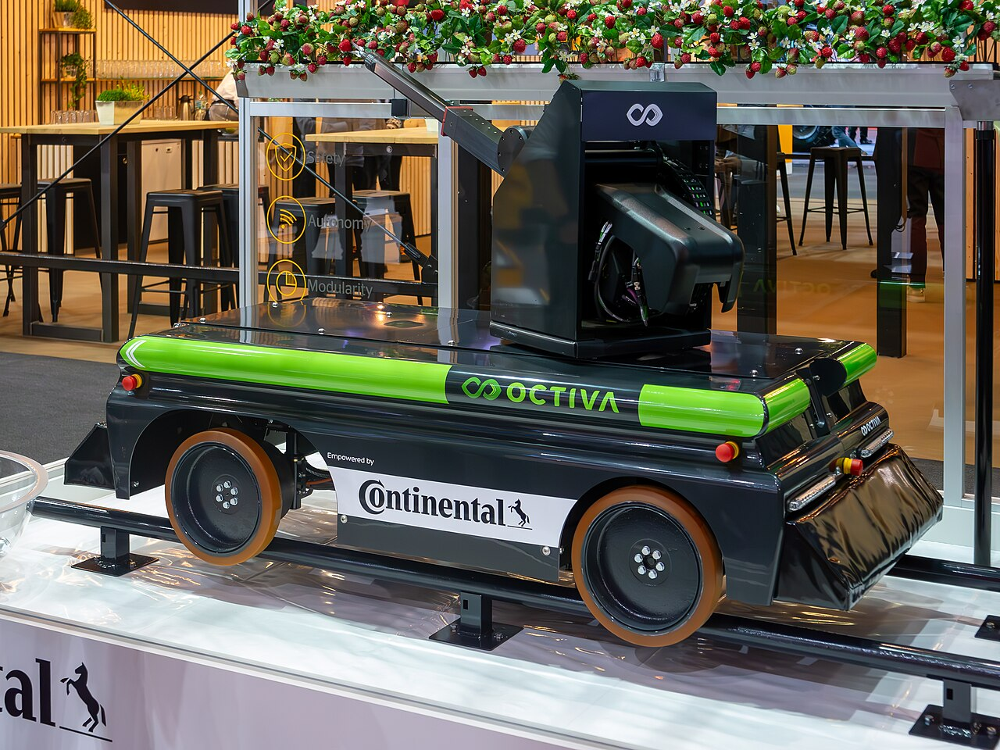 |
| Service robot | Serves people directly; emphasizes safety and interaction | Works alongside people; wide range of application scenarios | High safety and compliance requirements | 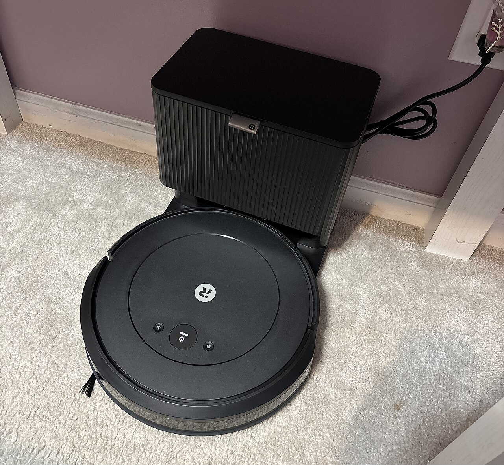 |
| Special-purpose robot | Works in dangerous/extreme environments in place of people | Replaces people in high-risk work | High cost, highly customized | 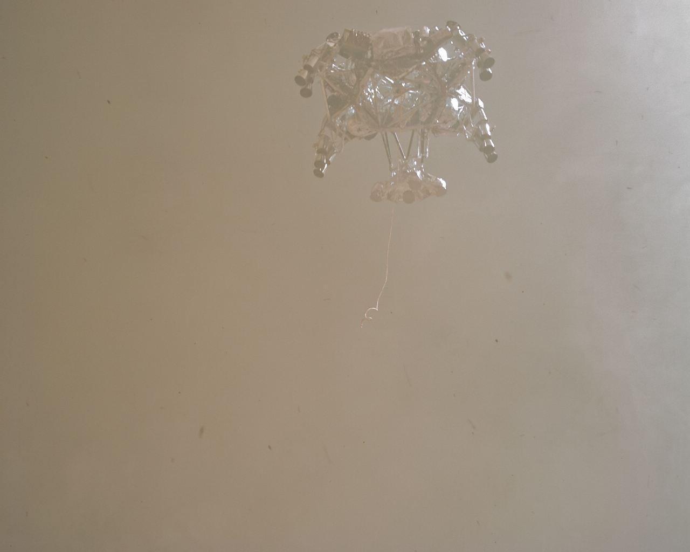 |

> 💡 Among these, "service robots" are further divided by service target into **personal/domestic** (such as robot vacuums and companion robots) and **professional service** (such as surgical robots and logistics delivery). The JoyArm robotic arm covered later in this tutorial can be used for both personal/domestic and professional service.

#### 1.2.2 By mode of locomotion

Robots are divided by whether the base moves and how it moves. This perspective directly reflects whether a robot "works in place" and "how it gets to the target position".

| Category | Main characteristics | Advantages | Disadvantages | Example |
|:---:|:---:|:---:|:---:|:---:|
| Fixed | Fixed base; only the arm moves | High precision, large payload, easy to control | Limited working range |  |
| Wheeled | Drives on the ground on wheels | Fast, efficient, simple structure | Only suitable for flat ground; poor obstacle crossing | 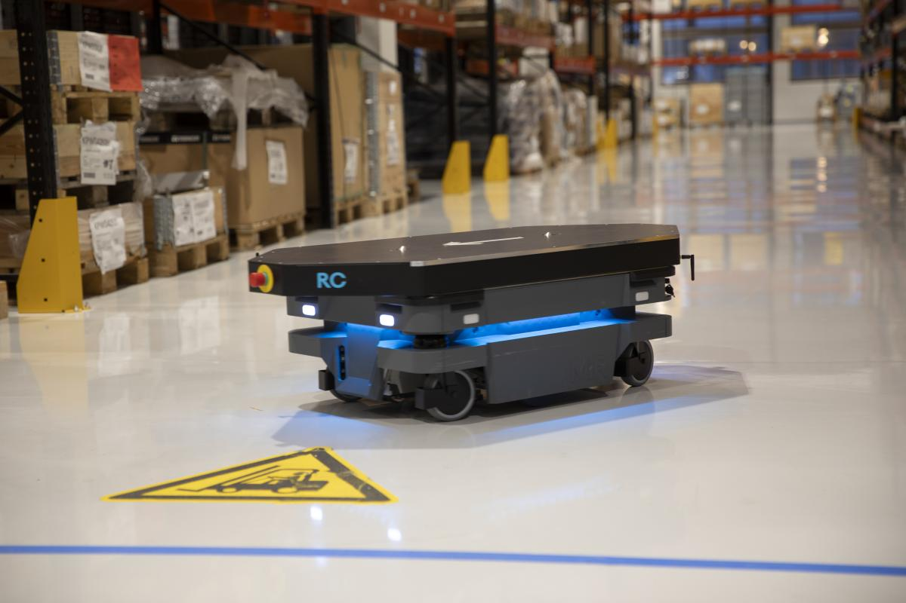 |
| Tracked | Drives on tracks; strong traction | Good off-road and obstacle-crossing capability; large ground contact area | Slow, high energy consumption, damages the ground | 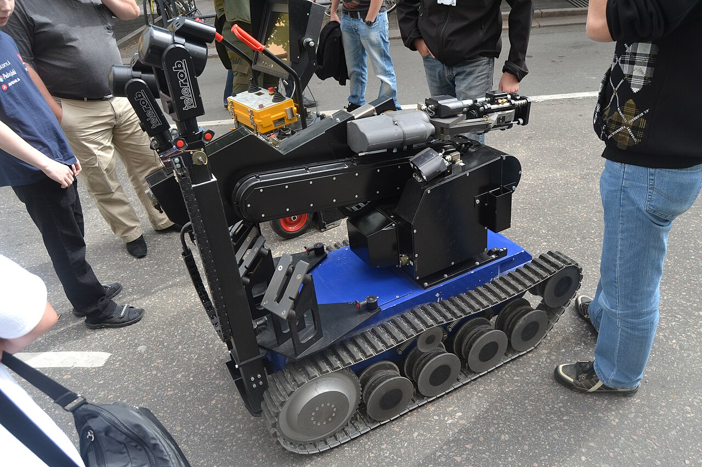 |
| Legged | Bionic multi-legged walking (bipedal/quadrupedal/multi-legged) | Best obstacle-crossing and terrain adaptability | Complex control, high energy consumption, limited payload | 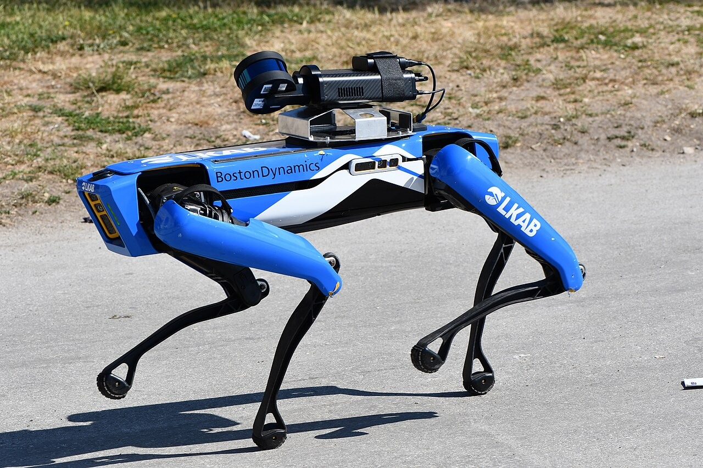 |
| Hybrid | Combination of two or more of wheels, legs, tracks, etc. | Balances speed and obstacle crossing; wide adaptability | High mechanical and control complexity | 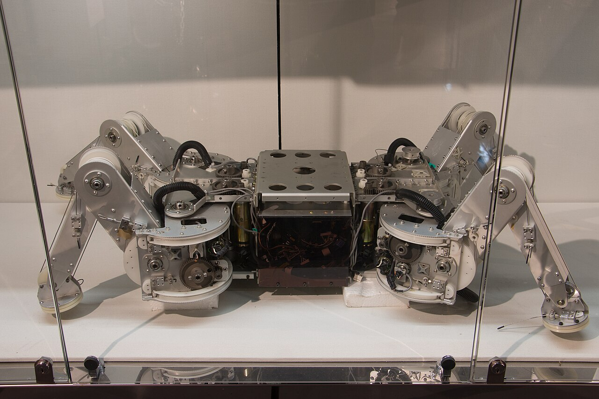 |
| Aerial | Flies in the air using rotors/fixed wings | Three-dimensional mobility, wide coverage, terrain-independent | Limited endurance and payload; affected by weather | 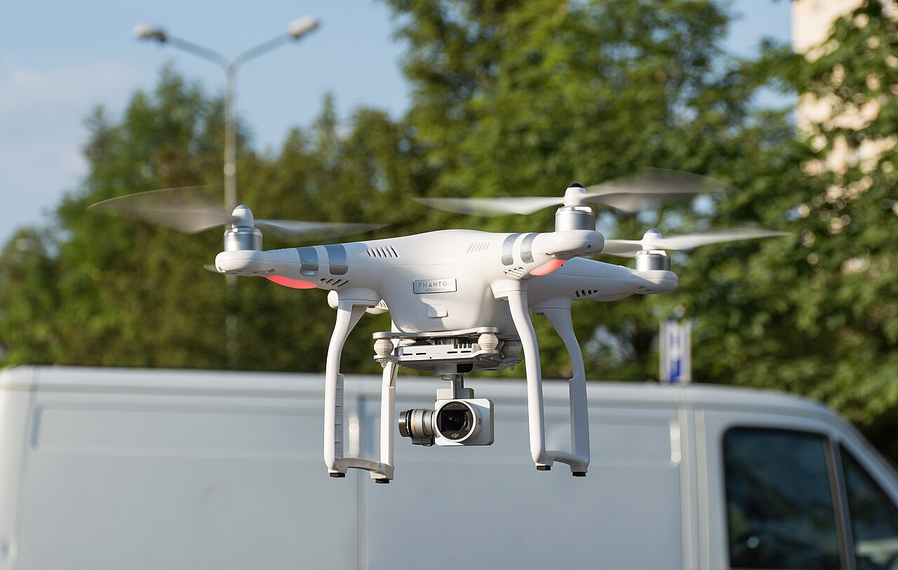 |
| Underwater | Works underwater with pressure-resistant sealing (including propeller propulsion and bionic fish tail oscillation) | Can reach deep-sea areas that are hard for humans to access | Difficult communication and localization; high maintenance cost | 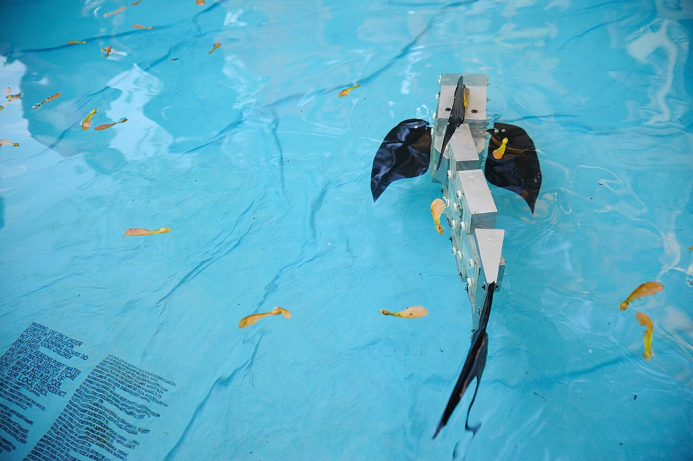 |
| Space | Operates in space/alien environments | Undertakes extreme missions such as planetary exploration | Extremely high development cost; unrepairable |  |
| Other modes of locomotion (crawling/climbing/peristalsis/jumping/flapping/rolling, etc.) | Niche modes beyond the above: crawling along the ground, climbing vertical surfaces, body peristalsis, bouncing, flapping-wing flight, whole-body rolling, etc. | Each suits special scenarios (pipes/rubble/debris terrain/air, etc.) | Poor generality, limited payload and endurance; mostly customized | 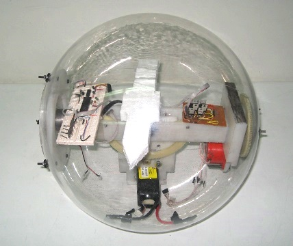 |

#### 1.2.3 By configuration and biomimicry

Robots are divided by the topology of the mechanical structure (how joints are connected in series/parallel/hybrid) and whether they imitate biological forms. This perspective is closest to "what the robot body looks like".

| Category | Main characteristics | Advantages | Disadvantages | Example |
|:---:|:---:|:---:|:---:|:---:|
| Serial robot | Multiple joints connected end to end in sequence, like a human arm; common variants include **Cartesian, cylindrical, and SCARA** (planar joints) | Large workspace, flexible, simple structure | Large accumulated error, lower stiffness |  |
| Parallel robot | Multiple limbs jointly drive the end platform; representative types are the **Delta** (high-speed pick-and-place) and the **Stewart** platform (six degrees of freedom) | High stiffness, fast, no accumulated error | Small workspace, complex control | 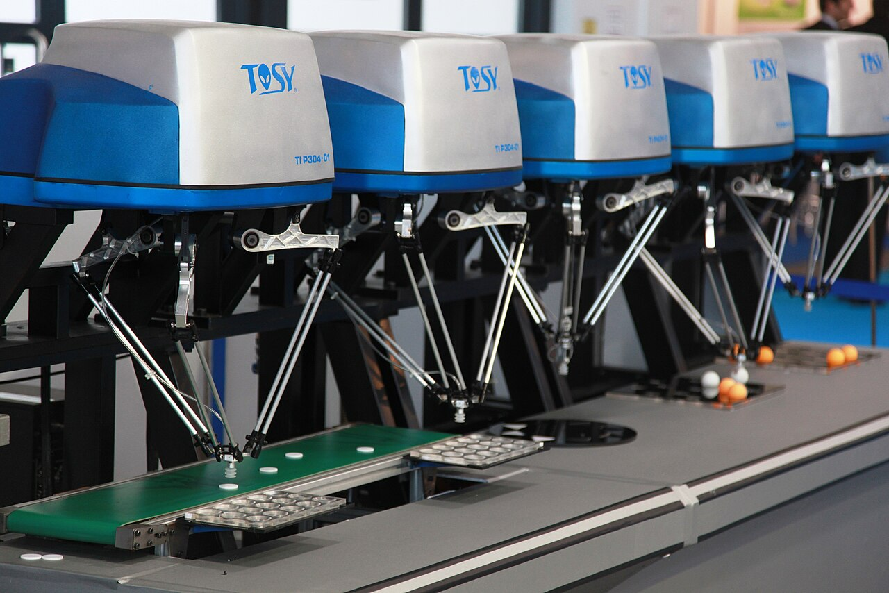 |
| Hybrid robot | A combination of serial and parallel mechanisms that takes the strengths of both (such as Tricept and Exechon, a parallel main structure + serial wrist) | Large workspace together with high stiffness | Complex structure and modeling | 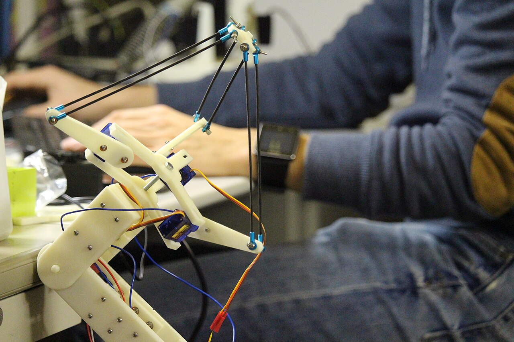 |
| Humanoid robot | Human-like: bipedal + dual arms + head | Fits human environments and tools | Balance and control are extremely difficult; high cost | 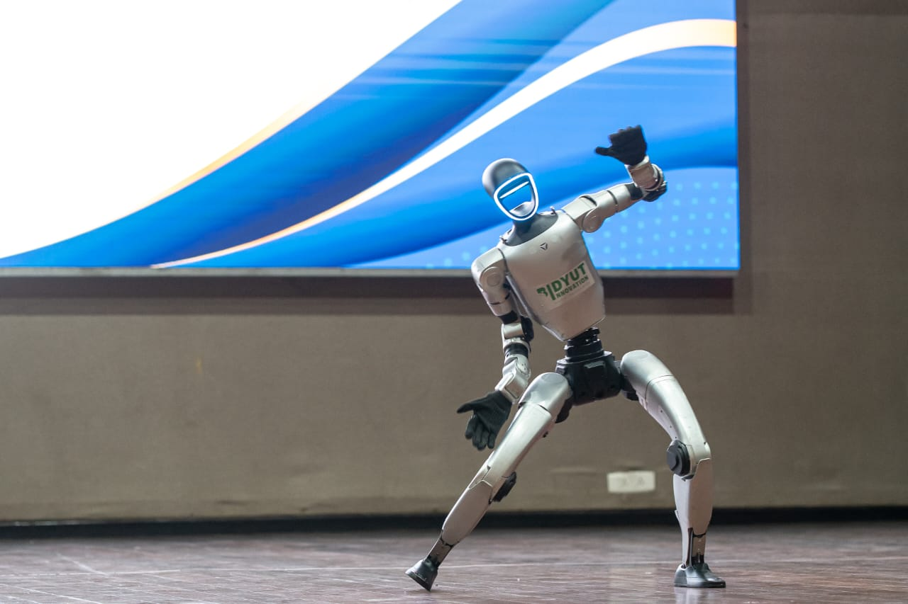 |
| Quadruped robot | Imitates four-legged animals; walks on four legs | More stable than bipedal, better at obstacle crossing than wheeled | Payload and endurance still limited |  |
| Other biomimetic forms | Many biomimetic forms such as birds (flapping wings), fish (tail oscillation), insects and arthropods (six/eight legs), crawling (snake-like), and plants | Each suits special scenarios (air/underwater/confined spaces/reconnaissance, etc.) | Poor generality; mostly customized | 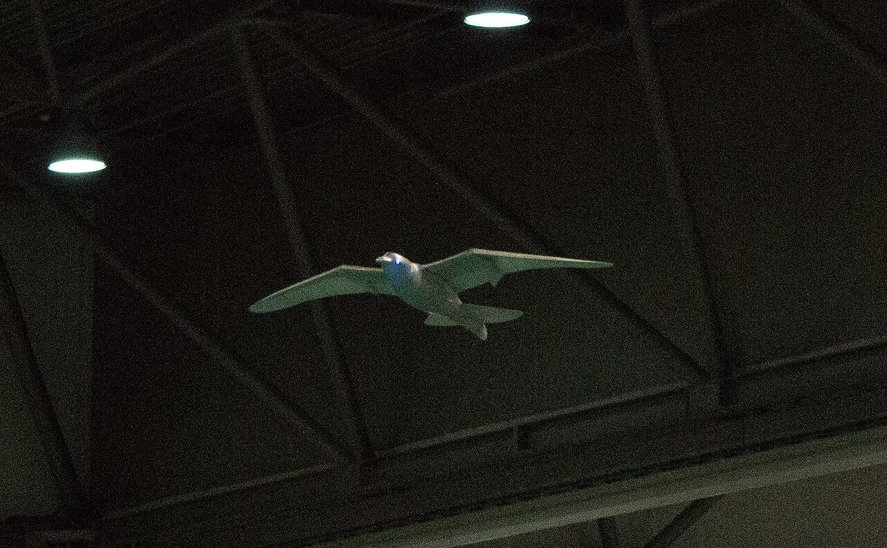 |

> 📌 A robot often belongs to several categories at the same time: for example, a hotel delivery robot with wheels that delivers items and interacts with people belongs to both "service robots" and "mobile robots".

### 1.3 Why start with a robotic arm

The **robotic arm (Robotic Arm / Manipulator)** is almost the "common denominator" running through all categories: it is the representative of industrial robots, the typical case of fixed robots, and the basic form of serial configurations. It is the most classic type of robot and the most suitable one for getting started:

1. **Widest application, worth learning**: From welding, assembly, and painting in factories to surgical assistance in hospitals (such as the da Vinci surgical robot), and to sorting and grasping in daily life, robotic arms are almost everywhere. This means that what you learn can be applied directly to real scenarios to solve practical problems right away.
2. **Most complete theory, easy to get started**: The kinematics, dynamics, trajectory planning, and motion control involved in robotic arms are exactly the core skeleton of robotics as a whole. The system is the most mature and the textbooks are the most abundant, so beginners can progress steadily along a clear main line.
3. **Prerequisite for other robots, enabling further progress**: The arms of humanoid robots and the legs of quadruped robots are essentially "robotic arms mounted on a movable base". Mastering the fixed robotic arm first and then extending to mobile and humanoid forms is the most natural path forward.

> 🎯 This tutorial uses the **JoyArm robotic arm** as the physical robot for introductory robotic arm study — it lets you do something useful right away, connects to the main trunk of robotics theory, and lays a foundation for later study of more complex forms such as humanoid and quadruped robots.

## 2 A quick primer on basic concepts

Robotics has a large number of technical terms, and beginners can easily get confused and be put off. This section gives each term an "intuitive explanation + role description" by category, so that you build an intuitive understanding before starting formal study.

> 💡 You do not need to memorize them right away. Read through once to leave an intuitive impression, then look them up later as needed.

### 2.1 Mechanical structure and geometry

These terms describe "what a robotic arm looks like and how it can move"; they are the physical basis of all later chapters.

#### 2.1.1 Basic composition: base, joint, link, end effector

If you strip away the "outer shell" of a robotic arm, what remains is a kinematic chain strung together as **base → joint → link → joint → … → end effector**. The figure below shows the component composition of JoyArm:

| Chinese | English | Intuitive explanation | Function |
|:---:|:---:|:---:|:---:|
| 机械臂 | Robotic Arm / Manipulator | A programmable kinematic chain of joints and links connected in series | Delivers the end effector to a specified position and orientation within the workspace |
| 基座 | Base | The "root" of the robotic arm, fixed to the foundation or a mobile platform | Bears the entire weight and defines the position of the robotic arm; it is the origin of the base frame |
| 关节 | Joint | The rotatable "hinge" connecting two links (rotary joint R or prismatic joint P) | Provides degrees of freedom and determines the directions in which the robotic arm can move |
| 连杆 | Link | A rigid rod connecting adjacent joints, similar to a human bone | Transmits and amplifies joint motion to the end effector, and determines the arm span of the robotic arm |
| 末端执行器 | End-Effector | The tool mounted at the very front of the robotic arm that does the actual work (gripper, suction cup, welding torch, etc.) | Physically interacts with the outside world to complete tasks such as grasping, assembly, and painting |

> 💡 **Mnemonic**: **The joints "move", the links "transmit", the end effector "does the work", and the base "stands".**

The number of repeated "joint—link" segments in a robotic arm often determines how many degrees of freedom it has.

#### 2.1.2 Key parameters: degrees of freedom, payload, reach, workspace

After understanding "what it looks like", you also need a set of key parameters that describe "what it can do and how far it can reach". These are the basic metrics for robotic arm selection and performance evaluation:

| Chinese | English | Intuitive explanation | Function |
|:---:|:---:|:---:|:---:|
| 自由度 | Degree of Freedom (DOF) | The number of **independent ways of moving** the robotic arm has, equal to the number of "variables" that can be controlled independently; usually one joint contributes 1 degree of freedom | Determines in how many ways the end effector can adjust its position and orientation; it is the core indicator of a robotic arm's flexibility |
| 负载 | Payload | The **maximum weight** that the end of the robotic arm can lift stably, commonly in kg | Determines how heavy a workpiece can be handled; during selection or design it must exceed the actual workpiece + end effector weight |
| 工作半径 | Reach | The **maximum extension distance** of the robotic arm from the base to the end effector; commonly in mm | Determines how far the robotic arm can reach in one stretch; it directly reflects the arm span dimensions |
| 工作空间 | Workspace | The volume formed by **all positions the end effector can reach** | Determines the size of the area where work can be done; a target point must lie within the workspace to be executed |

> 💡 **How the three relate**: **Degrees of freedom** answer "is it agile", **payload** answers "how heavy can it lift", and **reach / workspace** answers "can it get there". All three must be satisfied at the same time — an arm that is agile but cannot reach or lift is useless.

#### 2.1.3 Coordinate frame system

For the robotic arm to move the end effector precisely to a point, there must first be a "common language" for describing position and orientation: the **reference coordinate frame** system. Robotic arms commonly use the following frames:

| Chinese | English | Intuitive explanation | Function |
|:---:|:---:|:---:|:---:|
| 基座系 | Base Frame | The frame fixed to the base; it is the "origin" of the whole robotic arm | Serves as the common reference for robotic arm motion; kinematics and dynamics are usually solved in this frame |
| 连杆系 | Link Frame | A frame fixed to each link; there is one at each joint | Describes the relative position and orientation between adjacent links; it is the basic tool for kinematic modeling |
| 腕部系 | Wrist Frame | The frame fixed at the wrist (the last three joints) | Separates "position determined by the arm, orientation determined by the wrist", simplifying inverse kinematics solving |
| 末端系 / 工具系 | End / Tool Frame | The frame fixed to the end effector (such as the gripper fingertip) | Describes the position and orientation of the tool itself; the operator cares most about targets expressed in this frame |
| 固定系 / 工作台系 | World / Station Frame | The global frame fixed to the workbench or workshop | Provides unified world coordinates when multiple robotic arms or external devices cooperate |
| 目标系 / 物体系 | Object Frame | The frame fixed to the workpiece or target object | Describes "where the workpiece is and which way it is placed"; an object can be grasped only when the gripper frame coincides with it |

> 📌 **Why are there so many coordinate frames?** Because different people care about different things: motion control cares about the **base frame** and the **end-effector frame**, the operator cares about the **tool frame**, and visual perception cares about the **station frame**. The principle of position forward kinematics in [Chapter 2](chapt2_fkine.md) is exactly the solving of pose relationships among multiple coordinate frames.

### 2.2 Perception and actuation hardware

These terms describe "what devices make the robotic arm move and what devices let it perceive the world". The table lists the hardware typically used by a robotic arm (light, small, desktop-class); the figure below shows the hardware used by JoyArm:

| Chinese | English | Intuitive explanation | Function | Photo |
|:---:|:---:|:---:|:---:|:---:|
| 电源 | Power Supply | The "heart" that powers the whole system, converting mains power or battery power to the required voltage | Provides stable energy for motors, controllers, and sensors; determines whether the system can run for a long time | - |
| 电机 | Motor | The "muscle" that converts electrical energy into mechanical rotation; it is the power source of the joint | Drives the joint to rotate; it is the final actuator of robotic arm motion | - |
| 驱动器 | Driver / Amplifier | The "amplifier" that receives controller commands and outputs current precisely to the motor | Drives the motor according to the target position/speed/torque; it is the power bridge between the controller and the motor | - |
| 编码器 | Encoder | The "angle ruler" mounted on the motor shaft that reads the current rotation position in real time | Feeds the actual joint angle back to the controller to form closed-loop control; it is the key to precise positioning | - |
| 一体化关节 | Integrated Joint Module | A joint that packages the motor + reducer + encoder + driver into one unit | Highly integrated with clean cable routing; it is the standard unit of modern modular robotic arms (such as JoyArm) | - |
| 关节力矩传感器 | Joint Torque Sensor | The "electronic wrist" mounted at the joint that measures the output torque | Feeds back the actual output force of the joint; used for force control and collision detection | - |
| 六维力传感器 | 6-Axis Force/Torque Sensor | A sensor mounted at the wrist that measures three forces + three torques simultaneously | Senses the contact force between the end effector and the outside world; it is the core device for precision assembly and compliant control | - |
| RGB 相机 | RGB Camera | An ordinary color camera that outputs 2D color images | Recognizes object color, texture, and contour; used for object detection and visual localization | - |
| RGB-D 相机 | RGB-D Camera | A camera that outputs a color image + a depth map simultaneously (such as RealSense) | Obtains object distance directly; better suited to 3D grasping by robotic arms than RGB alone | - |
| 雷达 | LiDAR | A sensor that measures distance with lasers and scans a 3D point cloud of the surroundings | Perceives the environment and obstacles over a large range; mostly used for mapping and obstacle avoidance by mobile robotic arms | - |

> 💡 **In one sentence**: **actuators "exert force" and sensors "feed back"**. One is responsible for making the robotic arm move, the other for telling the brain where it has moved to and whether it has touched anything.

### 2.3 Disciplinary methods

This is the **theoretical main line** of this tutorial, addressing the question "how to make the robotic arm move precisely as we intend"; later chapters unfold it step by step.

| Chinese | English | Intuitive explanation | Function |
|:---:|:---:|:---:|:---:|
| 位置正运动学 | Forward Kinematics | Given the joint angles, **work out where the end effector is** (forward solution) | Computes the "end effector pose" from the "joint state"; it is the basis of modeling and analysis |
| 位置逆运动学 | Inverse Kinematics | Given the target end effector pose, **solve back for the joint angles** (inverse solution) | The core of the "reach out to it" problem: deriving joint commands from a target; it is the prerequisite for planning |
| 速度运动学 | Velocity Kinematics | Describes the mapping between **joint velocities and end effector velocities** | Used for smooth velocity control and Jacobian analysis |
| 雅可比 | Jacobian | The **linear transformation matrix** between end effector velocity and joint velocity | The key to velocity kinematics and statics relations; it reveals the motion sensitivity of the robotic arm in each orientation and is also a tool for singularity analysis |
| 静力学 | Statics | Studies the transmission of forces and torques when the robotic arm is in **static equilibrium** | Works back from the force at the end effector to the torque each joint should output; it is the basis of force control and structural verification |
| 动力学 | Dynamics | Studies the relationship between joint torque and **motion (acceleration)**, accounting for mass and inertia | Used for precise feedforward control and simulation in highly dynamic scenarios; it is the core of [Chapter 8](chapt8_dyn.md) in the advanced part |
| 轨迹生成 | Trajectory Generation | **Plans the motion path of the end effector or joints** on the time axis (position as a function of time) | Moves the robotic arm from point A to point B "smoothly, continuously, and without exceeding limits" |
| 运动控制 | Motion Control | Makes each joint **actually track** the planned trajectory | Eliminates errors and resists disturbances, ensuring the robotic arm executes the intended motion precisely |
| 力控制 | Force Control | No longer tracking only position, but **controlling the contact force between the end effector and the outside world** | Used for tasks requiring "compliant contact", such as assembly, grinding, and wiping |

One of the most basic and classic main lines for a robotic arm to achieve motion planning and control is the four steps "**give a target → find a path → solve for joints → control execution**", and the software structure is shown below. First, the **host computer or an SDK call** provides the target pose to reach; then, combined with the forward kinematics estimate of the current pose, **trajectory generation** produces a smooth trajectory from the current pose to the end pose; next, **inverse kinematics solving** yields the joint trajectory; finally, joint **control** makes the robotic arm follow this trajectory precisely. The fundamentals part of this tutorial unfolds chapter by chapter along exactly this main line.

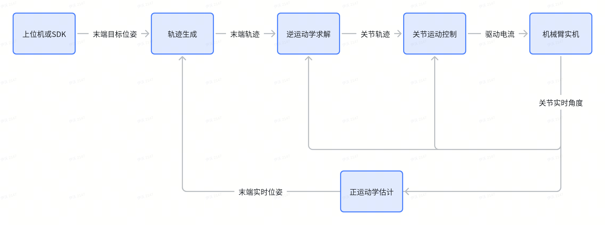

## 3 Development tools and environment

To answer "what software and hardware should be used to develop robotic arm programs", this tutorial gives a recommended combination. In the table below, "Common tools" lists common options in the field for comparison, while "Tutorial recommendation" is the option or solution actually adopted and recommended by this tutorial:

| Category | Intuitive explanation | Function | Common tools | Tutorial recommendation |
|:---:|:---:|:---:|:---:|:---:|
| Computing device | The hardware platform that runs programs and algorithms | Carries out kinematic solving, planning and control, and visualization for the robotic arm | Laptop, desktop, Jetson, RDK, Raspberry Pi | Laptop (Jetson / RDK optional at the deployment stage) |
| Operating system | The underlying foundation that manages hardware and schedules programs | Provides the runtime environment for files, processes, drivers, and development tools | Ubuntu, Windows, macOS | [Ubuntu 24.04 LTS (jammy)](https://releases.ubuntu.com/jammy/) (Linux distribution) |
| Programming language | The language people use to "talk" to the robotic arm | Writing kinematics, control, communication, and visualization code | Python, C++, MATLAB | Python (scientific computing and prototyping) + C++ (performance-sensitive modules) |
| Environment management | Tools that isolate the dependencies of different projects | Prevents library version conflicts and makes code reproducible and easy to migrate | conda, uv, venv, Docker | [uv](https://docs.astral.sh/uv/) (Python virtual environments and dependency management) |
| Editor | The "workbench" for writing code, debugging, and watching run results | Provides file reading and editing, syntax highlighting, autocompletion, breakpoint debugging, and a terminal | VS Code, PyCharm, CLion, Jupyter | [VS Code](https://code.visualstudio.com/Download?_exp_download=fb315fc982) (GitHub ecosystem + rich extensions) |
| AI coding assistant | An intelligent coding assistant that helps you write, read, and modify code | Accelerates learning and troubleshooting, especially for beginners understanding unfamiliar APIs | Cursor, Copilot, Codex, Claude Code, ZCode, Kimi Code | Choose as needed |
| Other tools | Auxiliary software for serial-port debugging, version management, simulation, etc. | Solves specific needs such as communication debugging, code backup, and offline simulation | Git, URDF Studio, Serial Studio, RViz, Gazebo, MATLAB/Simulink | [Git (version management)](https://git-scm.com/book/zh/v2/%E8%B5%B7%E6%AD%A5-%E5%AE%89%E8%A3%85-Git), [URDF Studio](https://urdf.d-robotics.cc/), etc.; choose as needed |

> 📌 **Recommended minimal starting setup**: one JoyArm robotic arm + one laptop running **Ubuntu 24.04 LTS (jammy)** + **VS Code** + a **Python** environment managed by **uv** + a familiar **AI Agent tool**. You do not need to understand the other tools in depth; just enrich your tool stack gradually as you learn and practice.
