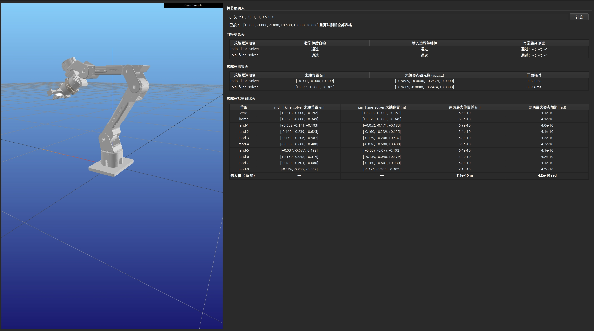

# Chapter 2: Spatial Poses and Forward Position Kinematics

> 📌 **Overview**: This chapter establishes the forward kinematics model of the robotic arm and solves for the spatial pose (3D position + 3D orientation) of the arm's end effector given each joint angle.
> Before forward kinematics modeling, you must first know the mathematical representation of a pose—the pose matrix $^A_B\bm{T}$—along with common equivalent representations such as RPY, axis-angle, and quaternion, and the conversions between them; then use the modified DH method (MDH method) to assign frames to each link of the robotic arm and convert the real arm's structural relationships into a unified MDH parameter table, thereby obtaining the pose matrix$^{i-1}_i\bm{T}$ between adjacent link frames, and by chained multiplication obtain the arm's **position forward kinematics equation** (given each joint angle, find the end-effector pose); finally, encapsulate the forward kinematics solving algorithm and call it through JoyArm, randomly sample each joint angle with the Monte Carlo method, substitute the samples into the forward kinematics relation, and plot and analyze the end-effector workspace (the spatial range the arm's end effector can reach).

## 1 Spatial pose and its matrix representation

Before forward kinematics modeling, you first need to establish the concept of pose and its mathematical representation: the 3D spatial position and 3D orientation of the described object relative to a reference frame.

### 1.1 What is a spatial pose

#### 1.1.1 Pose: 3D position + 3D orientation

Imagine the robotic arm is about to grasp an object on a table; then you need to know the following about the object being grasped:

- **Position**: where the object being grasped is.
- **Orientation**: which direction the object being grasped faces.

Therefore, to have the robotic arm perform a task, you must first describe precisely **where the target is and which direction it faces**—this is the **spatial pose**.

| Concept | English | Question answered |
|:---:|:---:|:---:|
| Position | Position | Where is it? |
| Orientation | Orientation | Which direction does it face? |
| Pose | Pose | The complete "position + orientation" state |

#### 1.1.2 Why six dimensions

- **Position has 3 dimensions**: the position of a point in 3D space requires three coordinates $(x, y, z)$ — front/back, left/right, up/down.
- **Orientation has 3 dimensions**: orientation can be decomposed into "rotating a certain angle about each of three axes" — for example a person's: tilting the head left/right, turning the head left/right, and lowering/raising the head up/down.

> 💡 **Six-dimensional spatial pose $\Leftrightarrow$ six joint motors**. This is exactly why the **6R robotic arm** has become the "gold standard": six joint motors provide 6 independent control variables, exactly matching the 6 dimensions of a pose.

#### 1.1.3 A reference frame must be specified

A pose is **relative**; discussing a pose without a reference frame is meaningless (the same object necessarily has different poses relative to different reference frames such as a table or the ground). In practical robotic arm development and applications, the base frame or the workbench frame is usually taken as the default global reference frame.

If the coordinate frame fixed to the reference object is denoted $\{A\}$ and the coordinate frame fixed to the described object is denoted $\{B\}$, then the pose of $\{B\}$ relative to $\{A\}$ is written "$^A_B\bm{T}$" and read as "the pose transformation of B relative to A (Translation)".

### 1.2 Mathematical representation of a spatial pose

#### 1.2.1 The pose matrix $^A_B\bm{T}$

The most fundamental and commonly used mathematical representation of a pose is the $4\times 4$ **homogeneous transformation matrix $^A_B\bm{T}$**.

Every coordinate frame consists of **one origin** and **three mutually perpendicular unit axes**. If the three axes of $\{A\}$ are $\hat{X}_A, \hat{Y}_A, \hat{Z}_A$, the three axes of $\{B\}$ are $\hat{X}_B, \hat{Y}_B, \hat{Z}_B$, and the position of the origin of $\{B\}$ in $\{A\}$ is $^A\bm p_B$, then the pose $^A_B\bm{T}$ of $\{B\}$ relative to $\{A\}$ is described by two parts:

- **Orientation $^A_B\bm{R}$ **: the coordinates of the three unit axes of $\{B\}$ expressed in $\{A\}$.
- **Position $^A\bm p_B$ **: the position coordinates of the origin of frame $\{B\}$ in $\{A\}$.

Combining $^A_B\bm{R}$ and $^A\bm p_B$ gives the **homogeneous transformation matrix** $^A_B\bm{T}$:

$$
^A_B\bm{T} =
\begin{bmatrix}
^A_B\bm{R}          & ^A\bm p_B \\
\bm{0}_{1\times3}   & 1
\end{bmatrix}
= \begin{bmatrix}
\vert       & \vert         & \vert             & \vert \\
^A\hat{X}_B & ^A\hat{Y}_B   & ^A\hat{Z}_B       & ^A\bm p_B \\
\vert       & \vert         & \vert             & \vert \\
0           & 0             & 0                 & 1
\end{bmatrix}
= \begin{bmatrix}
r_{11}      & r_{12}        & r_{13}        & p_x \\
r_{21}      & r_{22}        & r_{23}        & p_y \\
r_{31}      & r_{32}        & r_{33}        & p_z \\
0           & 0             & 0             & 1
\end{bmatrix}
$$

| Block | Size | Meaning | Corresponding physical quantity |
|:---:|:---:|:---:|:---:|
| Upper left $^A_B\bm{R}$ | $3\times3$ | Coordinates of the three unit-axis column vectors of frame $\{B\}$ in frame $\{A\}$ | **Orientation** |
| Upper right $^A\bm p_B$ | $3\times1$ | Coordinates of the origin of frame $\{B\}$ in frame $\{A\}$ | **Position** |
| Lower left | $1\times3$ all 0 | Homogeneous-form placeholder | —— |
| Lower right | 1 | Homogeneous coordinate scale factor | Fixed at 1 |

> 💡 **Why $4\times4$?** — It unifies "rotation" and "translation" into **a single matrix multiplication**: in 3D coordinates translation is addition while rotation is multiplication, so mixing them is cumbersome; with $4\times4$ you only need matrix multiplication.

> 💡 The rotation matrix $^A_B\bm{R}$ has 9 variables, but the three axes of a coordinate frame are all unit axes (3 constraints) and mutually perpendicular (3 constraints), so the number of independent variables is 9-3-3 = 3; these are the three dimensions of orientation mentioned earlier.

#### 1.2.2 Two uses of the pose matrix

**Use 1: coordinate transformation**—convert a point from one frame to another. If point $P$ has coordinates $^B\!P$ in $\{B\}$, then in $\{A\}$:

$$
^A\!P = {}^A_B\bm{T}\;{}^B\!P
$$

**Use 2: pose composition**—chain multiple relative poses. If the pose of $\{B\}$ relative to $\{A\}$ is $^A_B\bm{T}$ and the pose of $\{C\}$ relative to $\{B\}$ is $^B_C\bm{T}$, then the pose of $\{C\}$ relative to $\{A\}$ is:

$$
^A_C\bm{T} = {}^A_B\bm{T}\;{}^B_C\bm{T}
$$

This is exactly the soul of forward kinematics: **the pose of the end-effector frame relative to the base frame = the chained product of a string of adjacent link transformation matrices**.

> 📌 **Mnemonic**: when chaining products, if the matrix sub- and superscripts "**match diagonally, they can be canceled**" — $^A_{\boxed{B}}\bm{T}\cdot{}^{\boxed{B}}_C\bm{T}= {}^A_C\bm{T}$. Keep the letter chain aligned and you will not get the order wrong.

#### 1.2.3 The inverse of the pose matrix

A pose is relative: knowing "$\{B\}$ relative to $\{A\}$" also gives you "$\{A\}$ relative to $\{B\}$"—the latter is the **inverse matrix** of the former. The expression is:

$$
{}^B_A\bm{T} = (^A_B\bm{T})^{-1} =
\begin{bmatrix}
(^A_B\bm{R})^\top & -(^A_B\bm{R})^\top\,{}^A\bm p_B \\
\bm{0}_{1\times3} & 1
\end{bmatrix}
$$

**Geometric meaning** (each block corresponds one-to-one to the forward matrix):

| Block | Inverse matrix value | Meaning |
|:---:|:---:|:---:|
| Orientation | ${}^B_A\bm{R} = (^A_B\bm{R})^\top$ | Coordinates of the three unit axes of frame $\{A\}$ in frame $\{B\}$ |
| Position | ${}^B\bm p_A = -(^A_B\bm{R})^\top\,{}^A\bm p_B$ | Coordinates of the origin of frame $\{A\}$ in frame $\{B\}$ |

> 💡 The position column is **not** simply $-{}^A\bm p_B$—you must first left-multiply by $(^A_B\bm{R})^\top$ to convert $^A\bm p_B$ into frame $\{B\}$ and then negate it.

**Use 1: inverse coordinate transformation**—convert a point from frame $\{A\}$ back to frame $\{B\}$:

$$
{}^B\!P = {}^B_A\bm{T}\;{}^A\!P = (^A_B\bm{T})^{-1}\;{}^A\!P
$$

**Use 2: back-solving a pose chain**—solve for an unknown intermediate element from the two ends of the pose composition equation. For example, given the poses of $\{B\}$ and $\{C\}$ relative to $\{A\}$, find the pose of $\{C\}$ relative to $\{B\}$:

$$
{}^B_C\bm{T} = (^A_B\bm{T})^{-1}\;{}^A_C\bm{T}
$$

> 💡 **Program implementation**: applying the formula above directly is faster and more stable than general inversion methods. Library methods: Pinocchio `T.inverse()`, Spatial Math `T.inv()`.

### 1.3 Visual demonstration of pose transformation

A Python script demonstrates how the pose matrix $^A_B\bm{T}$ simultaneously drives a **coordinate frame** and a **position point**: the global reference frame $\{A\}$ stays fixed, the attached frame $\{B\}$ is moved by $^A_B\bm{T}$, and the point $P$ defined in $\{B\}$ ($^B\!P=[x,y,z,1]^T$) is converted into frame $\{A\}$ accordingly—an intuitive presentation of the coordinate transformation $^A\!P={}^A_B\bm{T}\,{}^B\!P$.

| Element | Role | Visualization |
|:---:|:---:|:---:|
| Fixed reference frame $\{A\}$ | Observation reference, does not move | Origin + RGB dashed unit axes |
| Attached frame $\{B\}$ | Driven by $^A_B\bm{T}$ | Origin + RGB solid coordinate axes |
| Point $P$ | A point defined in $\{B\}$ | Black dot marker + gray dashed line ($\{B\}$ origin$\to P$) + orange dashed line ($\{A\}$ origin$\to P$) |

Interface operation: enter the $x,y,z$ values of $^A_B\bm{T}$ and $^B\!P$ in the right-hand panel, then click **Start calculation**:

| Result item | Meaning |
|:---:|:---:|
| Position of $P$ relative to $B$ | The input $^B\!P$ |
| Position of $P$ relative to $A$ | The result of $^A\!P={}^A_B\bm{T}\,{}^B\!P$ |
| Position of $B$ relative to $A$ | $^A\bm p_B$, i.e. the position column at the upper right of the matrix |
| Orientation of $B$ relative to $A$ | The $3\times3$ rotation block at the upper left of the matrix, plus the derived RPY angles and quaternion (see §2) |

Changing the components of $^A_B\bm{T}$ lets you observe three typical transformations:

| Transformation type | Modified part of $^A_B\bm{T}$ | Effect |
|:---:|:---:|:---:|
| Pure translation | The position column $(p_x,p_y,p_z)$ at the upper right | $\{B\}$ translates together with $P$; the three colored axes keep their directions |
| Pure rotation (about a single axis) | The $3\times3$ rotation block at the upper left | $\{B\}$ rotates in place and $P$ rotates with it about the origin of $\{B\}$ |
| Combined transformation | Position and orientation changed at the same time | $\{B\}$ translates and rotates at once; $P$ follows to a new position |

The corresponding script is located at `joyarm_code/chapt/chapt2/chapt2_T_demo.py`; usage instructions are in the header comment of the script.

> 💡 We suggest first editing the matrix numbers or point coordinates by hand, predicting the positions of $\{B\}$ and $P$ in $\{A\}$, and then clicking "Start calculation" to check the result, so as to build an intuition linking "matrix numbers" and "spatial motion"; if the upper-left $3\times3$ rotation matrix does not satisfy the orthogonality constraints (the three axes must be of unit length and mutually perpendicular), the program automatically normalizes and orthogonalizes it and shows a notice.

## 2 Other common pose representations and their conversions

The rotation matrix $\bm{R}$ in the pose matrix $\bm{T}$ has **9 elements** (only 3 independent quantities in practice); in practical applications (especially when data is transmitted or stored) more compact forms are often used to represent orientation. This section introduces the three most classic and commonly used ones: **RPY (and Euler angles), axis-angle, and quaternion**.

### 2.1 Euler angles and fixed angles {#21}

Any orientation can be obtained by "successively rotating about three coordinate axes". There are two ways to rotate: rotating about the original coordinate frame (extrinsic rotation) and rotating about the new coordinate frame after rotation (intrinsic rotation).

| Type | Axis rotated about | Common aliases |
|:---:|:---:|:---:|
| **Intrinsic Euler angles** | The axes of the new **moving** coordinate frame $\{B\}$ (updated after each rotation) | Intrinsic / Euler |
| **Extrinsic fixed angles** | The axes of the original **fixed** reference frame $\{A\}$ (never change) | Extrinsic / Fixed-angle / RPY |

#### 2.1.1 The three basic rotation matrices

$$
\bm{R}_X(\gamma)=\begin{bmatrix}1&0&0\\0&c\gamma&-s\gamma\\0&s\gamma&c\gamma\end{bmatrix},\quad
\bm{R}_Y(\beta)=\begin{bmatrix}c\beta&0&s\beta\\0&1&0\\-s\beta&0&c\beta\end{bmatrix},\quad
\bm{R}_Z(\alpha)=\begin{bmatrix}c\alpha&-s\alpha&0\\s\alpha&c\alpha&0\\0&0&1\end{bmatrix}
$$

The symbols in the equation above are defined as follows:

- $\bm{R}_X(\gamma),\bm{R}_Y(\beta),\bm{R}_Z(\alpha)$: the basic rotation matrices for rotation about the $\hat{X},\hat{Y},\hat{Z}$ axes respectively; the angles $\gamma,\beta,\alpha$ in parentheses are the corresponding rotation angles;
- $c\cdot=\cos(\cdot)$, $s\cdot=\sin(\cdot)$: shorthand for trigonometric functions, e.g. $c\gamma=\cos\gamma$ (the same below).

The composite rotation matrices or orientation matrices that follow are the results of composing these three basic rotation matrices according to different rules.

#### 2.1.2 Intrinsic Euler angles (Z-Y-X order)

**Intrinsic rotation** means each step rotates about the axes of the **current (already rotated) coordinate frame $\{B\}$**. Let $\{B\}$ initially coincide with $\{A\}$; the rotation in Z-Y-X order proceeds as follows:

| Step | Axis rotated about | Rotation angle | Intuitive motion |
|:---:|:---:|:---:|:---:|
| 1 | Current $\hat{Z}_B$ (coincident with $\hat{Z}_A$) | $\alpha$ | Yaw: like a person turning their head left and right |
| 2 | Rotated $\hat{Y}_B$ | $\beta$ | Pitch: like a person nodding up and down |
| 3 | Further rotated $\hat{X}_B$ | $\gamma$ | Roll: like a person tilting their head left and right |

Key point: **each rotation about a "moving axis" multiplies the matrix in from the right (the B-frame side)**. The chained product of the three rotations is therefore:

$$
^A_B\bm{R}_{\text{intrinsic }ZYX}(\alpha,\beta,\gamma)=\bm{R}_Z(\alpha)\,\bm{R}_Y(\beta)\,\bm{R}_X(\gamma)
$$

> 💡 Intuitive reading: let ${}^A_B R = {}^0_1 R \cdot {}^1_2 R \cdot {}^2_3 R $; initially all three matrices are identity matrices (frames A and B coincide). After the first rotation ${}^0_1 R$ is no longer the identity, and then ${}^1_2 R$ and ${}^2_3 R$ cease to be identity.

#### 2.1.3 Extrinsic fixed angles (X-Y-Z, i.e. RPY angles)

**Extrinsic rotation** means each step rotates about the axes of the **fixed reference frame $\{A\}$**, whose directions never change. Let $\{B\}$ initially coincide with $\{A\}$; the rotation in X-Y-Z order proceeds as follows:

| Step | Axis rotated about | Rotation angle | Intuitive motion |
|:---:|:---:|:---:|:---:|
| 1 | Fixed frame $\hat{X}_A$ | $\gamma$ | Roll |
| 2 | Fixed frame $\hat{Y}_A$ | $\beta$ | Pitch |
| 3 | Fixed frame $\hat{Z}_A$ | $\alpha$ | Yaw |

These are what is commonly called the **RPY (Roll-Pitch-Yaw) angles**.

Key point: **each rotation about a "fixed axis" multiplies the matrix in from the left (the A-frame side)**. The chained product of the three rotations is therefore:

$$
^A_B\bm{R}_{\text{extrinsic }XYZ}(\gamma,\beta,\alpha)=\bm{R}_Z(\alpha)\,\bm{R}_Y(\beta)\,\bm{R}_X(\gamma)
$$

> 💡 Intuitive reading: let $ {}^A_B R = {}^0_1 R \cdot {}^1_2 R \cdot {}^2_3 R $; initially all three matrices are identity matrices (frames A and B coincide). After the first rotation ${}^2_3 R$ is no longer the identity, and then ${}^1_2 R$ and ${}^0_1 R$ cease to be identity.

#### 2.1.4 Why the two expressions are identical

The reason is that in matrix multiplication, "post-multiplication for intrinsic rotations" and "pre-multiplication for extrinsic rotations" are dual to each other. Compare them item by item in terms of rotation axis, multiplication, chaining order, mathematical expression, and intuitive understanding:

| Comparison dimension | **Intrinsic** (Euler angles) | **Extrinsic** (fixed angles / RPY) |
|:---:|:---:|:---:|
| Axis rotated about | The axes of the **moving** frame $\{B\}$ itself (updated after each rotation) | The axes of the **fixed** frame $\{A\}$ (never change) |
| Matrix multiplication | **Post-multiply** (multiply on the right) | **Pre-multiply** (multiply on the left) |
| Chaining order vs. rotation order | **Same** (the matrix of the first rotation is leftmost) | **Reversed** (the matrix of the last rotation is leftmost) |
| Expression | $\bm{R}_Z(\alpha)\bm{R}_Y(\beta)\bm{R}_X(\gamma)$ | $\bm{R}_Z(\alpha)\bm{R}_Y(\beta)\bm{R}_X(\gamma)$ |
| Intuitive understanding | Rotate the **shoulder** first, then the **elbow**, and the **wrist** last | Rotate the **wrist** first, then the **elbow**, and the **shoulder** last |

It follows that the chained product of "intrinsic Z-Y-X" and the reverse-order pre-multiplication of "extrinsic X-Y-Z" give exactly the same result—although **shoulder first, then elbow, then wrist** and **wrist first, then elbow, then shoulder** follow opposite motion orders, the final result is completely identical.

#### 2.1.5 The gimbal lock problem

$$
^A_B\bm{R}=\bm{R}_Z(\alpha)\bm{R}_Y(\beta)\bm{R}_X(\gamma)=\begin{bmatrix}c\alpha\,c\beta & c\alpha\,s\beta\,s\gamma-s\alpha\,c\gamma & c\alpha\,s\beta\,c\gamma+s\alpha\,s\gamma\\ s\alpha\,c\beta & s\alpha\,s\beta\,s\gamma+c\alpha\,c\gamma & s\alpha\,s\beta\,c\gamma-c\alpha\,s\gamma\\ -s\beta & c\beta\,s\gamma & c\beta\,c\gamma\end{bmatrix}
$$

When the pitch angle is $\beta=\pm90°$, $c\beta=0$ and $s\beta=\pm1$; substituting these and simplifying, the rotation matrix becomes

$$
\beta=+90°:\quad {}^A_B\bm{R}=\begin{bmatrix}0&-s(\alpha-\gamma)&c(\alpha-\gamma)\\0&c(\alpha-\gamma)&s(\alpha-\gamma)\\-1&0&0\end{bmatrix}
$$

$$
\beta=-90°:\quad {}^A_B\bm{R}=\begin{bmatrix}0&-s(\alpha+\gamma)&-c(\alpha+\gamma)\\0&c(\alpha+\gamma)&-s(\alpha+\gamma)\\1&0&0\end{bmatrix}
$$

These depend only on $(\alpha\mp\gamma)$, which shows that Roll ($\gamma$) and Yaw ($\alpha$) play equivalent roles: their axes lie on the **same straight line**, so the overall rotation is unique but the two cannot be distinguished. Two of the three rotation axes are collinear, so **one degree of freedom is lost**.

> ⚠️ **Gimbal lock**: when $\beta=\pm90°$, Roll and Yaw degenerate to the same axis, and the orientation is no longer determined by three independent angles (the inverse solution is no longer unique). This is a common weakness of **all three-parameter orientation representations** (including RPY and the various Euler angle conventions), and one of the important reasons for introducing axis-angle ([2.2](#22)) and quaternion ([2.3](#23)) representations in engineering practice.

### 2.2 Axis-angle representation {#22}

**Euler's rotation theorem**: any orientation change in 3D space can be obtained by **rotating by an angle $\theta$ about some axis $\hat{k}$**. An orientation can therefore be described by a unit axis $\hat{k}=(k_x,k_y,k_z)$ + a rotation angle $\theta$ (since $\|\hat{k}\|=1$, this is in fact also 3 independent variables).

Obtaining the rotation matrix from axis-angle (Rodrigues' formula):

$$
\bm{R}(\hat{k},\theta)=\cos\theta\,\bm{I}+(1-\cos\theta)\,\hat{k}\hat{k}^\top+\sin\theta\,\bm{K},\quad
\bm{K}=\begin{bmatrix}0&-k_z&k_y\\k_z&0&-k_x\\-k_y&k_x&0\end{bmatrix}
$$

### 2.3 Quaternions {#23}

A quaternion is the "combined version" of axis-angle, describing an orientation with a four-dimensional vector $\bm{q}=(w,x,y,z)$:

$$
\bm{q}=\cos\frac{\theta}{2}+\sin\frac{\theta}{2}\,(k_x\hat{i}+k_y\hat{j}+k_z\hat{k}) = \bigl( w,x,y,z \bigr)
$$

$w=\cos(\theta/2)$ is the real part and $(x,y,z)=\sin(\theta/2)\hat{k}$ is the imaginary part, satisfying $w^2+x^2+y^2+z^2=1$ (so the number of independent variables is also 3). Obtaining the rotation matrix from a quaternion:

$$
\bm{R}(\bm{q})=\begin{bmatrix}
1-2(y^2+z^2) & 2(xy-wz) & 2(xz+wy)\\
2(xy+wz) & 1-2(x^2+z^2) & 2(yz-wx)\\
2(xz-wy) & 2(yz+wx) & 1-2(x^2+y^2)
\end{bmatrix}
$$

### 2.4 Comparison of the four orientation representations

The four orientation representations are compared side by side below:

| Representation | Number of parameters | Advantages | Disadvantages | Typical use |
|:---:|:---:|:---:|:---:|:---:|
| Rotation matrix $\bm{R}$ | 9 (3 independent) | No singularity, direct computation (matrix multiplication), the "common language" of all methods | Redundant, not intuitive, high storage/transmission overhead | Internal computation, conversion hub |
| Euler angles and fixed angles | 3 | Intuitive, in line with human intuition | **Gimbal lock** (Pitch=$\pm90°$); multiple solutions exist | Host-computer teaching, parameter display |
| Axis-angle $(\hat{k},\theta)$ | 4 (3 independent) | Intuitive, no gimbal lock, the rotation angle can be read directly | The axis $\hat{k}$ is undetermined when $\theta\to0$; not unique ($\theta\leftrightarrow2\pi-\theta$, $\hat{k}\leftrightarrow-\hat{k}$) | Single rotation, joint motion, interpolation intermediate quantities |
| Quaternion $\bm{q}$ | 4 (3 independent) | No gimbal lock, smooth interpolation (SLERP), numerically stable | Not intuitive; double cover of $\pm\bm{q}$ | Rendering engines, orientation filtering, trajectory interpolation |

> 💡 **Summary**: RPY is intuitive but suffers from gimbal lock; axis-angle is compact but singular at zero rotation; quaternions are robust but abstract; the $\bm{R}$ matrix is redundant but universal. Host-computer displays commonly use RPY, internal computation/interpolation commonly uses quaternions, and conversions among multiple representations always go through $\bm{R}$ as an intermediary.

### 2.5 Converting between the four orientation representations

Let $\bm{R}=\begin{bmatrix}r_{11}&r_{12}&r_{13}\\r_{21}&r_{22}&r_{23}\\r_{31}&r_{32}&r_{33}\end{bmatrix}$ and $\mathrm{tr}(\bm{R})=r_{11}+r_{22}+r_{33}$; then the conversion relationships among the four orientation representations are:

| Source representation | Target representation | Conversion formula | Pinocchio (`pinocchio`) | Spatial Math (`spatialmath`) | Notes |
|:---:|:---:|:---:|:---:|:---:|:---:|
| $\bm{R}$ | ZYX Euler angles and RPY | $\beta=\arctan2(-r_{31},\sqrt{r_{11}^2+r_{21}^2})$; $\alpha=\arctan2(r_{21},r_{11})$; $\gamma=\arctan2(r_{32},r_{33})$ | `pinocchio.rpy.matrixToRpy(R)` | `rmat.rpy()` | **$\beta\ne\pm90°$**, otherwise gimbal lock |
| $\bm{R}$ | Axis-angle | $\theta=\arccos\!\frac{\mathrm{tr}(\bm{R})-1}{2}$; $\hat{k}=\frac{1}{2\sin\theta}\begin{bmatrix}r_{32}-r_{23}\\r_{13}-r_{31}\\r_{21}-r_{12}\end{bmatrix}$ | `pinocchio.log3(R)` | `rmat.angvec()` | **$\theta\ne0,\pi$**, otherwise the axis is undetermined |
| $\bm{R}$ | Quaternion | $w=\tfrac{1}{2}\sqrt{1+\mathrm{tr}(\bm{R})}$; $x=\frac{r_{32}-r_{23}}{4w}$; $y=\frac{r_{13}-r_{31}}{4w}$; $z=\frac{r_{21}-r_{12}}{4w}$ | `pinocchio.Quaternion(R).coeffs()` | `UnitQuaternion(rmat)` | **$\mathrm{tr}(\bm{R})>-1$** (i.e. $w\ne0$) |
| ZYX Euler angles and RPY | $\bm{R}$ | $\bm{R}=\bm{R}_Z(\alpha)\bm{R}_Y(\beta)\bm{R}_X(\gamma)$ | `pinocchio.rpy.rpyToMatrix(rpy)` | `SE3.RPY(rpy, order='zyx')` | See [2.1](#21) |
| Axis-angle | $\bm{R}$ | Rodrigues' formula $\bm{R}=\cos\theta\,\bm{I}+(1-\cos\theta)\hat{k}\hat{k}^\top+\sin\theta\,\bm{K}$, $\bm{K}=\begin{bmatrix}0&-k_z&k_y\\k_z&0&-k_x\\-k_y&k_x&0\end{bmatrix}$ | `pinocchio.exp3(theta*k)` | `SE3.AngVec(theta, k)` | See [2.2](#22) |
| Quaternion | $\bm{R}$ | $\bm{R}(\bm{q})=\begin{bmatrix}1-2(y^2+z^2)&2(xy-wz)&2(xz+wy)\\2(xy+wz)&1-2(x^2+z^2)&2(yz-wx)\\2(xz-wy)&2(yz+wx)&1-2(x^2+y^2)\end{bmatrix}$ | `pinocchio.Quaternion(q).toRotationMatrix()` | `SE3(UnitQuaternion(q))` | See [2.3](#23) |
| Axis-angle | Quaternion | $\bm{q}=\bigl(\cos\tfrac{\theta}{2},\;\sin\tfrac{\theta}{2}\hat{k}\bigr)$ | `pinocchio.Quaternion(pin.AngleAxis(theta, k))` | `UnitQuaternion.AngVec(theta, k)` | No singularity; the most commonly used direct method |
| Quaternion | Axis-angle | $\theta=2\arccos w$; $\hat{k}=\frac{(x,y,z)}{\sqrt{x^2+y^2+z^2}}=\frac{(x,y,z)}{\sin(\theta/2)}$ | — (computed directly from the quaternion components) | `q.angvec()` | The axis is undefined when $w=\pm1$ ($\theta\to0$) |

> 📌 **All other conversions not listed in the table go through $\bm{R}$ as an intermediary**: for RPY↔axis-angle and RPY↔quaternion, solve in two steps—"first convert to $\bm{R}$, then convert to the target form".

> 💡 **Library recommendation**: for kinematic analysis and teaching, use `spatialmath` (clear semantics); for dynamics and efficient simulation, use `pinocchio` (deeply integrated with URDF). Considering subsequent practical development, this tutorial mainly uses `pinocchio`.

### 2.6 Visual demonstration of converting between the four orientation representations

A Python script demonstrates how the four orientation representations describe **the same rotation**: the global reference frame $\{A\}$ stays fixed and frame $\{B\}$ is driven to rotate (pure orientation). Edit one of them in the numeric panel on the right and click **Start calculation**; the data in the other three panels and the 3D visualization on the left refresh immediately.

| Element | Role | Visualization |
|:---:|:---:|:---:|
| Fixed reference frame $\{A\}$ | Observation reference, does not move | Origin + RGB dashed unit axes |
| Attached frame $\{B\}$ | Driven by $^A_B\bm{R}$, rotating about the origin | Origin + RGB solid coordinate axes |

The four input panels (all angles in degrees, the quaternion as $(w,x,y,z)$) are normalized as follows after **Start calculation**:

| Panel | Input form | Normalization |
|:---:|:---:|:---:|
| RPY angles | Three numeric boxes for $r_x,r_y,r_z$ (°) | Displays the canonical solution |
| Axis-angle | Arbitrary non-zero vector $\hat{k}=(k_x,k_y,k_z)$ + $\theta$ (°) | Normalizes the unit axis and maps the rotation angle to $[0°, 180°]$ |
| Quaternion | Four numeric boxes for $w,x,y,z$ | Normalizes to a unit quaternion |
| Rotation matrix $\bm{R}$ | Editable $3\times3$ table | Orthogonalizes it if not orthogonal |

Gimbal lock: click **Gimbal lock example** to fill in $(30°, 90°, 60°)$ and calculate, then change the RPY to $(0°, 90°, 30°)$ and calculate again; the two sets of RPY angles differ but describe **the same orientation** (the results of the other three representations stay unchanged).

The corresponding script is located at `joyarm_code/chapt/chapt2/chapt2_R_demo.py`; usage instructions are in the header comment of the script.

> 💡 We suggest first editing numbers by hand in one panel and predicting the computed results of the other three representations, then clicking "Start calculation" to check them.

## 3 JoyArm link frame assignment and MDH parameters

This section uses the **modified D-H (Modified Denavit-Hartenberg, MDH) parameter method** to convert the arm's configuration relationships into an MDH parameter table: a coordinate frame is established for each link, and 4 parameters describe the pose relationship between adjacent link frames.

### 3.1 Steps of link frame assignment

#### 3.1.1 Numbering of joints and links


Taking the JoyArm robotic arm above as an example: this arm is a **6 DOF serial revolute-joint robotic arm** (6R): 6 revolute joints; the rigid member between two adjacent joints is a link, and joint $i$ drives the link $i$ rigidly attached to it.

#### 3.1.2 MDH frame assignment steps

**Step 1**: Place the robotic arm in its zero configuration, mark each joint axis and its extension line, and number them from the base toward the end effector as 1 to n. The link between joint axes $i$ and $i+1$ is link $x$.

**Step 2**: Find the common perpendicular of two adjacent joint axes $\{i\}$ and $\{i+1\}$ (if the two are parallel, usually take the common perpendicular that is intuitive, structurally symmetric, and convenient for calculation) or the intersection point of joint axes $\{i\}$ and $\{i+1\}$; take the intersection of the common perpendicular with joint axis $\{i\}$, or the intersection of joint axes $\{i\}$ and $\{i+1\}$, as the origin of link frame $\{i\}$.

**Step 3**: Define the $\hat{Z}_i$ axis of link frame $\{i\}$ to lie along the direction of joint axis line $\{i\}$.

**Step 4**: Define the $\hat{X}_i$ axis of link frame $\{i\}$ to lie along the common perpendicular of joint axes $\{i\}$ and $\{i+1\}$ and point toward axis $\{i+1\}$; if axes $\{i\}$ and $\{i+1\}$ intersect, take their common perpendicular direction.

**Step 5**: With $\hat{X}_i$ and $\hat{Z}_i$ already determined, determine the $\hat{Y}_i$ axis according to the right-hand rule.

**Step 6**: The base frame $\{0\}$ usually coincides with link frame $\{1\}$ in the zero pose; it may also be translated along its $\hat{Z}_1$ axis so that the origin of base frame $\{0\}$ lies on the mounting bottom face of the base.

**Step 7**: The end-effector tool frame $\{e\}$ (optional) is fixed to the end effector; its origin is taken as the tool center point (TCP) and the directions of its three axes are chosen according to the specific tool orientation. The end-effector tool frame $\{e\}$ can be connected to the last link frame $\{n\}$ through a fixed offset $^n_E\bm{T}$.

**Step 8**: The origin of the last link frame $\{n\}$ and the direction of $\hat{X}_n$ can be chosen arbitrarily, but usually the origin of link frame $\{n\}$ is made to coincide with the origin of link frame $\{n-1\}$, and the direction of $\hat{X}_n$ usually points toward the end-effector tool frame $\{e\}$.

#### 3.1.3 JoyArm link frames

Applying the frame assignment rules above to the JoyArm robotic arm yields the link frames, base frame, and tool frame shown in the figure below. The figure marks the $Z$ axis (joint rotation axis) and $X$ axis (common perpendicular) of each frame, which are the basis for deriving the MDH parameter table.


> 📌 Frame assignment results are **not unique** (there are several legal choices for the positive/negative direction of the $Z$ axis and for the direction of the $X$ axis), but the finally computed pose $^0_n\bm{T}$ or $^0_E \bm{T}$ should be unique.

### 3.2 MDH parameter table

#### 3.2.1 Geometric meaning of the four parameters


The relative pose between adjacent link frames $\{i-1\}$ and $\{i\}$ is completely described by the following 4 parameters:

| Parameter | Symbol | Geometric meaning | Physical correspondence |
|:---:|:---:|:---:|:---:|
| Link twist | $\alpha_{i-1}$ | The angle required to rotate $\hat{Z}_{i-1}$ about $\hat{X}_{i-1}$ to $\hat{Z}_i$ | The **angle** between adjacent joint axis lines (link twist angle) |
| Link length | $a_{i-1}$ | The length of the common perpendicular between $\hat{Z}_{i-1}$ and $\hat{Z}_i$ | The **shortest distance** between adjacent joint axis lines (link length) |
| Link offset | $d_i$ | The length of translating $\hat{X}_{i-1}$ along $\hat{Z}_i$ to $\hat{X}_i$ | The **offset** on the joint axis (constant for a revolute joint) |
| Joint angle | $\theta_i$ | The angle of rotating $\hat{X}_{i-1}$ about $\hat{Z}_i$ to $\hat{X}_i$ | The joint **rotation angle** (the variable of a revolute joint) |

> 💡 **Mnemonic**: $ \alpha_{i-1},a_{i-1}$ describe the **link geometry** (constants); $d_i, \theta_i$ describe the **joint motion**. For an all-revolute-joint robotic arm, **$\theta_i$ is the variable** and the other three parameters are constants.

#### 3.2.2 JoyArm MDH parameter table

| Index $i$ | $\alpha_{i-1}(rad)$ | $a_{i-1}(m)$ | $d_i(m)$ | $\theta_i(rad)$ | Range $(rad)$ |
|:---:|:---:|:---:|:---:|:---:|:---:|
| 1 | 0.0 | 0.0 | 0.1402 | $\theta_1$ | -2.8 ~ 2.8 |
| 2 | $\pi/2$ | 0.02 | 0.0 | $\theta_2+\pi$ | -$\pi$ ~ 0.0 |
| 3 | -$\pi$ | 0.264 | 0.0 | $\theta_3+2.9226$ | -$\pi$ ~ 0.0 |
| 4 | 0.0 | 0.2485 | 0.0 | $\theta_4+0.2190$ | -$\pi/2$ ~ $\pi/2$ |
| 5 | $-\pi/2$ | 0.0783 | 0.0025 | $\theta_5+\pi/2$ | $-\pi/2$ ~ $\pi/2$ |
| 6 | $\pi/2$ | 0.0 | 0.0 | $\theta_6$ | $-\pi/2$ ~ $\pi/2$ |

The pose of the end-effector tool frame $\{e\}$ relative to the last link frame $\{n\}$

$$
{}^n_e\bm{T} = \begin{bmatrix}
r_{11} & r_{12} & r_{13} & p_x \\
r_{21} & r_{22} & r_{23} & p_y \\
r_{31} & r_{32} & r_{33} & p_z \\
0 & 0 & 0 & 1
\end{bmatrix}
$$

## 4 Solving JoyArm position forward kinematics

Once the MDH parameter table is obtained, solving the arm's position forward kinematics (Forward Kinematics, FK) means: **write out the pose matrices between each pair of adjacent link frames, then multiply them in a chain from the base frame to the end-effector frame (or the tool frame)**.

### 4.1 Pose matrices between adjacent link frames

#### 4.1.1 General expression of the pose matrix

The transformation matrix $^{i-1}_i\bm{T}$ of $\{i\}$ relative to $\{i-1\}$ is composed of the four parameters in the following order:

$$
^{i-1}_i\bm{T}=\bm{R}_x(\alpha_{i-1})\,\bm{D}_x(a_{i-1})\,\bm{R}_z(\theta_i)\,\bm{D}_z(d_i)
$$

**$R$** is a $4 \times 4$ rotation operator and **$D$** is a $4 \times 4$ translation operator. Expanded:

$$
^{i-1}_i\bm{T}=\begin{bmatrix}
c\theta_i & -s\theta_i & 0 & a_{i-1}\\
s\theta_i\,c\alpha_{i-1} & c\theta_i\,c\alpha_{i-1} & -s\alpha_{i-1} & -s\alpha_{i-1}\,d_i\\
s\theta_i\,s\alpha_{i-1} & c\theta_i\,s\alpha_{i-1} & c\alpha_{i-1} & c\alpha_{i-1}\,d_i\\
0 & 0 & 0 & 1
\end{bmatrix}
$$

In the equation above, $c\cdot=\cos(\cdot)$ and $s\cdot=\sin(\cdot)$.

#### 4.1.2 JoyArm pose matrices of adjacent links

Substituting the MDH parameter table row by row into the equation above gives:

$$
^0_1\bm{T}=\begin{bmatrix}
c_1 & -s_1 & 0 & a_0\\
s_1 c_{\alpha_0} & c_1 c_{\alpha_0} & -s_{\alpha_0} & -s_{\alpha_0} d_1\\
s_1 s_{\alpha_0} & c_1 s_{\alpha_0} & c_{\alpha_0} & c_{\alpha_0} d_1\\
0 & 0 & 0 & 1
\end{bmatrix},\quad c_1=\cos\theta_1,\;s_1=\sin\theta_1
$$

$$
^1_2\bm{T}=\begin{bmatrix}
c_2 & -s_2 & 0 & a_1\\
s_2 c_{\alpha_1} & c_2 c_{\alpha_1} & -s_{\alpha_1} & -s_{\alpha_1} d_2\\
s_2 s_{\alpha_1} & c_2 s_{\alpha_1} & c_{\alpha_1} & c_{\alpha_1} d_2\\
0 & 0 & 0 & 1
\end{bmatrix},\quad c_2=\cos\theta_2,\;s_2=\sin\theta_2
$$

$$
^2_3\bm{T}=\begin{bmatrix}
c_3 & -s_3 & 0 & a_2\\
s_3 c_{\alpha_2} & c_3 c_{\alpha_2} & -s_{\alpha_2} & -s_{\alpha_2} d_3\\
s_3 s_{\alpha_2} & c_3 s_{\alpha_2} & c_{\alpha_2} & c_{\alpha_2} d_3\\
0 & 0 & 0 & 1
\end{bmatrix},\quad c_3=\cos\theta_3,\;s_3=\sin\theta_3
$$

$$
^3_4\bm{T}=\begin{bmatrix}
c_4 & -s_4 & 0 & a_3\\
s_4 c_{\alpha_3} & c_4 c_{\alpha_3} & -s_{\alpha_3} & -s_{\alpha_3} d_4\\
s_4 s_{\alpha_3} & c_4 s_{\alpha_3} & c_{\alpha_3} & c_{\alpha_3} d_4\\
0 & 0 & 0 & 1
\end{bmatrix},\quad c_4=\cos\theta_4,\;s_4=\sin\theta_4
$$

$$
^4_5\bm{T}=\begin{bmatrix}
c_5 & -s_5 & 0 & a_4\\
s_5 c_{\alpha_4} & c_5 c_{\alpha_4} & -s_{\alpha_4} & -s_{\alpha_4} d_5\\
s_5 s_{\alpha_4} & c_5 s_{\alpha_4} & c_{\alpha_4} & c_{\alpha_4} d_5\\
0 & 0 & 0 & 1
\end{bmatrix},\quad c_5=\cos\theta_5,\;s_5=\sin\theta_5
$$

$$
^5_6\bm{T}=\begin{bmatrix}
c_6 & -s_6 & 0 & a_5\\
s_6 c_{\alpha_5} & c_6 c_{\alpha_5} & -s_{\alpha_5} & -s_{\alpha_5} d_6\\
s_6 s_{\alpha_5} & c_6 s_{\alpha_5} & c_{\alpha_5} & c_{\alpha_5} d_6\\
0 & 0 & 0 & 1
\end{bmatrix},\quad c_6=\cos\theta_6,\;s_6=\sin\theta_6
$$

### 4.2 Complete forward kinematics

According to the chaining rule of pose composition, the pose matrix of the end-effector tool frame $\{e\}$ relative to the base frame $\{0\}$ is:

$$
^0_e\bm{T}(\theta_1,\cdots,\theta_6)=^0_1\bm{T}(\theta_1)\cdots{ }^{n-1}_n\bm{T}(\theta_n)\cdot^n_e\bm{T}
$$

The equation above is the arm's position forward kinematics equation**: given each joint angle, the end-effector pose $^0_e\bm{T}$ is solved.

### 4.3 Solving forward kinematics with URDF + a library

In real projects and applications, hand-deriving $\bm{T}$ is both tedious and error-prone, and less general than the latter approach. The more usable and modern practice is: export the robot CAD model to the Unified Robot Description Format (URDF), and in the program **describe the robot geometry with URDF so that a robotics library assigns frames and solves automatically**. Once we understand and master the basic principles of pose transformation and forward kinematics, we can switch entirely to the **"URDF + robotics computation library"** combination in practical use.

#### 4.3.1 URDF: the arm's "digital twin"

**URDF (Unified Robot Description Format)** is an XML-format digital model of a robot, described with link + joint:

| URDF element | What it describes | Corresponding physical quantity |
|:---:|:---:|:---:|
| `<link>` | Visual, collision, and inertial properties of a link | Link geometry, mass, inertia |
| `<joint>` | The connection relationship between adjacent links | Joint type (revolute/fixed), axis vector, zero offset |

For example, the URDF for the arm base, joint 1, and link 1 is as follows:

```xml
<link name="link0">
  <visual>
    <origin xyz="0 0 0" rpy="0 0 0"/>
    <geometry>
      <mesh filename="../meshes/link0.STL"/>
    </geometry>
  </visual>
</link>

<joint name="joint1" type="revolute">
  <origin xyz="0 0 0.1402" rpy="0 0 0"/>
  <parent link="link0"/>
  <child  link="link1"/>
  <axis xyz="0 0 1"/>
  <limit lower="-2.8" upper="2.8" effort="30" velocity="5"/>
</joint>

<link name="link1">
  <visual>
    <origin xyz="0 0 0" rpy="0 0 0"/>
    <geometry>
      <mesh filename="../meshes/link1.STL"/>
    </geometry>
  </visual>
</link>
```

URDF describes the robot's geometric structure with a tree structure of "parent-child links + joint offsets"; it **does not depend on a specific D-H convention and is more general than the MDH method, staying closer to the structural design CAD**. The JoyArm URDF is exported from the CAD assembly based on the method in [Chapter 7](chapt7_urdf.md).

The visualization of the JoyArm robotic arm URDF in [URDF Studio](https://urdf.d-robotics.cc/) (you can also preview it with a URDF visualization extension in VS Code) is as follows.


URDF is compatible with almost all mainstream simulators and robotics computation libraries; it can be imported into a simulator as a digital model for simulation, and can also be loaded into a robotics computation library for robot planning and control.

#### 4.3.2 Solving forward kinematics automatically with a library

The core workflow for computing forward kinematics with **URDF + Pinocchio** is as follows:

```python
import numpy as np
import pinocchio as pin

# 1. Load the model from URDF (including the kinematic chain and joint limits)
model = pin.buildModelFromUrdf("joyarm.urdf") # Model (immutable data)
data  = model.createData() # Mutable data

# 2. Specify the joint angles (rad)
q = np.array([0.0, 0.0, 0.0, 0.0, 0.0, 0.0])

# 3. Solve for the pose of the end effector (the "frame_end_tcp" frame, i.e. the end-effector TCP frame) relative to the base
pin.forwardKinematics(model, data, q) # Compute forward kinematics
T_0e = pin.updateFramePlacement(model, data, model.getFrameId("frame_end_tcp")) # Get the result
```

## 5 Hands-on practice: forward kinematics solver implementation and workspace plotting analysis

### 5.1 Algorithm implementation of the forward kinematics solver

The forward kinematics solving algorithms are encapsulated in robotics/fkine: one base class defines the interface, and several subclasses implement the individual algorithms.

#### 5.1.1 Base class interface: FkineSolver

The base class defines only the `solve(arm, q, frame) → Pose` method; its input parameters and return value are as follows:

| Input/Return | Name | Description |
|:---:|:---:|:---:|
| Input | `arm` | Robotic arm object |
| Input | `q` | `(n,)` joint angles, rad |
| Input | `frame` | End-effector frame name, e.g. `"frame_end_tcp"` |
| Return | `Pose` | `position`: `(3,)` position; `orientation`: `(4,)` quaternion $(w,x,y,z)$; `.T`: $4\times4$ pose matrix |

#### 5.1.2 Sub-solver: MDH pose matrix chaining

The MDH version is a direct implementation of the chaining formula in Section 4.2:

| Step | Operation | Result |
|:---:|:---:|:---:|
| 1 | Read the MDH parameter table and the end-effector offset | `arm_mdh` and `T_linkn_endtcp` of cfg.joyarm |
| 2 | Substitute row by row into the adjacent-link pose matrix expression | Adjacent-link pose matrices $^{i-1}_i\bm{T}$ |
| 3 | Chain-multiply the pose matrices starting from the base frame | $^0_e\bm{T}={}^0_n\bm{T}\,{}^n_e\bm{T}$ |
| 4 | Convert to `Pose` and return | Position + quaternion |

The complete implementation is located at `joyarm_code/joyarm_core/robotics/fkine/fkine_solver_mdh.py`.

#### 5.1.3 Sub-solver: Pinocchio library call

The Pin version calls Pinocchio library functions to complete the solution:

| Step | Operation | Result |
|:---:|:---:|:---:|
| 1 | `forwardKinematics` propagates poses joint by joint along the kinematic chain | The pose of each link frame relative to the base |
| 2 | `updateFramePlacement` extracts the end-effector frame pose and converts it to `Pose` for returning | Position + quaternion |

The complete implementation is located at `joyarm_code/joyarm_core/robotics/fkine/fkine_solver_pin.py`.

#### 5.1.4 Registration and configuration

After a subclass is implemented, it must be registered in the `REGISTRY` table of `robotics/fkine/__init__.py` (registration name = lowercase class name with underscores):

```python
REGISTRY = {
    "pin_fkine_solver": PinFkineSolver,
    "mdh_fkine_solver": MdhFkineSolver,
}
```

After registration, `config/` loads them by name:

```yaml
robotics:
  fkine:
    - { name: pin_fkine_solver }  # The first entry in the list is activated by default
    - { name: mdh_fkine_solver }
```

### 5.2 Calling and testing the forward kinematics solver

#### 5.2.1 How to call the forward kinematics solver

When the robotic arm object is created, all fkine solvers are loaded according to the config, and `arm.solve_fkine` automatically calls the activated solver for the computation:

```python
import numpy as np
from joyarm_core import joyArm

arm = joyArm("rebot_arm_b601_dm")               # Create the object offline
arm.connect()                                   # Connect to the hardware communication bus
print(arm.get_fkine_solvers())                  # All loaded fkine_solvers
print(arm.get_activated_fkine_solver())         # The currently activated solver
pose = arm.solve_fkine(arm.zero_arm)            # Perform the position forward kinematics computation
print(pose.position)                            # Position (x,y,z)
print(pose.orientation)                         # Orientation quaternion
print(pose.T)                                   # Pose matrix
arm.set_fkine_solver("mdh_fkine_solver")        # Switch the solver
print(arm.solve_fkine().position)               # MDH version result; q defaults to the arm's real-time joint angles
arm.close()                                     # Stop the robotic arm
```

#### 5.2.2 Test verification of the forward kinematics solver

The test verification script is located at `joyarm_code/test/fkine_test.py`; usage instructions (create environment, activate environment, install dependencies, change directory, run the command) are in the header comment of the script.



In the upper right of the interface you can enter the joint angles q according to the arm's degrees of freedom (separated by English commas); clicking `Calculate` updates the forward kinematics data.

### 5.3 Workspace and solution approach

#### 5.3.1 What is a workspace

**Workspace** is the set of all positions reachable by the end-effector reference point (usually the TCP); it answers the question "can the target point be reached?". The two most commonly used workspace types are:

| Type | Definition | Role and significance |
|:---:|:---:|:---:|
| **Reachable workspace** | All positions the end effector can reach in at least one orientation | Reflects the arm's "maximum motion range"; referenced in design and model selection |
| **Dexterous workspace** | All positions the end effector can reach in multiple or arbitrary orientations | The feasible region for tasks with high orientation requirements; commonly used for confined spaces and obstacle avoidance tasks |

> 📌 This chapter focuses on the **reachable workspace** (most commonly used and easy to compute). Solving for the dexterous workspace involves inverse kinematics (the existence of inverse solutions for different orientations at a given end-effector position).

#### 5.3.2 Solution approach: Monte Carlo sampling

Computing the workspace boundary analytically requires solving the joint limits together with the kinematics equations, which is very difficult. **The practical approach is Monte Carlo sampling**—approximating the workspace with a large number of random joint-angle samples:

| Step | Operation | Principle |
|:---:|:---:|:---:|
| 1 | Uniformly sample $\theta_i$ at random within each joint angle range | Covers all reachable configurations in joint space |
| 2 | Call `arm.solve_fkine(q)` for each set of sampled angles to obtain the end-effector position $(p_x,p_y,p_z)$ | Maps joint space to Cartesian space |
| 3 | Collect the end-effector position points to form a point cloud | The envelope of the point cloud is the approximate workspace |

> 💡 The more samples, the denser the point cloud and the clearer the boundary, but the longer the computation takes.

#### 5.3.3 Volume estimation: voxel counting

The point cloud only gives the shape; quantifying the "size of the motion range" also requires the **volume**. The simplest method is voxel counting: divide space into small cubic cells of side length $h$ and count the cells that points fall into. If the number of occupied cells is denoted $N$, the volume is approximately

$$V \approx N\,h^3$$

> 💡 The volume is an **approximate value**: the smaller the cells, the finer the boundary, but the more sample points are needed—with too few points, cells are easily missed, making the volume smaller; with overly large cells, whole cells are counted at the boundary, making the volume larger.

### 5.4 Workspace plotting method

Following the approach above—plotting the point cloud as it is computed and refreshing batch by batch, then printing the analysis data when everything finishes—the workspace plotting workflow is:

| Step | Operation | Function called |
|:---:|:---:|:---:|
| ① | Create the object and select the solver | `joyArm("<model>")`, `arm.set_fkine_solver(SOLVER)` |
| ② | Uniformly sample $N$ sets of joint angles at random within the hard limits | `rand_within_limits(arm.joint_limits_hard_arm, size=N)` |
| ③ | Compute the end-effector positions in batches and refresh the display | `arm.solve_fkine(q)` |
| ④ | Print the analysis data (range / reach / volume / proportion / elapsed time) | ——|

The interface has three plots in total: the 3D view on the left, and the top view (for horizontal coverage) above the side view on the right. The role and drawing method of each element are:

| Element | Role | Visualization |
|:---:|:---:|:---:|
| Point cloud | End-effector positions of all sample points | Plotted in all three subplots at once; point color encodes the distance to the base (purple near, yellow far) |
| Arm configuration | Reference pose in the home configuration | Black polyline from base → each joint → end effector |
| End-effector coordinate frame | End-effector orientation in the home configuration | Three red, green, and blue axes at the end-effector origin (length 0.1 m) |

The tunable constants at the top of the script are as follows:

| Constant | Meaning | Default value |
|:---:|:---:|:---:|
| `N_SAMPLES` | Number of sample sets | 1_000_000 |
| `N_BATCHES` | Number of batches (the display refreshes once per batch) | 10 |
| `SEED` | Random seed (results are reproducible once fixed) | 0 |
| `VOXEL` | Voxel side length (m) | 0.05 |
| `SOLVER` | Registered name of the forward kinematics solver | `"pin_fkine_solver"` |
| `SHOW_MAX` | Maximum number of points displayed (statistics still use all points) | 20000 |

The model must be specified at runtime, for example:

```bash
uv run python chapt/chapt2/chapt2_workspace.py rebot_arm_b601_dm
```

The corresponding script is located at `joyarm_code/chapt/chapt2/chapt2_workspace.py`; usage instructions (create environment, activate environment, install dependencies, change directory, run the command) are in the header comment of the script.

> 💡 First run it with the default parameters and check the overall results, then increase `N_SAMPLES`.

### 5.5 Uses and analysis of the workspace

#### 5.5.1 Uses of the workspace

Workspace analysis provides direct guidance for the arm's **design, model selection, layout, and task planning**:

| Application scenario | Guidance |
|:---:|:---:|
| Design and model selection | The target task's working area must fall entirely within the workspace |
| Installation and layout | Workpieces/bins should be placed in the dense region of the workspace, avoiding edge dead zones |
| Task feasibility | First determine whether the target point is inside the workspace, then solve inverse kinematics |
| Performance evaluation | Workspace volume and shape are basic indicators of "motion capability" |

#### 5.5.2 JoyArm workspace analysis

The following data come from one run with the script's default parameters: model `rebot_arm_b601_dm`, $N=10^6$ sets sampled uniformly at random within the hard limits (random seed 0), solver `pin_fkine_solver`.

| Metric | Value | Description |
|:---:|:---:|:---:|
| x range (m) | [-0.709, +0.750] | Slightly farther directly in front than directly behind (a trace of the joint 1 limit) |
| y range (m) | [-0.748, +0.748] | Essentially symmetric left and right |
| z range (m) | [-0.325, +0.872] | Up to 0.87 m above the base, down to 0.33 m below the mounting surface |
| Maximum reach (m) | 0.874 | The farthest distance from the end effector to the base origin |
| Minimum distance (m) | 0.004 | The end effector can fold back close to the base |
| Volume (m³) | About 1.595 | Voxel-method approximation (side length 0.05 m); see Section 5.3.3 for the estimation method |
| Proportion of points below the mounting surface | 15.2% | Sample points with $z<0$, unreachable when mounted on a tabletop |
| Solving time | 12.33 s | About 12.3 µs per computation |

Reading the shape from the run's display:

- **Overall shape**: an approximately **solid spherical region**—the point cloud is densest near the base and thins outward (the display shows a bright core with a faint rim), yet the end effector can fold back to as close as 0.004 m from the base, and there are also points directly above the base, so there is no central void.
- **The top view is approximately a full circle**: joint 1 can rotate only ±2.8 rad (about ±160°), which seems to leave a gap behind; but the shoulder joint's travel is close to $-\pi$, so the whole arm can swing to directly behind the base and fill in that direction—the only trace left is the asymmetry in the $x$ direction: +0.750 m directly in front and -0.709 m directly behind.
- **The side view is dome-shaped**: the highest point $z\approx0.872$ m is near directly above the base and gradually decreases toward both sides; the lower boundary reaches down to $z\approx-0.325$ m.

> ⚠️ Pure forward kinematics sampling is constrained only by joint limits and **does not consider link self-collision or tabletop occlusion**; the actually executable space is smaller than the space computed here, so combine it with collision detection to refine the effective range in use.
