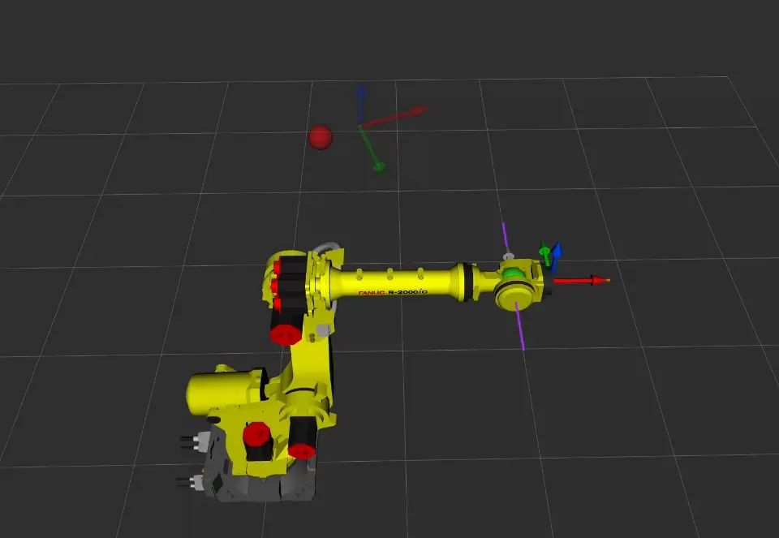
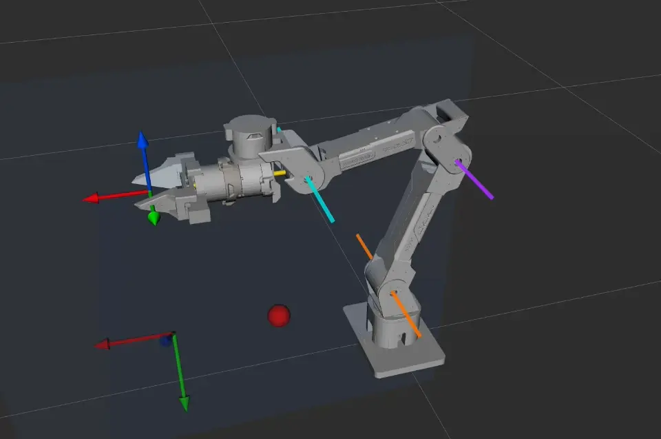

# Chapter 3: Inverse Position Kinematics

> 📌 **Overview**: Inverse kinematics means solving backwards from a target end-effector pose to the joint angles. This chapter starts with the existence of solutions, explaining when a robotic arm has a solution, why there are multiple solutions, and how to filter out the solutions that are actually usable. It then presents analytic solution approaches through two configurations, introduces a numerical iterative method that does not depend on a special configuration, and finally validates continuous inverse solutions and forward-kinematics back-substitution along a straight-line geometric path of the end effector.

## 1 Existence of inverse kinematics solutions

Forward kinematics computes the end-effector pose from known joint variables; inverse kinematics does the reverse, finding a set of joint variables that brings the end effector to a given target pose.

The inverse kinematics equations may have no solution, or one or more solutions. When solving, you need to judge separately whether the target position is reachable, whether the target orientation is achievable, and whether the resulting joint angles can be used for actual motion.

### 1.1 Workspace

The set of all spatial positions that the end effector can reach when the joints of the robotic arm move within their allowed ranges is called the **workspace** of the robotic arm.

A human arm gives an approximate illustration of the workspace: arm length determines the farthest distance, while the range of joint motion and obstruction by the body cut away part of the region. The range the hand can reach is therefore a sphere with pieces missing.

A robotic arm is the same, and its workspace is mainly determined by the following factors:

| Factor | Effect on the workspace |
|:---:|:---:|
| Link length | Determines how far the robotic arm can reach |
| Joint axis layout | Determines the directions in which the robotic arm can move |
| Joint limits | Restrict the range through which each joint can rotate |
| Mechanical structure | Self-collision may remove part of the reachable region |

Being able to achieve a target pose does not mean the joint angles are unique. The same end-effector target may correspond to multiple robotic arm configurations.
### 1.2 Number of inverse kinematics solutions

Given a target end-effector pose, the inverse kinematics equations may have no solution, a unique solution, several solutions, or infinitely many solutions. Multiple solutions often come from different shoulder, elbow, and wrist configurations. Their joint angles differ, but the forward kinematics results are the same.

The same end-effector pose can be achieved by several sets of joint angles, as follows:

> 🖼️ **Figure placeholder (multiple joint solutions for the same end-effector pose)**

> 🧪 **Supporting demo**: `joyarm_code/chapt/chapt3/chapt3_2r_demo.py` uses a planar two-link arm to visually demonstrate the existence and multiplicity of inverse solutions. Drag the target point to observe phenomena such as an unreachable target, the two elbow-up and elbow-down solutions, and the coincidence of the two solutions at the workspace boundary.

```bash
cd joyarm_code
uv run python chapt/chapt3/chapt3_2r_demo.py
```

### 1.3 A mathematically valid solution is not necessarily usable in engineering

The joint angles obtained from analytic formulas or numerical iteration are only candidate solutions at first. Even if they bring the end effector to the target pose, they cannot necessarily be used directly for robotic arm motion; the following conditions still need to be checked:

1. **Joint limits**: each joint angle must lie within the range of rotation allowed by the robotic arm;
2. **Collision constraints**: the robotic arm must not collide with itself, the workbench, or surrounding objects;
3. **Singularity**: keep the robotic arm away from singular configurations, otherwise a very small end-effector motion may cause very large joint motion;
4. **Back-substitution error**: after substituting the candidate joint angles into forward kinematics, the resulting end-effector pose must be sufficiently close to the target pose;
5. **Motion continuity**: when several usable solutions exist, the one closest to the current joint angles is usually chosen, to avoid the robotic arm suddenly switching to another configuration.

The analytic methods described below are responsible for generating multiple candidate solutions from the robotic arm configuration, while numerical methods usually find one local solution from a given initial value. Whichever method is used, the final result must pass the checks above before it can be used for trajectory planning and robotic arm motion.

## 2 Analytic solution for the configuration with intersecting last three axes

The mechanical structure of JoyArm has been confirmed to adopt the 6R configuration with **intersecting last three axes**, also called a spherical wrist. The axes of joints 4, 5, and 6 intersect at the wrist center $W$: rotation of the last three axes changes the end-effector orientation, but does not change the position of the wrist center. This structure satisfies the Pieper condition, so the complete inverse solution can be split into two subproblems, position and orientation.

This section first completes the mathematical derivation of the spherical wrist inverse solution, then explains how these formulas are written into `SphericalWristAnalyticIkineSolver`. Inside the solver, `solve_all()` assembles all solution branches, and `solve()` selects one solution in combination with the current joint angles.


| Subproblem | Unknowns | Core idea |
|:---:|:---:|:---:|
| Position subproblem | $q_1,q_2,q_3$ | Invert the wrist center from the target pose, then use the first three axes to move the wrist center to the target position |
| Orientation subproblem | $q_4,q_5,q_6$ | After eliminating the orientation of the first three axes, decompose the remaining rotation according to the wrist axis layout |



| Solution stage | Which joints move | Change in the animation | Result |
|:---:|:---:|:---:|:---:|
| ① Locate the wrist center | Joints 1, 2, and 3 | The green wrist center gradually moves to the red target point | Position solution complete |
| ② Adjust the orientation | Joints 4, 5, and 6 | The wrist center stays coincident, and the solid RGB axes gradually turn toward the semi-transparent target axes | Orientation solution complete |

### 2.1 Obtaining the wrist center position from the target pose

Let the target pose be ${}^0_6\bm T$,

$$
{}^{0}_{6}\bm T=
\begin{bmatrix}
{}^{0}_{6}\bm R & {}^{0}\bm p_6\\
\bm 0^\mathsf T & 1
\end{bmatrix}
$$

The fixed offset from the origin of the end-effector frame to the wrist center is ${}^6\bm p_W$ in $\{6\}$, so the position of the wrist center in the base frame is

$$
{}^0\bm p_W={}^0_6\bm R\,{}^6\bm p_W+{}^0\bm p_6
$$

The target orientation transforms the fixed offset into the base frame, and adding it to the target end-effector position gives the wrist center position. The program first uses _target_link6() to remove the TCP fixed offset; for the current analytic model, the origin of frame 6 is the wrist center, so T_06[:3, 3] can be passed directly to the position subproblem.

### 2.2 Obtaining the first three joint angles from the wrist center

The position of the target wrist center is determined only by the first three joints, so $q_1,q_2,q_3$ can be solved first. The geometric process of the solution usually includes two kinds of branches, shoulder left/right and elbow up/down; different robotic arms have different link dimensions, lateral offsets, and zero definitions, so the specific formulas must be derived from the actual model.


Let ${}^0\bm p_W=(x_W,y_W,z_W)$. In the simplified configuration without lateral offset, the first joint angle is determined by the horizontal projection of the wrist center:

$$
q_1=\operatorname{atan2}(y_W,x_W)
\quad\text{(the other candidate direction differs by }180^\circ\text{)}
$$

After transforming the wrist center into frame 1 and subtracting the fixed shoulder offset, the in-plane target coordinates are denoted $(x,z)$. The shoulder, elbow, and wrist center then form a plane triangle:

$$
\gamma=\frac{x^2+z^2-l_1^2-l_2^2}{2l_1l_2},\qquad
q_3=\pm\arccos(\gamma)
$$

$$
q_2=\operatorname{atan2}(z,x)
-\operatorname{atan2}\!\bigl(l_2\sin q_3,\;l_1+l_2\cos q_3\bigr)
$$

A real solution exists only when $\gamma\in[-1,1]$. If the robotic arm has a lateral offset, the first three axes are still solved from the wrist center position, but the geometric relations corresponding to the actual structure must be used. _solve_q123() reads the lateral offset, zero offsets, and equivalent link lengths from the MDH parameters, and enumerates the shoulder and elbow solution branches.

### 2.3 Eliminating the first three axes and solving the wrist orientation

Once the first three axes are solved, ${}^0_3\bm R$ is known. The rotation produced by the first three axes can be eliminated from the target orientation:

$$
{}^3_6\bm R=({}^0_3\bm R)^{\top}{}^0_6\bm R
$$

${}^3_6\bm R$ contains only the rotation of the last three joints, so $q_4,q_5,q_6$ can be obtained from the wrist axes and the frame definitions. The first three axes determine the wrist center position, while the last three complete the orientation adjustment with the wrist center held fixed.

For a common orthogonal spherical wrist, the remaining orientation can be written in ZYZ Euler angle form:

$$
{}^3_6\bm R=\bm R_Z(q_4)\bm R_Y(q_5)\bm R_Z(q_6)
$$

Let ${}^3_6\bm R=[r_{ij}]$; one set of angles can be extracted as follows:

$$
q_5=\operatorname{atan2}\!\bigl(\sqrt{r_{13}^2+r_{23}^2},\,r_{33}\bigr)
$$

$$
q_4=\operatorname{atan2}(r_{23},r_{13}),\qquad
q_6=\operatorname{atan2}(r_{32},-r_{31})
$$

When $\sin q_5=0$, $q_4$ and $q_6$ appear only as a combined angle and cannot be determined separately. In this case you need to fix one of the angles and then solve the other as a representative solution. _solve_q456() implements the wrist orientation decomposition; at a wrist singularity it uses the reference angle q0[5] to fix q6 and then solves back for q4.

### 2.4 Combining, filtering, and validating candidate solutions

Section 1 explained that the same target end-effector pose produces multiple solutions. The shoulder, elbow, and wrist usually each have two branches, so a spherical wrist can produce at most $2\times2\times2=8$ raw candidates.

Writing the mathematical steps above as a program, the core structure of `solve_all()` is as follows. The code first solves the position branches, then computes the remaining orientation for each set of first-three-axis solutions, and finally solves the wrist branches:

```python
T_06 = _target_link6(target, T_e6)
raw = []

for q1, q2, q3 in _solve_q123(mdh, T_06[:3, 3]):
    T_03 = np.eye(4)
    for row, qi in zip(mdh[:3], (q1, q2, q3)):
        T_03 = T_03 @ _mdh_transform(row, qi)

    R_36 = T_03[:3, :3].T @ T_06[:3, :3]
    for q4, q5, q6 in _solve_q456(mdh, R_36, q6_ref):
        raw.append(np.array([q1, q2, q3, q4, q5, q6]))
```

This code corresponds one-to-one with the mathematical derivation: `_solve_q123()` implements the position subproblem, `R_36` corresponds to $({}^0_3\bm R)^\mathsf T{}^0_6\bm R$, and `_solve_q456()` implements the orientation subproblem.

After obtaining the raw candidates, the program uses `_shift_2pi()` to handle equivalent angles that differ by whole turns, uses `_fkine_mdh()` and `_pose_error()` to complete forward-kinematics back-substitution, and merges duplicate solutions. `solve()` finally keeps the set within the soft limits that is closest to the reference joint angles $\bm q_0$. Thus, for the analytic method, $\bm q_0$ serves as a reference for solution selection, not as an iteration starting point.

The spherical wrist solver can be enabled only after the MDH parameters of the corresponding model are determined and written into the configuration. The solver also checks the MDH structural conditions, to avoid applying the spherical wrist formulas to a mismatched model.

> 📖 **Further reading**: To learn the complete implementation of the spherical wrist analytic solution in detail, see `joyarm_code/joyarm_core/robotics/ikine/ikine_solver_analytic_spherical_wrist.py`.

## 3 Analytic solution for the configuration with three consecutive parallel axes

The Pieper condition is not limited to the last three axes intersecting. When three consecutive joint axes are mutually parallel, an analytic solution can also be constructed from the special geometric relations. However, the decoupling order of this configuration differs from that of the spherical wrist.

The formulas in this section correspond to `ParallelAxisAnalyticIkineSolver`. The current `rebot_arm_b601_dm` model configuration enables this solver, in order to preserve and validate the analytic implementation for the configuration with three consecutive parallel axes.

### 3.1 Configuration characteristics and decoupling idea

When $q_1$ is fixed, joints 2, 3, and 4 drive the robotic arm to move within the same plane. They can both change the bending shape of the robotic arm and jointly change the in-plane orientation of the distal link.

For the axis directions adopted in this section, the joint effect of the three joints on the distal orientation can be merged into a single angle:

$$
\phi=-q_2+q_3+q_4
$$

The signs in the formula depend on the direction of each joint axis and on the frame definitions, and may not be the same on another robotic arm.

$\phi$ represents the combined in-plane orientation of the distal link, but it cannot alone determine the position of the wrist reference point. Even with the same $\phi$, different combinations of $q_2,q_3,q_4$ can still form different arm shapes, placing the wrist reference point at different positions. Once $\phi$ is known, we can only determine the direction and projection that the distal link occupies at the target position; only after subtracting this projection can the remaining position be reduced to a planar 2R problem.

> 📌 **Solution-order tip**: First determine $q_1$ from the target wrist position, then solve the combined angle $\phi$ and the wrist angles $q_5,q_6$ from the target orientation, and finally use the target position and the known $\phi$ to solve back for $q_2,q_3,q_4$. This differs from the spherical wrist decoupling, where "the first three axes locate the wrist center and the last three adjust the orientation".



| Solution stage | Change in the animation | Result |
|:---:|:---:|:---:|
| ① Solve $q_1$: horizontal projection of the wrist reference point | Solve $q_1$ from the target wrist position; joint 1 turns the blue motion plane toward the target azimuth | The target wrist position enters the motion plane of joints 2, 3, and 4 |
| ② Orientation subproblem: first solve $\phi,q_5,q_6$ | Solve $\phi,q_5,q_6$ from the target orientation; the solid RGB axes gradually align with the semi-transparent target axes | The end-effector orientation matches the target, but the green wrist reference point has not yet reached the red target point |
| ③ Position subproblem: solve $q_2,q_3,q_4$ from $\phi$ | Keeping $\phi,q_5,q_6$ unchanged, move $q_2,q_3,q_4$ together so that the green wrist reference point gradually moves to the red target point | The wrist position is solved while the end-effector orientation is kept unchanged |

### 3.2 Solving $q_1$: horizontal projection of the wrist reference point

Before the analytic solution, first convert the target end-effector pose into the target position of the wrist reference point $O_5$ according to the fixed geometric relations of the robotic arm, denoted as:

$$
{}^0\bm p_{O_5}
=
\begin{bmatrix}
x_5\\
y_5\\
z_5
\end{bmatrix}
$$
When joint 1 rotates, it drives the motion plane containing joints 2, 3, and 4 to rotate about the base axis. Viewed from above the base, the direction of the projection of $O_5$ in the horizontal plane is the direction toward which this motion plane needs to turn.

Therefore, the first joint angle is


$$
q_1=\operatorname{atan2}(y_5,x_5)
$$

Here, $\operatorname{atan2}(y_5,x_5)$ determines the quadrant from both coordinates of the horizontal projection at once, giving the azimuth of the wrist reference point relative to the base $x$ axis.

After $q_1$ is solved, the motion plane of joints 2, 3, and 4 turns toward the target wrist position. The program first uses _target_link6() to remove the TCP fixed offset, then _solve_q1() incorporates the lateral offset and joint zero positions and enumerates the candidate directions of the motion plane.

### 3.3 Orientation subproblem: first solve $\phi,q_5,q_6$

Axes 2, 3, and 4 all change the distal orientation, but the rotation of each of the three joints cannot yet be determined from the target orientation alone. When solving, first merge their joint effect on the orientation into the in-plane orientation angle $\phi$:

$$
\phi=-q_2+q_3+q_4
$$

In this way, only three unknowns remain in the orientation subproblem: $\phi$, $q_5$, and $q_6$. First solve these three from the target orientation, then in the next subsection combine them with the target position to decompose $\phi$ into the specific $q_2,q_3,q_4$.

The specific approach is to first remove the already-solved rotation of axis 1 and the fixed base twist. Let the target end-effector orientation be ${}^0_6\bm R$; the two parts together are written as

$$
\bm B=\bm R_Z(q_1)\bm R_X(-\tfrac{\pi}{2})
$$

Then the reduced orientation is $\bm Q=\bm B^{\top}{}^0_6\bm R$. At this point $\bm Q$ contains only the rotation of "in-plane combined angle + last two axes":

$$
\bm Q=
\underbrace{\bm R_Z(\phi)}_{\text{combined orientation of axes 2–4}}
\bm R_X(\alpha_4)
\underbrace{\bm R_Z(q_5)}_{\text{axis 5}}
\bm R_X(\alpha_5)
\underbrace{\bm R_Z(q_6)}_{\text{axis 6}}
$$

Main idea: **do not distinguish $q_2,q_3,q_4$ first, but compress their effect on the orientation into a single $\phi$**.

When $\alpha_5=\pi/2$ and $\sin\alpha_4\ne0$, $q_5$, $\phi$, and $q_6$ can be obtained in turn from the reduced orientation matrix $\bm Q$. First solve $q_5$ from the $(2,2)$ element of $\bm Q$:

$$
\cos q_5=-\frac{Q_{22}}{\sin\alpha_4},\qquad
q_5=\operatorname{atan2}\!\bigl(\pm\sqrt{1-\cos^2q_5},\;\cos q_5\bigr)
$$

The sign gives two wrist flip branches. After selecting one $q_5$, solve $\phi$ and $q_6$ in turn:

$$
\phi=\operatorname{atan2}(Q_{12},Q_{02})
-\operatorname{atan2}\!\bigl(-\cos\alpha_4\cos q_5,\;\sin q_5\bigr)
$$

$$
q_6=\operatorname{atan2}(R_{10},R_{00})
$$

where $\bm R=\bigl[\bm R_Z(\phi)\bm R_X(\alpha_4)\bm R_Z(q_5)\bm R_X(\alpha_5)\bigr]^{\top}\bm Q$, that is, the already-solved $\phi$ and $q_5$ are further removed from $\bm Q$, and the remaining rotation is used to solve $q_6$.

When $|\sin q_5|\to0$, that is, $q_5=0$ or $180°$, $\phi$ and $q_6$ appear only as the combined angle $(\phi\pm q_6)$ and cannot be determined separately. In this case you can fix a reference value of $q_6$ and solve back for $\phi$ from the combined angle, choosing a representative solution from infinitely many equivalent angles. _reduced_orientation() is responsible for eliminating the known rotations, and _solve_phi_q56() is responsible for extracting the combined angle and wrist angles while keeping the wrist flip branches.

> 📌 **Key point**: This is the biggest difference between the configuration with three parallel axes and the spherical wrist — **the orientation equations also yield the $\phi$ required by the position subproblem**, rather than "position determines the wrist center → orientation determines the wrist angles".

### 3.4 Position subproblem: solving $q_2,q_3,q_4$ from $\phi$

After $q_1$ is solved, the motion of axes 2, 3, and 4 can be treated as a planar problem. Transform the wrist reference point $O_5$ into this plane:

$$
{}^1\bm p_{O_5}={}^0_1\bm R^{\top}\bigl({}^0\bm p_{O_5}-{}^0\bm p_1\bigr)
$$

In the simplified geometry of this section, the in-plane coordinates of $O_5$ in frame 1 are denoted

$$
x={}^1 p_{O_5,x},\qquad z={}^1 p_{O_5,z}
$$

Let the lengths of the two equivalent links be $l_1,l_2$, with corresponding joint angles $q_2,q_3$. In the simplified geometry of this section, the shoulder, the elbow, and the wrist reference point $O_5$ form a triangle, so $q_3$ can first be solved by the law of cosines:

> 🖼️ **Figure placeholder (Figure 3-4: position subproblem for the configuration with three consecutive parallel axes)**: Mark the shoulder, elbow, wrist reference point, the lengths of the two equivalent links, and the target coordinates $(x,z)$ in the motion plane, corresponding to the law of cosines and the solution relations for $q_2,q_3,q_4$.

$$
\cos q_3=\frac{x^2+z^2-l_1^2-l_2^2}{2l_1l_2}
$$

The two sign results given by the arccosine correspond to the elbow-up and elbow-down configurations. After selecting $q_3$, solve the shoulder joint $q_2$ from the direction of the target point:

$$
q_2=
\underbrace{\operatorname{atan2}(z,x)}_{\text{direction of the target point}}
-\underbrace{\operatorname{atan2}\!\bigl(l_2\sin q_3,\;l_1+l_2\cos q_3\bigr)}_{\text{correction angle due to link bending}}
$$

At this point $q_2,q_3$ have already brought the wrist reference point to the target position, but the distal orientation is not necessarily equal to the $\phi$ solved in Section 3.3. Finally, use $q_4$ to make up the remaining angle:

$$
q_4=\phi+q_2-q_3
$$

In summary: use the triangle to determine $q_2,q_3$, then use $q_4$ to make up the distal orientation. `_solve_q234()` implements this planar geometric computation.

Combining the three mathematical relations, the core flow of `solve_all()` is as follows:

```python
T_06 = _target_link6(target, T_e6)
raw = []

for q1 in _solve_q1(mdh, T_06[:3, 3]):
    Q = _reduced_orientation(mdh, T_06[:3, :3], q1)

    for phi, q5, q6 in _solve_phi_q56(mdh, Q, q6_ref=q6_ref):
        q234 = _solve_q234(mdh, T_06[:3, 3], q1, phi)
        for q2, q3, q4 in q234:
            raw.append(np.array([q1, q2, q3, q4, q5, q6]))
```

The nesting order of the program is exactly the solution order of the analytic method: first determine the motion plane, then solve the combined angle and the wrist angles, and finally solve the specific arm shape in the plane. The raw candidates likewise need equivalent-angle handling, forward-kinematics back-substitution, and deduplication; `solve()` then selects from within the soft limits the set closest to $\bm q_0$.

The two analytic solvers have different mathematical decompositions but the same program structure: `solve_all()` generates and validates candidate solutions, and `solve()` selects one usable solution in combination with the current joint angles.

> 🧪 **Supporting demo**: `joyarm_code/chapt/chapt3/chapt3_ikine_demo.py` uses the analytic solver for three parallel axes from this section to enumerate candidate solutions for the same target pose, performs forward-kinematics back-substitution on each set in turn, and plays the different robotic arm configurations in MeshCat. Green indicates solutions within the limits, and red indicates geometric solutions that exceed the hard limits.

```bash
cd joyarm_code
uv run python chapt/chapt3/chapt3_ikine_demo.py
```

To view only the solution results without starting MeshCat, run:

```bash
uv run python chapt/chapt3/chapt3_ikine_demo.py --headless
```

> 📖 **Further reading**: To learn the complete implementation of the analytic solution for the configuration with three consecutive parallel axes in detail, see `joyarm_code/joyarm_core/robotics/ikine/ikine_solver_analytic_parallel.py`.

## 4 Numerical solution for robotic arm inverse kinematics

The analytic solutions introduced in Sections 2 and 3 depend on a specific configuration. For a robotic arm without a closed-form solution, you can also start from a set of initial joint angles and keep correcting the joint angles so that the end effector gradually approaches the target pose. This is numerical inverse kinematics. This section corresponds to `PinIkineSolver`: Pinocchio computes forward kinematics and the Jacobian, and the solver handles the pose error, damped update, limit handling, and multi-start retries.

### 4.1 What numerical inverse kinematics does

Numerical inverse kinematics has no one-step formula; instead it repeatedly executes the following four steps:

1. Given a set of initial joint angles $\bm q_0$;
2. Compute the current end-effector pose with forward kinematics;
3. Compare the current pose with the target pose to obtain the error;
4. Compute the joint correction from the error and update the joint angles.

The updated joint angles enter forward kinematics again. If the error is already small enough, the current result is returned; otherwise iteration continues.

Numerical inverse kinematics means giving a set of joint angles first and then repeatedly correcting them according to the end-effector deviation. `solve()` prepares the target frame, soft limits, and starting points, and `_lm()` performs the iteration for a single starting point; if the initial value fails, other starting points are tried.

### 4.2 How to represent the pose error

The end-effector pose contains both position and orientation. Positions can be subtracted directly:

$$
\bm e_p(\bm q)=\bm p_{\mathrm d}-\bm p(\bm q)
$$

Orientations cannot be subtracted directly as two rotation matrices. Here the orientation error is represented by "the minimum rotation needed to turn the current orientation into the target orientation":

$$
\bm e_R(\bm q)
=
\log_3\!\bigl(\bm R_{\mathrm d}\bm R(\bm q)^{\top}\bigr)
$$

$\log_3$ turns the relative rotation between the two orientations into a three-dimensional rotation vector. Combining the position error and the orientation error gives the six-dimensional error:

$$
\bm e(\bm q)=
\begin{bmatrix}
\bm e_p(\bm q)\\
\bm e_R(\bm q)
\end{bmatrix}
$$

The solver uses the following residual to judge convergence:

$$
\varepsilon(\bm q)
=
\|\bm e_p(\bm q)\|_2
+
\|\bm e_R(\bm q)\|_2
$$

When $\varepsilon(\bm q)<\mathrm{tol}$, the current joint angles are considered to satisfy the target pose. `_err()` implements this residual, and the final value is returned by `IKResult.err`.

### 4.3 How to correct the joint angles

The Jacobian matrix $\bm J$ describes the relationship between small changes in the joint angles and changes in the end-effector pose. Using this relationship, the joint correction $\Delta\bm q$ can be computed from the end-effector error. To avoid excessively large joint corrections near singular configurations, the solver uses the damped pseudoinverse to improve iteration stability.

The joint correction can be written as

$$
\Delta\bm q=\bm J_{\lambda}^{+}\bm e
$$

A commonly used damped pseudoinverse form is

$$
\bm J_{\lambda}^{+}
=\bm J^T
\left(\bm J\bm J^T+\lambda^2\bm I\right)^{-1}
$$

The ordinary pseudoinverse may produce very large joint corrections near singular configurations; the damping parameter $\lambda$ is used to suppress these unstable corrections. With a smaller $\lambda$, the solver approaches the target more aggressively; with a larger $\lambda$, joint corrections are more conservative, but the end-effector error may also increase.

The Levenberg–Marquardt (LM) method automatically adjusts $\lambda$ according to whether the current correction reduces the error. The damped pseudoinverse can only mitigate numerical amplification; it cannot eliminate the singularity inherent in the geometric structure of the robotic arm.

After the correction is obtained, update the joint angles and limit them within the joint range:

$$
\bm q_{k+1}
=
\operatorname{clip}\!\bigl(
\bm q_k+\Delta\bm q_k
\bigr)
$$

The formulas above are written as the following iteration core in `_lm()`. The model, target frame, and parameter preparation outside the loop are omitted here:

```python
pin.forwardKinematics(model, data, q)
M = pin.updateFramePlacement(model, data, fid)

e = np.hstack([
    p_ref - M.translation,
    pin.log3(R_ref @ M.rotation.T),
])

J = pin.computeFrameJacobian(
    model, data, q, fid, pin.LOCAL_WORLD_ALIGNED
)
U, sv, Vt = np.linalg.svd(J, full_matrices=False)

dq = (Vt.T * (sv / (sv**2 + lam**2))) @ U.T @ e
q_new = np.clip(q + dq, limits.q_min, limits.q_max)
```

In the code, `e` corresponds to the six-dimensional pose error $\bm e$, `J` corresponds to $\bm J$, and `dq` corresponds to $\Delta\bm q$. The actual solver also limits the length of $\Delta\bm q$ and compares whether `q_new` reduces the residual: if it decreases, the step is accepted and the damping is reduced; if it increases, the step is rejected and the damping is increased. The geometric meaning of the Jacobian and singularity will be developed in [Chapter 4](chapt4_jacobian.md).

### 4.4 Initial values and singularity

Numerical solutions depend on the initial value $\bm q_0$. When the initial value is close to the target solution, usually only a few iterations are needed; when it is far, the solution may become slow, fall into another solution, or fail to converge.

Near a singular configuration, end-effector motion in some directions requires very large joint changes. Damping can alleviate the sudden amplification of the correction, but cannot guarantee success every time. During the solution process, the single-step correction also needs to be limited, and the joint angles must be limited to within the soft limits.

The complete `solve()` tries the initial value and then other starting points within the soft limits in turn. If any starting point converges, success is returned; if all fail, it still returns the joint angles with the smallest residual encountered during the attempts, and sets `success` to `False`. A fixed random seed makes the retry process reproducible for the same input.

> 📖 **Further reading**: To learn the complete implementation of the Pinocchio numerical inverse solution in detail, see `joyarm_code/joyarm_core/robotics/ikine/ikine_solver_pin.py`.

## 5 Chapter practice: continuous inverse solutions along a Cartesian straight-line path {#5}

The reference code is located in `joyarm_code/chapt/chapt3/chapt3_movel_demo.py`. This section connects the pose representation and forward kinematics of Chapter 2 with the inverse kinematics of this chapter, focusing on verifying whether a Cartesian geometric path can be converted into a continuous joint path that can be back-substituted. The script filename is retained for compatibility with existing run commands; the path in it does not include velocity, acceleration, or arrival-time planning, and is not equivalent to a complete `MoveL`.

> 📖 **Chapter boundary**: This chapter addresses "which joint angles correspond to each end-effector pose along the path", that is, the geometric path and continuous inverse solutions; [Chapter 5](chapt5_trajectory.md) further establishes a time law for the path and generates the reference position, velocity, and acceleration. A complete `MoveL` requires a Cartesian path, time parameterization, continuous inverse solutions, and control execution all at once.

### 5.1 Task objective

Starting from the home configuration, the robotic arm keeps the end-effector orientation unchanged and generates a straight-line geometric path of the end effector with a length of $3\ \mathrm{cm}$ in the positive $Z$ direction of the base frame.

Let the path parameter be $s\in[0,1]$, with start and end positions $\bm p_0$ and $\bm p_1$ respectively; then the target position is

$$
\bm p(s)=(1-s)\bm p_0+s\bm p_1
$$

The orientation is kept unchanged in this example, so the target orientation at every path point equals the orientation at the start point.

### 5.2 Obtaining continuous joint solutions from a straight-line path

The program first uses forward kinematics to compute the end-effector pose of the home configuration, then generates 31 equidistant target poses. It calls inverse kinematics once for each target pose, and uses the result of the previous point as the reference joint angles for the next point:

~~~python
q_path = [q_start]

for pose in target_poses[1:]:
    result = arm.solve_ikine(pose, q0=q_path[-1])
    if not result.success:
        return
    q_path.append(result.q)
~~~

The analytic method selects the candidate solution closest to the previous point, and the numerical method also starts iterating near the previous point, so adjacent path points more easily stay on the same solution branch.

After solving the entire path, the program checks the following uniformly:

| Check | Purpose |
|:---:|:---:|
| The inverse solution succeeds at every point | Prevent executing an incomplete path |
| All joint angles are within the soft limits | Stay within the recommended working range |
| Adjacent joint angles have no sudden jumps | Prevent the inverse solution from switching to another solution branch |
| The forward-kinematics back-substitution error meets the threshold | Confirm that the joint path corresponds to the target straight line |

Only when all checks pass does the program allow physical robot motion to start.

### 5.3 Physical robot execution

Before running on the physical robot, you can first check the same geometric path and its continuous inverse solutions in MeshCat:

```bash
cd joyarm_code
uv sync
uv run python chapt/chapt3/chapt3_movel_demo.py rebot_arm_b601_dm --simulate
```

The yellow line in the simulation represents the target straight line of the end effector, the green and red points represent the start and end points respectively, and the white frame represents the current TCP. After confirming that the path direction and robotic arm configuration match expectations, run the physical robot example:

~~~bash
cd joyarm_code
uv run python chapt/chapt3/chapt3_movel_demo.py rebot_arm_b601_dm
~~~

The script contains two confirmations. After the first confirmation, the motion state machine brings the robotic arm back to home; after the second confirmation, the script sends the precomputed joint path points in sequence. The motion state machine and the joint command interface are physical robot capabilities already provided by the code base; this chapter only uses these interfaces and does not expand on their internal trajectory planning and control principles.

Observe the following during execution:

1. The terminal first prints the number of path points, the maximum joint jump, and the forward-kinematics back-substitution error;
2. After the robotic arm returns to home, the end effector moves about $3\ \mathrm{cm}$ in the positive $Z$ direction of the base;
3. The end-effector orientation stays unchanged during the motion;
4. When the program ends, the robotic arm returns to zero through the state machine and is disabled.

The complete flow of the practice in this chapter is

$$
\text{straight-line end-effector path}
\longrightarrow
\text{point-by-point inverse kinematics}
\longrightarrow
\text{continuous joint path}
\longrightarrow
\text{back-substitution validation and discrete execution}
$$

Discrete execution is only used to observe the actual motion produced by the continuous inverse solutions; velocity, acceleration, and trajectory smoothness are not analyzed, and these topics are developed further in Chapter 5.
