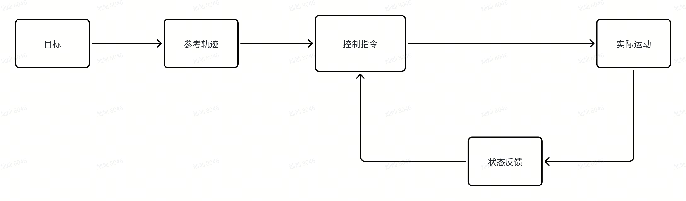
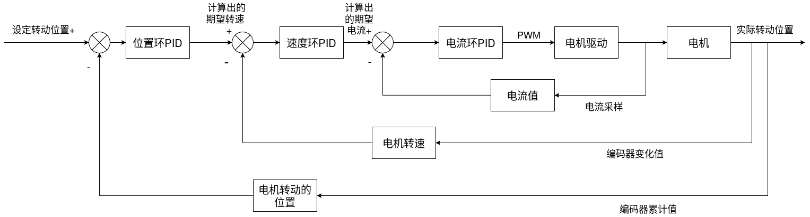
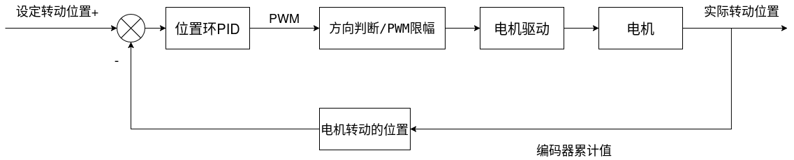
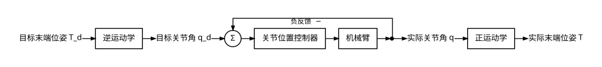
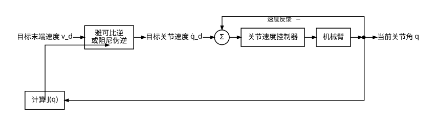

# Chapter 6: Motion Control

> 📌 **Overview**: This chapter turns the kinematic relationships and reference trajectories obtained in the previous chapters into control commands that the robotic arm can execute. It first establishes the complete "target—planning—control—execution—feedback" chain, then introduces single-joint control, joint-space motion control, and Cartesian position and velocity control, and finally combines the JoyArm planner, controller, motion state machine, and communication backend to complete a joint motion practice.

> 📖 **Chapter scope**: This chapter builds on the forward kinematics of [Chapter 2](chapt2_fkine.md), the inverse kinematics and continuous inverse solutions of [Chapter 3](chapt3_ikine.md), the Jacobian matrix of [Chapter 4](chapt4_jacobian.md), and the time-parameterized trajectories of [Chapter 5](chapt5_trajectory.md), and focuses on how these results enter the control chain without repeating their detailed derivation and implementation. Dynamic factors such as mass, inertia, and gravity are left to [Chapter 8](chapt8_dyn.md), the forces between the robotic arm and the environment are left to [Chapter 9](chapt9_force.md), and the complete task of drag teaching is left to [Chapter 12](chapt12_teleop.md).

## 1 From motion target to motor command

Robotic arm motion requires not only determining the endpoint but also specifying the motion process and correcting deviations promptly according to the actual state. The first five chapters mainly answer "how the robotic arm should move"; this chapter focuses on "how to make the robotic arm actually move along the reference trajectory".

### 1.1 The complete motion control chain

From receiving a motion target to producing actual motion, the robotic arm passes through planning, control, and execution in sequence. The drivers and sensors then return the actual state to the controller, so that the controller can continuously correct motion deviations.



This chain contains four consecutive stages:

1. **Specify the target**: determine the joint angles or end-effector pose that the robotic arm should finally reach.
2. **Generate the reference**: the planner generates a reference trajectory from the start point, the end point, and the motion constraints.
3. **Compute the command**: the controller computes control commands from the reference trajectory and the actual feedback.
4. **Execute and feed back**: the drivers move the motors and return states such as the actual position, velocity, and torque.

The target and the reference trajectory are passed downward along the chain, while the actual state returns to the controller through the feedback channel. This forms a closed-loop structure of "forward execution, reverse feedback".

### 1.2 Division of labor between planning and control

Planning and control solve two consecutive but different problems: **planning determines how the robotic arm should move, and control makes the robotic arm move as far as possible according to the planning result.**

| Item | Planning | Control |
|:---:|:---:|:---:|
| Core question | How it should move | How to follow the reference trajectory |
| Input | Motion target and constraints | Reference trajectory and actual feedback |
| Output | Reference position, velocity, and acceleration | Position, velocity, or torque commands |

The planner generates the reference trajectory, and the controller tracks it using feedback. A simple point-to-point motion can send only the target position to the driver; when the motion time, velocity, or multi-joint synchronization relationship must be constrained, the trajectory should be planned explicitly.

### 1.3 Control cycle and feedback loop

A complete control cycle usually includes:

1. Read the joint states and their timestamps.
2. Check whether the feedback is valid and whether it has timed out.
3. Sample the current reference state from the planner.
4. Compute the control command from the reference state and the actual state.
5. Perform position, velocity, torque, and single-cycle increment checks.
6. Send the command to the joint drivers.
7. Wait for the next control cycle.

The control performance depends not only on the nominal control frequency but also on the actual cycle, communication latency, cycle jitter, feedback timestamps, and loss-of-connection protection. If the feedback has expired, it cannot continue to be used as the current state even if its values look normal.

With the complete control chain clarified, we start below with single-joint control, which drives the robotic arm directly.

## 2 Single-joint motor control

Each joint of the robotic arm is usually driven by an integrated joint module. The joint module integrates components such as the motor, reducer, encoder, and driver; some products also include a torque sensor. The host computer sends position, velocity, or torque commands, and the controller inside the module adjusts the current according to the sensor feedback so that the joint moves as commanded.

### 2.1 Joint state and control quantities

Joint control most commonly uses position, velocity, and torque:

$$
q,\qquad \dot q,\qquad \tau.
$$

The driver may also return the current, motor temperature, MOS temperature, error code, enable state, and current control mode. During control, you need to distinguish:

- **Target value (target)**: the state that the controller expects the joint to reach.
- **Measured value (ref)**: the state actually fed back by the encoder or driver.
- **Control error (err)**: the difference between the target value and the measured value.

### 2.2 Position, velocity, and torque control modes

| Control mode | Main command | Main feedback | Characteristics | Typical use |
|:---:|:---:|:---:|:---:|:---:|
| Position mode | Target angle $q_d$ | Joint angle $q$ | Intuitive to use; convenient for fixed-point and trajectory tracking | `MoveJ`, returning Home, preset poses |
| Velocity mode | Target angular velocity $\dot q_d$ | Joint angular velocity $\dot q$ | Convenient for continuously adjusting the motion direction and speed | Teleoperation, visual servoing |
| Torque mode | Target torque $\tau_d$ | Current or joint torque $\tau$ | Can directly adjust the applied force; places high demands on the model and on safety protection | Damping, gravity compensation, compliant control |

#### 2.2.1 Position mode

Position mode takes the target angle $q_d$ as input, and the driver completes the position closed loop internally. It is the easiest mode to use, but the host computer usually cannot directly determine the actual output torque.

#### 2.2.2 Velocity mode

Velocity mode takes the target angular velocity $\dot q_d$ as input. Velocity commands must be sent continuously and must be stopped promptly after a communication interruption; the position limits must also be checked to prevent the joint from moving continuously in the same direction.

#### 2.2.3 Torque and MIT mode

A typical MIT control command can be written as

$$
\tau_{\mathrm{cmd}}
=K_p(q_d-q)+K_d(\dot q_d-\dot q)+\tau_{\mathrm{ff}}.
$$

Here, $K_p$ determines the position stiffness, $K_d$ provides velocity damping, and $\tau_{\mathrm{ff}}$ is the feedforward torque. By changing these parameters, the same interface can implement position holding, damping, gravity compensation, and drag teaching.

> ⚠️ Torque mode directly affects the force between the robotic arm and the environment. On real equipment, joint limits, velocity limits, torque limits, the emergency stop, and communication timeout protection must all be configured.

### 2.3 Cascade closed loop and PID control

Position mode does not mean that the motor controls only position internally. A typical driver uses cascade control: the position loop outputs a velocity target, the velocity loop outputs a current or torque target, and the innermost current loop drives the motor. The further inward the control loop, the higher its operating frequency usually is.



The three control loops generate the target of the next layer one after another, from the outside in:

| Control loop | Input target | Main feedback | Output to the next layer | Main function |
|:---:|:---:|:---:|:---:|:---:|
| Position loop | Target angle $q_d$ | Actual angle $q$ | Target angular velocity $\dot q_d$ | Reduce the position error |
| Velocity loop | Target angular velocity $\dot q_d$ | Actual angular velocity $\dot q$ | Target current or torque | Adjust the motion speed and provide damping |
| Current loop | Target current $i_d$ | Actual current $i$ | PWM or voltage command | Establish electromagnetic torque quickly |

Therefore, after the host computer sends a target angle, the driver does not immediately "pull" the motor to the target position; instead, the position loop first generates a velocity target from the position error, then the velocity loop generates a current or torque target, and finally the current loop drives the motor. When the load changes or an external disturbance occurs, the feedback changes the error of each loop, and the controller immediately updates the subsequent commands.

Taking single-joint position control as an example, the position error and the PID control law are

$$
e(t)=q_d(t)-q(t),
$$

$$
u(t)=K_p e(t)+K_i\int_0^t e(\xi)\,\mathrm{d}\xi+K_d\dot e(t).
$$

- **Proportional term ($K_p e(t)$)** corrects immediately according to the current error; an excessive gain may cause overshoot and oscillation.
- **Integral term ($K_i\int_0^t e(\xi)\,\mathrm{d}\xi$)** accumulates past errors and can reduce the steady-state error, but if too strong it easily causes integral windup.
- **Derivative term ($K_d\dot e(t)$)** reflects the trend of the error change and can add damping, but it is sensitive to measurement noise.



PID is a method by which a single control loop computes its output from the error, whereas cascade control describes how multiple control loops are nested. The position, velocity, and current loops may use different forms of P, PI, or PID control; the three loops are not required to use exactly the same control law. Usually the current loop with the fastest response is tuned first, then the velocity loop, and finally the position loop; if an inner loop is not yet stable, directly increasing the outer-loop gain easily causes overshoot and oscillation.

Practical tuning must not pursue only a fast response; you should also observe the rise time, overshoot, settling time, steady-state error, oscillation, and noise. An engineering implementation also needs to handle output limiting, integral windup, and derivative noise: after the control variable reaches its upper limit, the integral should be prevented from accumulating further, and the derivative term usually needs filtering. The original parameters may also need to be adjusted after changes in the robotic arm payload, reducer friction, and structural flexibility.

### 2.4 Communication, synchronization, and loss-of-connection protection

The host computer needs to send commands to each joint and read states through a communication link. CAN, RS-485, and EtherCAT sit at different layers of the communication architecture: CAN defines the bus communication mechanism, RS-485 mainly defines the electrical interface, and protocols such as Modbus RTU can run on top of RS-485.

| Communication method | Main characteristics | Typical topology | Applicable scenario | Notes |
|:---:|:---:|:---:|:---:|:---:|
| CAN / CAN FD | Multi-node arbitration and strong interference immunity; CAN FD can increase the data payload and rate | Bus | Mobile robots, small and medium-sized robotic arms | Termination resistor, baud rate, and node ID must be consistent |
| RS-485 | Differential transmission and simple wiring; often carries Modbus RTU or vendor protocols | Bus | Low-cost actuators, sensors | Real-time performance depends on the upper-layer protocol and polling method |
| EtherCAT | Strong cyclic communication and clock synchronization | Logical ring, physical chain | High-performance industrial motion control | Places high demands on the master, the slaves, and the network configuration |

When choosing a communication method, you should consider the control cycle, number of nodes, message length, synchronization accuracy, wiring environment, and development cost together. After a communication interruption, the old feedback should no longer be used, and the arm should enter the hold, damping, or disabled state according to the risk.

A single-joint closed loop solves how one joint tracks a target; to complete robotic arm motion, multiple joints also need to execute in a coordinated way according to a unified trajectory and time base.

## 3 Joint-space motion control

Joint-space motion control directly specifies the reference state of each joint over time and solves how multiple joints move in coordination according to the same time base; it is the most common way to perform point-to-point motion and preset actions with a robotic arm.

### 3.1 Joint targets and joint trajectories

A single target $\bm q_{\mathrm{goal}}$ specifies only the endpoint; the following quantities generated in Chapter 5

$$
\bm q_d(t),\qquad \dot{\bm q}_d(t),\qquad \ddot{\bm q}_d(t)
$$

also specify the intermediate motion process. The controller should sample the current reference state at a fixed period instead of sending a distant target directly to the motor all at once.

### 3.2 Joint position tracking

The joint position error is

$$
\bm e_q=\bm q_d-\bm q.
$$

When using the position loop inside the driver, the host computer can send $\bm q_d(t)$ periodically; when the host computer computes the control variable itself, it can also form PD control from the position error and the velocity error.

### 3.3 `MoveJ`

`MoveJ` generates and executes a trajectory in joint space, moving each joint smoothly from its current position to the target joint angle:

- All joints start and arrive in a coordinated way.
- The target must satisfy the joint position, velocity, and acceleration limits.
- It is suitable for point-to-point motion, returning Home, and preset poses.
- The intermediate end-effector path is usually not a straight line.

### 3.4 Home, Zero, and Neutral

- **Zero**: the zero position of the joint coordinates, mainly used for calibration and coordinate definition.
- **Home**: a safe pose used when the robotic arm starts, stops, or prepares for a task.
- **Neutral**: the midpoint of the soft limits, not necessarily suitable as an actual motion target.

Moving to the zero position and recalibrating the zero point are two different operations. Regular tasks usually use `move_home()`, and `move_zero()` should not be treated as the default way to return.

> 🖼️ **Image placeholder: comparison of Home, Zero, and Neutral configurations**
>
> It is recommended to show the three configurations of the same robotic arm side by side and to mark the main use of each configuration. Suggested file name: `home_zero_neutral_comparison.svg`.

### 3.5 In-position check

Completing the command transmission does not mean that the robotic arm has arrived. The basic position condition is

$$
|q_i-q_{d,i}|<\varepsilon_i.
$$

An engineering implementation should also check whether the feedback is fresh, whether the joint velocity has decreased, whether the tolerance is satisfied for several consecutive cycles, whether the operation has timed out, and whether a fault has occurred.

## 4 Cartesian position motion control

Cartesian position motion control takes the end-effector position and orientation as input and then converts them into joint targets through inverse kinematics. Viewed from the system level, the task layer gives the end-effector target, the whole-arm control layer computes coordinated joint targets, and the joint control layer then makes each joint track its target. Whole-arm control does not replace single-joint control; it performs the target conversion in an outer layer.

This section explains how inverse kinematics results enter the trajectory planning and joint control chain.

### 4.1 From end-effector target to joint target

Let the forward kinematics of the robotic arm be

$$
\bm T=f(\bm q).
$$

For a target pose $\bm T_d$, inverse kinematics solves for the target joint angles that satisfy

$$
f(\bm q_d)=\bm T_d
$$

The complete control chain is shown in the following figure:



### 4.2 Continuous selection of inverse kinematics solutions

Candidate solutions must be checked in sequence for validity, reachability, joint limits, the shoulder-elbow-wrist configuration, the distance to the current joint angles, and whether adjacent sample points stay on the same inverse-solution branch. If adjacent targets select different branches, the joint targets may jump suddenly; near a singular configuration, a small end-effector motion may also require rapid joint changes.

### 4.3 `MoveJ` for an end-effector target

If inverse kinematics is solved only once for the target end-effector pose and the arm then moves from the current joint angles to the final joint angles, that motion still belongs to `MoveJ`. It guarantees the end-effector pose at the endpoint but does not guarantee that the intermediate end-effector path is a straight line.

### 4.4 `MoveL`

`MoveL` first interpolates the position and orientation in Cartesian space, and then solves inverse kinematics continuously for each sampled pose. It can make the end effector move along an approximately straight line, but it needs additional handling of continuous inverse solutions, unreachability, joint limits, and singularity. Orientation interpolation should use rotation matrices, quaternions, or rotation vectors; Euler angles must not be linearly interpolated component by component.

The practice in Chapter 3 verifies only the kinematic process "Cartesian geometric path → continuous inverse solutions → forward kinematics substitution"; time parameterization such as the path velocity, acceleration, and arrival time belongs to Chapter 5. A complete `MoveL` is formed only after both the geometric path and the time law are determined and handed to the controller for execution.

### 4.5 `MoveJ` versus `MoveL`

| Item | `MoveJ` | `MoveL` |
|:---:|:---:|:---:|
| Planning space | Joint space | Cartesian space |
| Main goal | Smooth joint arrival | End effector moves along a specified path |
| Intermediate end-effector path | Usually not a straight line | Close to a straight line |
| Computational complexity | Lower | Higher |
| Main risk | Unpredictable end-effector path | Continuous inverse solutions, unreachability, and singularity |
| Typical scenario | Point-to-point, returning Home | Insertion, glue dispensing, straight-line approach |

> 🖼️ **Image placeholder: comparison of the end-effector paths of `MoveJ` and `MoveL`**
>
> It is recommended to draw the curved end-effector path of `MoveJ` and the straight-line path of `MoveL` between the same start and end points, and to use several intermediate poses to represent the motion process. Suggested file name: `movej_movel_path_comparison.svg`.

Cartesian position control is suitable for describing "where the end effector goes"; for continuous tracking tasks such as teleoperation and visual servoing, it is also necessary to describe "where the end effector is moving at this moment and how fast it moves".

## 5 Cartesian velocity motion control

Cartesian velocity motion control directly establishes the relationship between the end-effector velocity and the joint velocities, and is suitable for tasks such as continuous end-effector tracking, teleoperation, and visual servoing.

This section uses the Jacobian matrix to construct the velocity control relationship, and explains how the end-effector velocity is converted into joint velocities, how pose error feedback is added, and how the joint velocities are finally executed by the drivers.

### 5.1 Jacobian velocity mapping

The end-effector velocity twist $\bm v$ and the joint velocity $\dot{\bm q}$ satisfy

$$
\bm v=\bm J(\bm q)\dot{\bm q},
$$

where $\bm J(\bm q)$ is the Jacobian matrix. The controller needs to update the Jacobian matrix periodically according to the current joint angles.

### 5.2 End-effector velocity to joint velocity

In general, the pseudoinverse can be used to compute the joint velocities:

$$
\dot{\bm q}_d=\bm J^\dagger(\bm q)\bm v_d.
$$

When the matrix is square and invertible, the inverse matrix can be used; a general robotic arm more often uses the pseudoinverse. A redundant robotic arm can also use the null space to perform secondary tasks such as avoiding joint limits or improving the orientation.



### 5.3 Adding pose error feedback

When only the feedforward velocity is sent, model errors, discrete integration errors, and external disturbances accumulate gradually. Pose error feedback can be added:

$$
\bm v_c=\bm v_d+\bm K_p\bm e,
$$

$$
\dot{\bm q}_d=\bm J^\dagger(\bm q)\bm v_c.
$$

Position errors can be subtracted directly, whereas orientation errors should be computed using rotation matrices, rotation vectors, or quaternions, and Euler angles must not be subtracted component by component. The position error, orientation error, and target velocity must also be expressed in the same reference frame.

### 5.4 Executing velocity targets

When the driver supports velocity mode, the joint velocity targets can be sent directly. If the driver provides only position mode, the position for the next cycle can be obtained by discrete integration:

$$
\bm q_{k+1}=\bm q_k+\dot{\bm q}_{d,k}\Delta t.
$$

A real implementation must use the actual control cycle $\Delta t$ and limit the joint velocity, the single-cycle position increment, and the joint position after integration.

### 5.5 Singularity and damped pseudoinverse

When the robotic arm approaches a singular configuration, some singular values of the Jacobian matrix approach zero, and an ordinary pseudoinverse may amplify a very small end-effector velocity into a very large joint velocity. The commonly used damped least-squares pseudoinverse is

$$
\bm J_{\lambda}^{\dagger}
=\bm J^{\mathsf{T}}\left(\bm J\bm J^{\mathsf{T}}+\lambda^2\bm I\right)^{-1}.
$$

The larger the damping, the smoother the joint velocities, but the end-effector tracking error may also increase. A damped pseudoinverse cannot eliminate geometric singularity, so a joint velocity upper limit is still required, and the arm must slow down or stop when necessary.

### 5.6 Relationship between position control and velocity control

| Item | Position kinematics control | Velocity kinematics control |
|:---:|:---:|:---:|
| Main input | Target end-effector pose | Target end-effector velocity and pose error |
| Core computation | Inverse kinematics | Jacobian inverse, pseudoinverse, or damped pseudoinverse |
| Lower-layer command | Joint position | Joint velocity, or the joint position after integration |
| Advantages | Direct structure; suitable for fixed points and offline trajectories | Can correct errors continuously; suitable for online tracking |
| Main risk | Multiple solutions, discontinuity, unreachable target | Velocity amplification at singularities, integration drift |
| Typical scenario | Handling, grasping, preset actions | Teleoperation, visual servoing, path tracking |

The two approaches are not mutually exclusive. `MoveL` can be implemented through continuous inverse kinematics or through Jacobian velocity control; even if the lower-layer motor supports only position mode, the upper layer can still implement Cartesian velocity control through velocity integration.

Cartesian position and velocity control put the kinematic relationships learned earlier back into the complete control chain and establish the interface concepts for the subsequent teleoperation, visual servoing, and force control. The practice in this chapter chooses joint position control, which is the most basic and the easiest to verify safely.

The above introduced general methods for robotic arm motion control; below, these methods are mapped onto the planner, controller, state machine, and communication backend of JoyArm.

## 6 Motion control mechanisms in JoyArm

JoyArm separates targets, trajectories, control, state management, and hardware communication into different components, so that the same motion workflow can combine different planners, controllers, and robotic arm models.

### 6.1 Main components

- `TrajFrame`: stores a target or reference trajectory frame.
- `TrajPlanner`: receives targets and generates and samples trajectories.
- `Controller`: converts reference trajectory frames into motor commands.
- `MotionFSM`: manages motion states and arm-body control authority.
- `Backend`: implements communication and motor commands for a specific model.
- `safe_monitor`: determines safety events; the FSM executes the corresponding actions.

These components correspond to the general control chain in Section 1 as follows:

| General stage | JoyArm component | Main responsibility |
|:---:|:---:|:---:|
| Motion target | `TrajFrame`, target frame channel | Save and publish joint targets or Cartesian targets |
| Trajectory planning | `TrajPlanner` | Generate the reference trajectory from the target and sample it by time |
| Control computation | `Controller` | Generate motor commands from the reference frame and joint feedback |
| State management | `MotionFSM` | Manage the return, motion, hold, damping, and disabled states |
| Safety assessment | `safe_monitor` | Check faults, loss of connection, and custom safety rules |
| Execution and feedback | `Backend` | Communicate with the specific motors, issue commands, and read joint states |

### 6.2 Data flow

```text
set_target_joint / set_target_cart
              ↓
Target frame channel
              ↓
TrajPlanner.plan()
              ↓
TrajPlanner.sample()
              ↓
Controller.step()
              ↓
JoyArm public command interface
              ↓
Backend
              ↓
Joint motor
```

Application code is responsible only for setting targets. The planning thread periodically checks the target version and calls the planner to generate a trajectory only when a new target is received; the control thread samples the current trajectory, reads the joint feedback, and executes the controller according to the control cycle, and the Backend then converts the unified commands into communication messages for the specific model.

### 6.3 Planner

JoyArm currently provides two types of single-joint target planners:

- **Direct-pass planner**: provides the joint reference in the target frame directly to the controller.
- **Cubic polynomial planner**: generates a smooth joint trajectory from the start point, the end point, and the arrival time.

`plan_hz` determines the frequency at which the planning thread checks for new targets. After a new target is written, the planner generates the corresponding trajectory only once; before the target changes again, the control thread continuously calls `sample()` to obtain the reference frame for the current moment and does not periodically rebuild the same cubic trajectory. The meaning of the target time `t` may differ among planners, so the planner contract should be followed when using it.

### 6.4 Controller

- `JointPositionDirectController`: reads the joint angles in the trajectory frame and issues them through position mode.
- `JointDragTeachController`: implements drag teaching using MIT mode, gravity compensation, damping, and a slowly released equilibrium point.

The Chapter 6 practice mainly uses the position controller.

### 6.5 MotionFSM states

- `DISABLE`: the robotic arm is disabled.
- `ZERO`: return to the zero position and disable.
- `HOME`: move to the Home configuration.
- `MOTION`: execute planning and control normally.
- `HOLD`: hold the current position.
- `DAMP`: enter damping protection.

After the FSM is running, arm-body motion commands are issued uniformly by the control thread, and motor commands sent directly to the arm body from outside are intercepted. `DAMP` uses damping and optional partial gravity compensation to reduce the motion risk, but it is not equivalent to complete drag teaching.

### 6.6 High-level motion interface and low-level target channel

The current low-level motion approach is:

```python
arm.set_target_joint(t, q)
arm.is_in_q_arm(q)
```

For ordinary tasks, it can be further wrapped as:

```python
arm.move_j(q, duration=2.0, wait=True)
arm.move_home(wait=True)
```

The high-level interface handles target validation, waiting for in-position, and timeout handling, while the low layer still reuses the target frame, planner, controller, and FSM; a separate motion mechanism should not be set up again.

With the software components and their data flow clarified, the following verifies the complete chain consisting of target, planning, control, execution, and feedback through a joint motion experiment.

## 7 Chapter practice: JoyArm joint motion control

The practice in this chapter uses JoyArm's existing cubic joint trajectory planner, joint position controller, and MotionFSM to complete a small single-joint motion followed by a multi-joint `MoveJ`. The script records the target endpoint, actual joint positions, actual joint velocities, residual endpoint error, feedback frame age, and state machine state, and automatically generates a CSV file and joint curve plots.

The focus of the practice is to verify how "target—planning—control—execution—feedback" forms a complete operating chain in JoyArm.

### 7.1 Experiment tasks

1. Select the `single_joint_cubic_traj_planner` cubic trajectory planner.
2. Select the `joint_position_direct_controller` joint position controller.
3. Connect the robotic arm, wait for fresh feedback, and check the two sets of small-amplitude targets.
4. Start the MotionFSM and wait for the state to transition to `MOTION`.
5. Starting from Home, execute the single-joint motion and return to Home.
6. Starting from Home, execute the multi-joint `MoveJ` and return to Home again.
7. Stop the monitor and the MotionFSM, and complete the return-to-zero, disabling, and disconnection steps.
8. Save the raw data and the curve plots, and analyze the in-position error, velocity peaks, feedback frame age, and sampling period.

### 7.2 How to run

First synchronize the project environment:

```bash
cd joyarm_code
uv sync
```

Connect the robotic arm and run the practice script:

```bash
uv run python chapt/chapt6/chapt6_control_demo.py rebot_arm_b601_dm
```

By default, each motion segment lasts 3 s, the recording frequency is 50 Hz, and the results are saved in the current directory. You can change this with parameters:

```bash
uv run python chapt/chapt6/chapt6_control_demo.py rebot_arm_b601_dm \
    --duration 4.0 \
    --sample-hz 50 \
    --output-dir results
```

| Parameter | Meaning | Default value |
|:---:|:---:|:---:|
| `model` | Robotic arm model | Required |
| `--duration` | Planning time of each motion segment | `3.0` s |
| `--sample-hz` | Recording frequency of the teaching data | `50` Hz |
| `--output-dir` | Directory for saving the CSV files and images | Current directory |

> ⚠️ `--sample-hz` is the frequency at which the main thread records data, not the actual operating frequency of the controller. The planner and the controller run according to `plan_hz` and `ctrl_hz` in the model configuration, respectively.

### 7.3 Target generation and motion flow

The script uses Home as the common starting point. The single-joint experiment changes only one joint:

$$
q_{\mathrm{goal},i}=q_{\mathrm{home},i}+\Delta q_i,
$$

The remaining joints keep their Home angles. The multi-joint experiment changes several joints at the same time, and a single target arrival time constrains the joints to move in coordination. Each offset is chosen automatically according to the space available between Home and the soft limits on both sides, and the maximum single-joint offset does not exceed $0.15\ \mathrm{rad}$.

For each motion segment, only one frame containing the endpoint and the absolute arrival time is written to the target channel. After the planning thread detects a change in the target version, it generates the cubic reference trajectory once, and the control thread periodically samples this trajectory and issues it through the position controller; the main thread is responsible only for reading feedback and recording data and does not send position commands directly to the motors.

At startup, observe whether the state machine enters the normal motion state along the following path:

```text
DISABLE → HOME → MOTION
```

After the experiment ends, the script stops the monitor and the MotionFSM, and the state machine completes the safe shutdown.

### 7.4 Data and output files

The CSV file is named `chapt6_joint_control_<timestamp>.csv`, and each row corresponds to one frame of teaching sample data:

| Data | Meaning |
|:---:|:---:|
| `t_s`, `phase` | Experiment-relative time and current motion phase |
| `q_goal_*` | Target endpoint joint angles of the current phase |
| `q_*`, `dq_*` | Actual feedback joint angles and joint velocities |
| `endpoint_error_*` | Difference between the target endpoint and the actual position, i.e. the residual endpoint error |
| `frame_age_ms` | Difference between the recording moment and the feedback timestamp |
| `motion_state` | Current MotionFSM state |
| `safety_event` | Current safety event |

The PNG file is named `chapt6_joint_control_<timestamp>.png`. Each joint occupies its own subplot; the blue solid line represents the actual position feedback, the orange dashed line represents the target endpoint of the current phase, and the vertical dashed lines represent motion phase switches.

The current public API does not provide the planner's internal reference frame for each control cycle, so the orange dashed line in the figure is not the cubic reference trajectory. It indicates only the joint angles to be reached at the end of the phase; whether the actual feedback curve is smooth can be used to observe the combined effect of the whole planning and control chain, but it cannot separate the planning error from the control tracking error.

### 7.5 Acceptance criteria

| Acceptance item | Basis for judgment |
|:---:|:---:|
| Target valid | The automatically generated target is within the soft limits and contains no non-finite values |
| State machine ready | Enters the `MOTION` state within 15 s |
| Feedback valid | The state keeps updating, the feedback dimensions are correct, and the frame age does not increase abnormally |
| In-position complete | After the planning time ends, 5 consecutive recorded points satisfy `is_in_q_arm()` |
| Motion continuous | The actual position curve is continuous, and the velocity has no unexplained spikes or sustained oscillation |
| Safe stop | After the experiment ends, the MotionFSM completes the stop, return-to-zero, and disable sequence |

The script prints the maximum residual endpoint error, the residual endpoint error of the last frame, the maximum feedback velocity, and the number of sampled frames for each phase, and also prints the mean and standard deviation of the recording period as well as the maximum feedback frame age. The maximum residual endpoint error usually appears at the start of the motion and cannot be used as the controller tracking error; when judging the in-position quality, focus on the residual endpoint error of the last frame. A strict trajectory tracking error should be computed from the difference between the instantaneous reference value of the planner and the actual feedback.

### 7.6 Result analysis

Result analysis is performed in the order "position—velocity—timing—state":

1. **Check the final position**: the actual feedback should enter the target tolerance after the motion ends and remain stable.
2. **Check the motion continuity**: the position curve should not show discontinuous jumps, and the velocity curve should not show repeated large positive and negative switches.
3. **Compare single-joint and multi-joint motion**: the multiple joints should start changing in the same period and enter the target tolerance at approximately the same time.
4. **Check the feedback timing**: if the maximum frame age keeps increasing, troubleshoot the communication and state refresh first, and do not continue to interpret the control performance.
5. **Check the state machine**: during the normal sampling phase, it should remain in `MOTION` and `NORMAL`; if other states or events appear, consult the logs to determine the cause.

> 🖼️ **Experiment result placeholder: target endpoints and six-joint position feedback curves**
>
> After the physical robot experiment is completed, select a representative result from the images generated by the script and place it here, and state the motion duration, last-frame error, maximum feedback velocity, and maximum feedback frame age below the figure. Suggested file name: `joint_control_experiment_result.png`.

Common phenomena and troubleshooting directions are as follows:

| Phenomenon | Check first |
|:---:|:---:|
| The position curve jumps suddenly at startup | Whether the direct-pass planner was used by mistake; whether the target time has expired |
| Continuous oscillation after reaching the target | Position loop gain, velocity loop damping, payload, and structural flexibility |
| Obvious differences in the arrival times of multiple joints | Target time, whether a single planner is used, whether individual joints have hit the speed limit |
| Isolated spikes in the actual velocity | Feedback differentiation, dropped communication frames, timestamps, and mechanical transmission shocks |
| The in-position check changes repeatedly | Whether the tolerance is too small, feedback noise, whether the joint is still moving at low speed |
| The feedback frame age increases suddenly | Bus load, state refresh thread, serial port or CAN communication |

### 7.7 Safety boundaries

The script performs only small joint motions within the soft limits and requires a manual `yes` input before startup. This cannot replace the emergency stop, the hard limits, and on-site supervision. For the first run, use an unloaded robotic arm, reduce the motion speed, and ensure that no one is around the robotic arm and that the path is unobstructed; if abnormal noise, severe oscillation, a communication interruption, or an error code occurs, trigger the emergency stop or cut the power immediately, and do not continue the experiment just to obtain a complete curve.

Companion script: `joyarm_code/chapt/chapt6/chapt6_control_demo.py`.
