# Chapter 7: Configuration Design and URDF Export

> 📌 **Overview**: This chapter introduces the design considerations for the robotic arm's configuration, structure, and joint motors, then explains how CAD assembly information maps to the links, joints, and coordinate relationships in a URDF. Finally, you build reference geometry in SolidWorks, complete the model export and checks, and prepare a consistent model for subsequent forward and inverse kinematics calculations and simulation.

Robotic arms can be used for handling, assembly, inspection, and tool operation. Different applications have different requirements for motion range, end-effector orientation, payload, and accuracy, but every design must solve two basic problems: whether the mechanical structure can meet the usage requirements, and how to hand the structural information to the computation and control programs.

Starting from these shared problems, this chapter introduces the design methods and uses the JoyArm model to demonstrate the modeling and export workflow. The figure below shows the model viewer interface: by changing a joint angle, you can observe the motion of the corresponding link and the parts downstream of it.

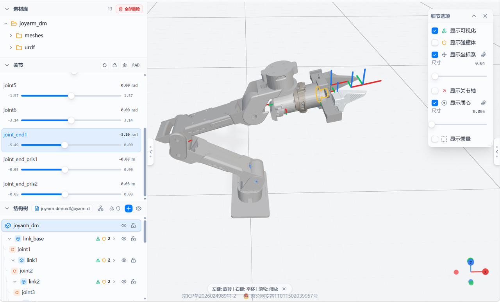

After completing the practice in this chapter, you should be able to organize the connection relationships, joint axes, and physical properties of an assembly into a URDF, check the model's motion, and understand how this data is used in subsequent calculations. Seeing the model's appearance is only the first step; you also need to verify coordinates, directions, and physical properties.

**How to read this chapter:** Sections 1 to 3 cover configuration, structure, and motor selection. If you already have a CAD assembly, you can start with Section 4 to learn the data relationships and then go to Section 5 for the hands-on steps. For the basics of coordinate frames and relative poses, see [Chapter 2](chapt2_fkine.md). The export practice requires SolidWorks, the SW2URDF plug-in, and complete assembly files; you do not need to connect the physical robot first.


## 1 Configuration design

The configuration of a robotic arm describes how the joints and links are connected and how the joint axes are arranged; it determines the arm's basic motion capabilities. Configuration design requires first clarifying the usage requirements, then determining the **number of joints, the arrangement of the axes, and the link dimensions**. When you build the robot model later, you also need to hand this information to the program accurately.

### 1.1 Application requirements and design specifications

Configuration design must first clarify: **where the end effector needs to reach, which way it needs to point, and how heavy the tool or workpiece it has to carry is**. For example, handling requires covering the pick-and-place area, assembly requires aligning the tool with the installation direction, and inspection requires bringing the sensor to a suitable observation position.

These requirements can be organized into the design specifications in the table below, which you can use to judge whether a concept is suitable.

| Requirement | Design specification | Impact on the concept |
|:---:|:---:|:---:|
| Which areas the end effector must cover | Workspace and reach | Base position, link lengths, and axis layout |
| How the tool must approach the target | Position and orientation requirements | Degrees of freedom and joint arrangement |
| How heavy the tool and workpiece are, and whether contact forces exist | Payload, center-of-mass position, and external forces | Joint torque, support, and structural strength |
| How quickly the motion must be completed | Speed, acceleration, and cycle time | Motor selection and trajectory scheduling |
| How much motion error is allowed | Positioning accuracy and repeatability | Structural stiffness, transmission backlash, and calibration |

These specifications are interrelated. For example, a longer link usually extends the reach, but the same payload may also produce greater torque on the joints. So you cannot judge a design by a single value such as reach or payload.

For subsequent algorithms, you also need to distinguish "reaching the target point" from "reaching the target point with a specified orientation". The fact that the tool can approach a hole does not mean it can insert into the hole along the hole's direction.

### 1.2 Degrees of freedom and kinematic chain selection


**The number of joints determines how many independently controllable motions the robotic arm has**. This chapter focuses on serial revolute-joint designs: joints and links are connected in sequence from the base to the end effector, revolute joints are denoted by R, and robotic arms with six or seven revolute joints are called 6R and 7R respectively.

When the axis layout is reasonable and the motion capability has not degenerated, six independent joints can provide the degrees of freedom needed to control these variables.
With a seventh joint, there is one more degree of freedom than the six-dimensional end-effector pose, which is called a redundant degree of freedom. You can understand this with your own arm: keep your hand at the same position and orientation, and your elbow can still change position. This extra freedom can be used for obstacle avoidance or to stay away from joint limits.

| Option | Main characteristics | Trade-offs to consider |
|:---:|:---:|:---:|
| 6R | Controls spatial pose with six joints | Limited by the workspace, joint limits, and singular configurations; not all target poses are reachable |
| 7R | Uses the redundant degree of freedom to adjust the posture of the arm | Adds mass, cost, and complexity in solving and planning |

Choosing 6R or 7R requires judging obstacles, installation space, and orientation requirements together. The extra joint adds adjustment freedom but does not guarantee obstacle avoidance in every scenario; you still need to check collisions between links and with the environment.

Therefore, the number of joints needs to be chosen according to the usage requirements. Robotic arms with the same number of joints may also have different motion capabilities, which further depends on how the joint axes are arranged.

### 1.3 Joint axis layout

**The axis layout determines which direction each joint turns in and how the links combine their motion**. You can think of each joint axis as a hinge axis: each joint rotates about its own axis, and the combination of several axes produces the extension, folding, and turning of the robotic arm.

The following compares two local layouts: adjacent axes alternately perpendicular, and three consecutive parallel axes.

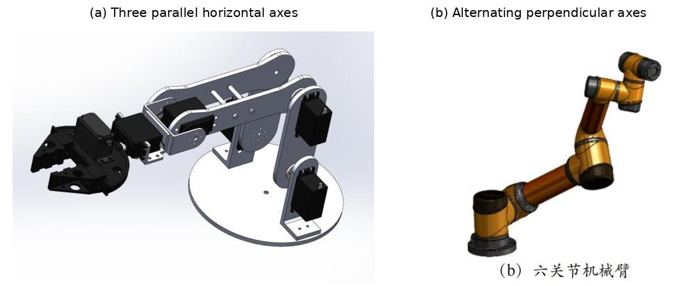


With adjacent axes alternately perpendicular, each joint provides rotation in a different direction, and the link connections also need to accommodate these direction changes. With three consecutive parallel axes, once the upstream joints are fixed, the motion of this segment can be understood as planar rotation, making it easier to analyze the extension and folding of the links intuitively; axis offsets still need to be included in the actual geometric model.

| Layout | Intuitive understanding | Motion characteristics |
|:---:|:---:|:---:|
| Three consecutive parallel axes | The three joints rotate about axes in the same direction | The extension and folding of the links in this segment is easier to understand as planar motion |
| Alternately perpendicular adjacent axes | Adjacent joints rotate about axes in different directions | The links rotate in different directions in turn, and the spatial relationships are more complex |


This tutorial takes the layout in which **the second, third, and fourth joint axes are parallel** as the analysis subject; the choice draws on the engineering experience of existing robotic arms. With the other joints fixed, you can first observe how this segment of links extends and folds, then combine it with the base and the remaining joints to understand the spatial motion of the whole arm.

Note that parallel axes do not mean the whole arm can only move within a plane, nor that it is a parallel robot. "Parallel" describes the direction of the axes; "serial" describes how joints and links are connected in sequence.

Once the axis layout is determined, you also need to combine link dimensions and joint limits to check whether target poses are reachable and whether collisions occur along the motion. For the relevant calculations, you can use the forward kinematics and workspace analysis of [Chapter 2](chapt2_fkine.md) and the inverse kinematics methods of [Chapter 3](chapt3_ikine.md).


## 2 Structural design

The configuration determines how the robotic arm moves, while structural design ensures that it **can carry loads, deforms little under load, and can be assembled and operated properly**. For subsequent modeling and algorithm use, the key is to understand how structural deformation, weight, and connection methods affect the actual motion.

### 2.1 Loads, strength, and stiffness

**The robotic arm must carry not only the end-effector payload but also its own weight and the forces generated by motion and contact.** The loads of the tool, the workpieces, and the links at every stage are transmitted to the base through the connections.


To judge whether a structure meets the requirements, you need to distinguish strength from stiffness:

| Concept | Question of concern | Symptom when insufficient |
|:---:|:---:|:---:|
| Strength | Whether it can carry the load without damage | Parts may fracture or deform irreversibly |
| Stiffness | Whether it can keep its original shape under load | The part is not damaged, but the end-effector position shifts because of deformation |

You can understand stiffness with a ruler sticking out over the edge of a desk: hold one end fixed and apply a downward force at the other end, and the ruler bends. All else being equal, the longer the overhang and the greater the applied force, the more obvious the bending usually is. Robotic arm links show a similar phenomenon.

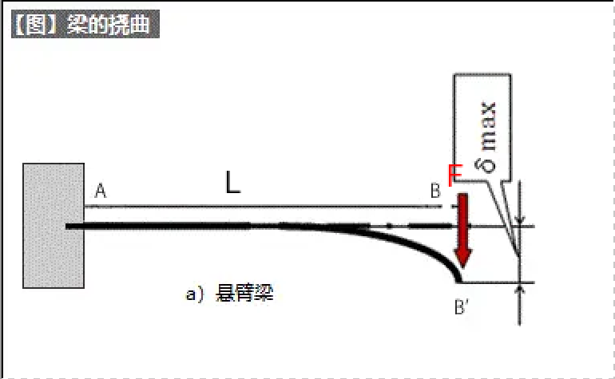

Therefore, although a longer link can increase the reach, you also need to consider deformation under load. Stiffness can be improved through material, cross-sectional shape, and support arrangement; making parts thicker is not the only method.

**This also explains the possible discrepancy between the model and the physical robot:** common kinematic models treat links as rigid bodies that do not deform. Even if the joint angles match the values in the program, the physical end effector may still deviate from the computed position because of structural deformation.

### 2.2 Link lightweighting and joint support

**The structure needs to balance weight against load capacity, and the joints need to satisfy both drive and support requirements**. Reducing weight alone may increase deformation, while simply thickening parts increases the burden on upstream joints.

Added weight closer to the end effector usually affects more upstream joints. For example, if you replace the tool at the wrist with a heavier one, the shoulder and elbow also have to carry its weight; during motion, they also need to provide the torque to accelerate or decelerate these parts.

The goal of lightweighting is to reduce unnecessary mass while meeting strength and stiffness requirements. After adjusting link shape, material distribution, or support positions, compare weight and deformation under the same loads and constraints; do not just look at how much material was removed.


The fixed end of a joint module connects to the upstream structure, and the output end connects to the downstream structure. The motor provides the drive torque, while the bearings and support structure constrain the motion and transmit radial forces, axial forces, and overturning moments. Meeting the motor torque requirement does not mean the joint support already meets the load-carrying requirement.

In design you can also compare mounting the drive components near the joint with remote drive: the former gives a direct connection, while the latter may reduce the mass at the moving end but adds transmission mechanisms and assembly work. The specific choice should consider mass distribution, space, transmission stiffness, and maintenance requirements.

### 2.3 Manufacturing, assembly, and cable routing

**A structure must not only work on the drawing; it must also be manufacturable, assemblable, and function properly throughout its motion range**. When using the CAD model, focus on checking the following:

| Check item | Specific points of attention |
|:---:|:---:|
| Manufacturing | Whether material and process match, and whether the accuracy of mounting surfaces and shaft holes can be achieved |
| Assembly and maintenance | Installation order of shafts, bearings, and modules, and space for tightening tools and replacement |
| Motion interference | Whether links, fasteners, and the environment collide during extension, folding, and wrist rotation |
| Cable routing | Cable bending allowance, fixing positions, and the risk of pinching, rubbing, and tangling |

Cables should be checked as the joints move; do not only check whether the length is sufficient at the zero position. For candidate structures, you can first build an assembly model using the module's external shape and mass, then update the mounting dimensions and mass distribution according to the motor selection results in the next section.


## 3 Joint motor selection

The joint motors provide the drive the robotic arm needs for motion, and their output capability determines **how large a payload the arm can carry, how fast it can move, and how long it can work continuously**. When reading motor parameters, focus on torque, speed, and gear ratio, and understand how these parameters become motion limits in the model and control system later.

### 3.1 Joint actuators and main parameters

**Joint motion is usually produced by a motor, a reducer, an encoder, and a driver working together**. The motor provides torque, the reducer adjusts the output torque and speed, the encoder feeds back position, and the driver controls the motor according to commands. These components can also be integrated into a single joint module.
When reading a parameter table, first confirm whether the data refers to the **motor shaft end or the joint output end**. Links are connected to the joint output end, so you need to compare the output-end capability with the actual motion requirements.

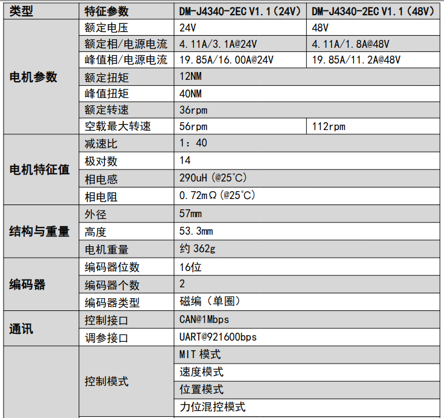

When reading the parameter table, first find whether the data corresponds to the **motor shaft end or the joint output end**. Links are attached to the output end, so you need to compare the torque and speed the output end can provide with the task requirements.

You can start by reading the parameters around three practical questions:

| What you want to know | Which parameters to check first | How to interpret them |
|:---:|:---:|:---:|
| Can it hold the object indefinitely? | Rated or permitted continuous torque and its conditions | Continuous working capability is affected by speed, heat dissipation, and other conditions |
| Can it accelerate at startup? | Peak torque and the permitted duration | Being able to reach it briefly does not mean it can be maintained |
| Can the motion finish on time? | Output speed and the torque–speed curve | There must still be enough torque at the required speed |

Mass must also be considered together. If a heavier motor is fitted at the wrist, the shoulder not only has to move the workpiece but also has to lift this added weight along with it.

### 3.2 Gear ratio and output characteristics

A reducer obtains a larger output torque by reducing the output speed. Under the same motor input conditions, increasing the gear ratio usually makes the joint rotate more slowly but increases the output torque.

For example, a gear ratio of 10 means that the motor shaft turns 10 revolutions while the output end turns 1 revolution. Ignoring losses, the output speed drops to one tenth of the motor speed and the output torque increases tenfold; the actual torque is also limited by transmission losses and the load capacity of the reducer.

Therefore, the gear ratio involves a trade-off between load and speed:
| Adjustment direction | Possible change | Question to check |
|:---:|:---:|:---:|
| Increase the gear ratio | Output torque increases and output speed decreases | Whether the motion can still finish on time |
| Decrease the gear ratio | Output speed increases and output torque decreases | Whether there is still enough torque to drive the load |
A reducer does not create power out of nothing, nor can it increase joint load capacity without limit. When selecting, you still need to check the limits of the motor, the reducer, and the support structure individually.

> 📌 If the module parameters already give the output-end torque, use that value directly; do not multiply by the gear ratio again.

### 3.3 Static torque and load estimation

**The torque a joint needs depends not only on how heavy the load is but also on where the load is located and its motion state**. For the same object, the farther it is from the joint, the larger the gravitational moment it may produce; when accelerating or braking, additional torque is needed to change the motion speed.

First look at a static example. For a horizontal joint axis, the gravitational moment produced by the workpiece can be understood as:

$$
\text{Gravitational moment}=\text{Gravity}\times\text{Moment arm}
$$

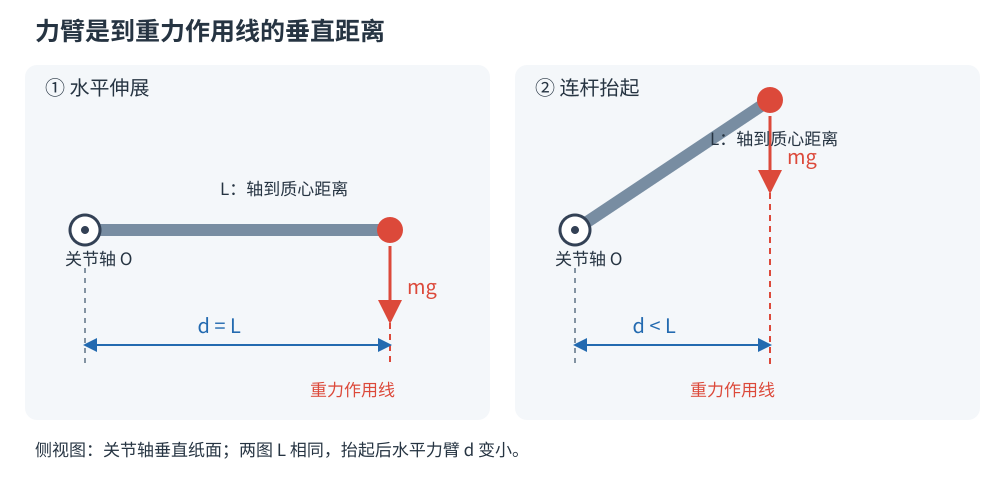

The handling of a workpiece below is used as a standalone calculation example and does not represent the intended task of the whole arm. Assume the workpiece mass is 0.5 kg and its gravitational moment arm about the shoulder joint is 0.40 m. Then:

$$
\tau_{\mathrm{load}}=0.5\times9.81\times0.40\approx1.96\ \mathrm{N\cdot m}
$$

The shoulder motor also has to carry the dead weight of the downstream links, joint modules, and gripper. Assume their gravitational moments act in the same direction:

| Downstream part | Mass (kg) | Gravitational moment arm (m) | Gravitational moment (N·m) |
|:---:|:---:|:---:|:---:|
| Links and joint modules | 1.20 | 0.20 | Approx. 2.354 |
| Gripper and adapter | 0.30 | 0.35 | Approx. 1.030 |
| Workpiece | 0.50 | 0.40 | Approx. 1.962 |
| Total | — | — | Approx. 5.346 |

With a 1.5× margin reserved, the required continuous output torque is about 8.02 N·m (calculated from unrounded data). Conversely, if the joint can output 12 N·m continuously, then after deducting the margin and the effect of the parts' dead weight, the workpiece mass it can support in this pose is about 1.18 kg.

The above is only a static estimate under assumed conditions and does not represent the rated payload of the whole arm. The shorter the moment arm for the same workpiece, the smaller the gravitational moment produced; during motion, additional requirements such as acceleration and braking must also be considered.

> 💡 **Guess before you calculate**: with the workpiece weight unchanged, if the moment arm changes from 0.40 m to 0.20 m, the gravitational moment it produces halves. However, the gravitational moments of the other parts must be recalculated according to their own positions; you cannot simply halve the total torque.

### 3.4 Selection checks and model limits

**After the initial motor selection, you need to check the entire motion and write the confirmed capability limits into the model and control configuration**. Verifying that a single pose can be held is not enough to judge whether the motor can complete the whole task.

In engineering practice, you can estimate level by level from the wrist toward the base: once a candidate module for the wrist is determined, its mass becomes the downstream load of the elbow; once the elbow candidate is determined, include it in the shoulder. Each level should use its own joint axis and center-of-mass position; you cannot copy the shoulder's moment arm to the other joints.

This is especially true for the base joint that rotates about a vertical axis: gravity may not produce a drive torque about that axis, but starting and braking still require torque. In general spatial poses, you need to compute the component of each part's moment about the joint axis; you cannot apply the same planar formula to all of them.

After the initial selection, update the mass, center of mass, and inertia of the candidate parts in the model, schedule the trajectory according to the application requirements, and then check the whole motion through dynamics calculations or simulation.

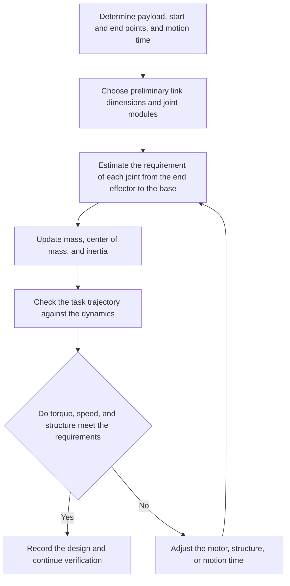

When checking, look at the torque peak and its duration, the continuous operating conditions, and whether torque and speed fall within the permitted ranges at the same time. Do not look only at the average torque with signs, because positive and negative values may cancel out without reducing motor heating.

If the wrist motor gains 0.2 kg and its gravitational moment arm at the shoulder is 0.4 m, the added static gravitational moment alone is about $0.2\times9.81\times0.4=0.785\ \mathrm{N\cdot m}$, before accounting for inertial effects during motion. Therefore, after replacing a motor, you need to recheck the upstream joints.

This chapter completes the static initial selection and establishes this iterative approach; for the full dynamics calculation, see [Chapter 8](chapt8_dyn.md). Next, you need to hand information such as axes and masses from CAD to the program, which is exactly the role of the robot description file.


## 4 CAD and URDF model description
A CAD assembly tells you the shape, dimensions, and mating relationships of the parts. To compute the pose of the end-effector tool, the program also needs to know: which parts move together, in what order they are connected, and where each joint is and which direction it rotates about.

**URDF (Unified Robot Description Format)** records this information in a single file for kinematics, visualization, and simulation programs to use.

### 4.1 Role of the URDF and sources of information

**A URDF is a structural description file for a robot**. It uses XML tags to record links, joints, and their properties; once the program reads it, it can build the robotic arm model.

| Information the program needs | Content in the URDF | Main source |
|:---:|:---:|:---:|
| Which parts move together | Link `link` | CAD part grouping |
| How parts are connected and how they move | Joint `joint` | Assembly relationships, joint axes, and coordinate frames |
| Appearance of the robotic arm | `visual` | Exported part meshes |
| Which shapes participate in collision detection | `collision` | External shape or simplified collision geometry |
| How heavy the parts are and how the mass is distributed | `inertial` | CAD mass properties or part data |

The SolidWorks export plug-in extracts this information and reduces manual entry. Before exporting, you still need to set part grouping, coordinate frames, and material properties correctly; otherwise the model the program receives will also contain errors.

URDF itself does not solve inverse kinematics or control motors; it provides the model data that these programs share.

### 4.2 Link grouping and link properties

**A `link` represents a set of parts that stay fixed relative to each other during motion; it does not necessarily correspond to one CAD part**.
A forearm may consist of two side plates, several connectors, and many screws. In CAD they are separate parts, but if they do not move relative to each other during motion, they can be treated as one rigid part group, called a `link` in URDF.

To judge the grouping, you can temporarily fix the other joints and rotate only one joint. Parts that move relative to each other on opposite sides of the joint should be assigned to different links; parts fixed on the same side that always move together belong to one group.


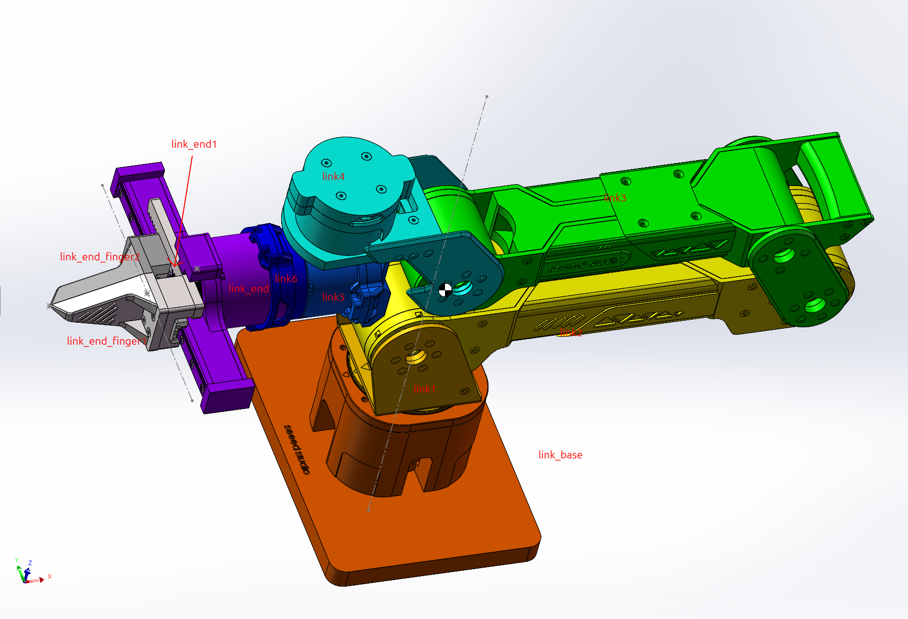

This is also why you cannot assign an entire motor assembly to one link without judgment: if it contains both a fixed end and parts that rotate with the output end, you need to group them according to the real motion relationships.

A link can record three things separately: appearance `visual`, collision geometry `collision`, and physical properties `inertial`. Appearance is used for display; collision geometry can be simpler to reduce detection cost; physical properties include mass, center of mass, and inertia tensor.

### 4.3 Joint connections and kinematic tree

The connection between two links is called a `joint`. The joint type determines how the child link can move relative to the parent link. The `Joint Type` drop-down menu in SW2URDF contains the following options:

| Option | Meaning and motion | Configuration points | Typical use |
|:---:|:---:|:---:|:---:|
| `Automatically Detect` | The plug-in infers the joint type from the mating relationships in the assembly; this is a plug-in option, not a URDF joint type. | After export, check the generated `type`, motion axis, and limits; this tutorial already specifies the motion of each node, so manual selection is recommended. | Assisting in recognizing joints in the assembly |
| `continuous` | Rotates about a fixed axis with no upper or lower angle limits and can turn through multiple revolutions; has 1 rotational degree of freedom. | Set `axis`; angles are in radians; do not set the angle `lower` and `upper`, but you still need to set speed and torque limits. | Wheels or turntables that rotate continuously |
| `revolute` | Rotates about a fixed axis within a specified angle range; has 1 rotational degree of freedom. | Set `axis` and `limit`; the upper and lower angle limits are in radians. | Body joints `joint1`–`joint6`, gripper drive joint `joint_end1` |
| `prismatic` | Translates along a fixed axis within a specified stroke without relative rotation; has 1 translational degree of freedom. | Set `axis` and `limit`; the upper and lower displacement limits are in meters. | Finger joints on both sides `joint_end_pris1` and `joint_end_pris2` |
| `fixed` | The relative position and orientation of the parent and child links remain unchanged; has 0 degrees of freedom. | Use `origin` to set the fixed transform; no motion axis or motion limits are needed. | Gripper mounting joint `joint_end`, and the fixed joints of the two tool reference frames |

`continuous` does not mean "the rotation range is exactly one revolution"; it means that there are no upper or lower angle limits. Even if the motor itself can rotate continuously, as long as the mechanism or cabling limits the actual rotation angle, you should use `revolute` and fill in the corresponding limits. `fixed` means there is no relative motion between the two links; when the parent link moves, the child link still moves with it.

<div style="display: flex; align-items: center; gap: 16px;">
  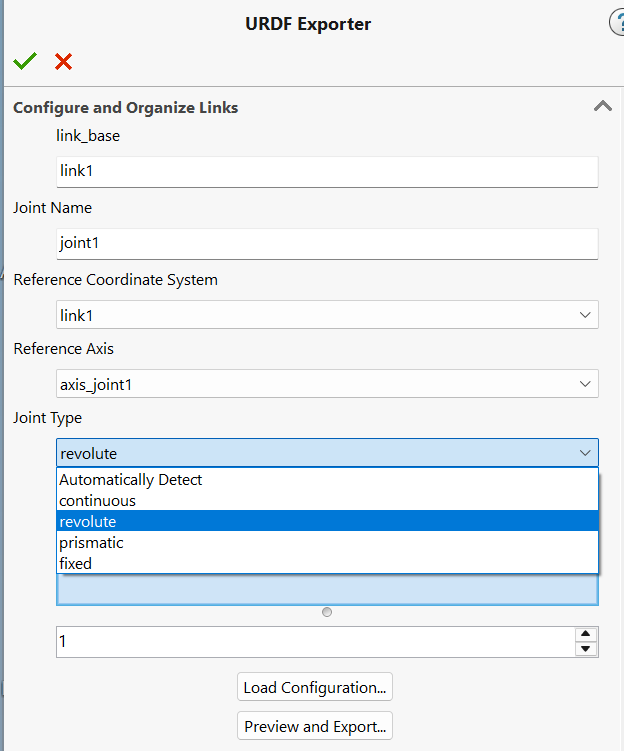
  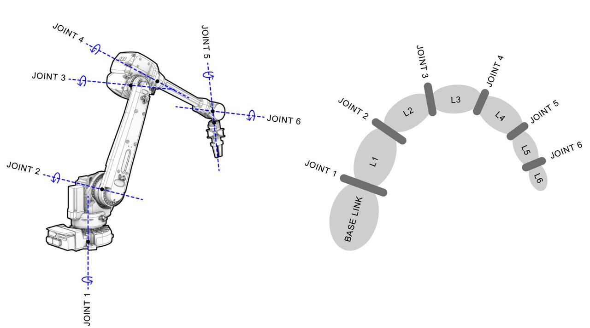
</div>

For example, `joint3` connects `link2` and `link3`: the side nearer the base is the parent link `parent`, and the next side is the child link `child`. Continue connecting in this relationship; for example, the six-axis body can form the following kinematic chain:

```text
link_base
└── joint1 → link1
    └── joint2 → link2
        └── joint3 → link3
            └── joint4 → link4
                └── joint5 → link5
                    └── joint6 → link6
```

> 💡 If you change only `joint3`, which parts do you expect to move? `link3` and the wrist and tool beyond it will move with it, while `link_base`, `link1`, and `link2` should stay in place. This can be used directly to check the exported grouping.

### 4.4 Joint axes and link coordinate frames

Knowing only the connection order is not enough; the program also needs to know the position of the joints. First find the real rotation axis in CAD: select a cylindrical face, shaft hole, or existing assembly axis that is coaxial with the output shaft, and create a reference axis.

Next, fix a "three-dimensional ruler" to the part, that is, the link coordinate frame. Its origin determines where measurement starts, and its coordinate axes determine the directions of measurement. The rotation axis gives a line, but it cannot alone determine the position of the origin along that line, nor the direction of the X axis, so assembly datums and frame assignment rules are also needed.

This chapter follows the MDH frame assignment convention of [Chapter 2](chapt2_fkine.md), so that the coordinate frames correspond to the kinematics discussed earlier. When adjacent axes are parallel, you need to select the common normal; when they intersect, you can use the intersection point for locating; when they are skew, use the shortest common normal for locating. Which reference face and reference point to click in practice is explained in Section 5.

**URDF itself does not require MDH coordinate frames.** This project keeps them consistent so that CAD measurements, the URDF, and the earlier calculations can be checked item by item. When exporting you do not need to re-derive the MDH formulas, but you do need to place the origins and directions correctly according to the convention.

Before establishing coordinate frames, first determine the zero position of the assembly. The zero position here is "the pose when the joint angles are recorded as zero"; it is not necessarily the pose in which the robotic arm is fully extended. The encoder reading may have an offset from this convention, but the correspondence must be recorded.

#### 4.4.1 Positive directions of joint space and motor space

When assigning frames and exporting, this tutorial uses a consistent positive direction for joint angles and motor feedback angles, so that when the motor feedback angle increases, the corresponding joint angle also increases, avoiding the need to add per-joint direction reversal in the control program. Zero-position offsets, units, and gear-ratio conversions still need to be handled according to the actual interface; they are different issues from the positive direction convention.

To define the forward rotation axis of the motor, you must first clarify the viewing direction: according to the observation end specified in the motor documentation, confirm that counterclockwise rotation of the output end relative to the stator corresponds to an increasing feedback angle, then use the right-hand rule to determine that forward rotation axis. You cannot judge directly from counterclockwise on the screen, nor mix the motor rotor angle with the reducer output angle.

For `jointi` connecting `link(i-1)` and `linki`, joint motion describes the rotation of the child link relative to the parent link. Which side the stator is mounted on determines its correspondence with the relative rotation of the motor:

| Stator mounting position | Motion of the child link relative to the parent link | Positive Z axis of the joint frame |
|:---:|:---:|:---:|
| Previous link `link(i-1)` | The output end drives the child link; the relative motion is the same as the motor's forward rotation | Take the motor's forward rotation axis |
| Same-numbered link `linki`, with the output end connected to the parent link | The child link moves with the stator; the relative motion is opposite to the rotation of the output end relative to the stator | Take the opposite of the motor's forward rotation axis |

The reversal here comes from the relative motion of the parent and child links and does not require negating the motor feedback value. Set the joint Z axis according to the table above and make the exported rotation axis along the local positive Z, that is, `<axis xyz="0 0 1" />`, to express in the model the actual motion direction when the motor angle increases.

### 4.5 Joint position and axis representation

Taking `joint3` as an example, the origin of `link3` is offset 264 mm, that is, 0.264 m, along the X direction of the parent frame `link2`.

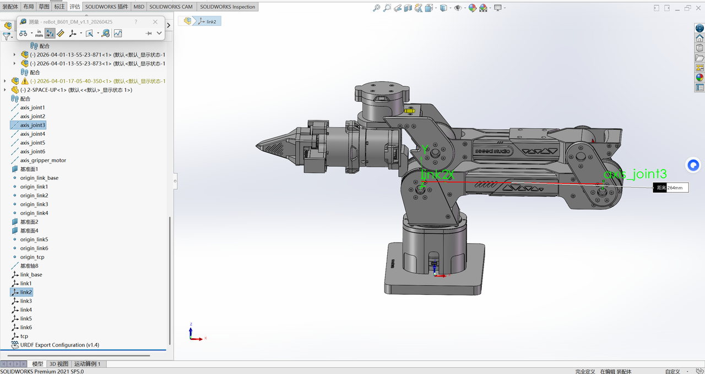

The corresponding zero-position transform is:

```xml
<origin xyz="0.264 0 0" rpy="3.141592653589793 0 -2.9226" />
```

`xyz` is the position of the zero-position joint origin in the **parent link frame**, in m. `rpy` is the relative orientation at the zero position, in rad, determined by the directions of the CAD coordinate frames; it is not the joint angle at runtime.

The positive direction of the body joints has been unified with the local positive Z, so use:

```xml
<axis xyz="0 0 1" />
```

`axis` expresses the motion axis in the **joint coordinate frame**. Point the right-hand thumb along positive Z; the direction in which the four fingers curl is the direction of increasing joint angle.

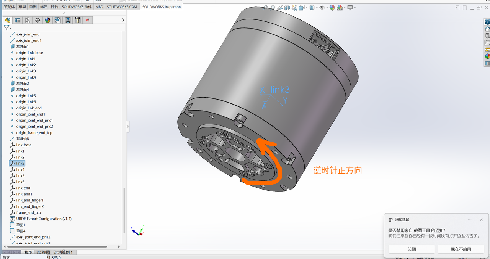

After adding the parent-child relationship and limits, the joint configuration is:

```xml
<joint name="joint3" type="revolute">
  <parent link="link2" />
  <child link="link3" />
  <origin xyz="0.264 0 0" rpy="3.141592653589793 0 -2.9226" />
  <axis xyz="0 0 1" />
  <limit lower="-3.14" upper="0" effort="30" velocity="5" />
</joint>
```

At runtime, the program first determines the zero-position relationship from `origin`, then applies the joint rotation about `axis`. `lower` and `upper` in `limit` specify the angle range, while `effort` and `velocity` specify the torque and speed limits respectively; for revolute joints the units are rad, N·m, and rad/s.

### 4.6 Tool reference frames

When using a tool, you need to specify the position where it actually acts, such as the gripping center of a gripper or the action point of a machining tool, so you need to define the **TCP (Tool Center Point)** and its reference frame. As long as this reference frame is fixed relative to the end link, it can be connected through a fixed joint, and the program can then compute all the way from the base to the tool center.

However, being named `tcp` does not mean the link must have no mass. First look at how the model is grouped: if it is only a reference frame, it can be an empty link; if it also carries the geometry and inertia of the actual tool, you need to keep these real properties. Any tool mass should be counted exactly once; do not omit or duplicate it.

Likewise, whether to describe gripper opening depends on the task: computing the pose from the body to a fixed tool reference point and simulating finger motion and contact require different joint relationships. If you want to simulate the grasping process, keep the corresponding moving parts and confirm that the simulation tool supports their constraints. Do not delete motion that is actually needed just to make the export easier.

The model finally exported in this chapter will continue to be used in subsequent calculations. For forward and inverse kinematics, first check the joint geometry, limits, and end-effector reference frame; for dynamics simulation, also confirm the mass, center of mass, inertia, and collision properties, and configure the drive and contact conditions in the simulation environment.

### 4.7 Mass, center of mass, and inertia tensor

The joint axes and link dimensions tell the program how the robotic arm moves, but to calculate how much torque the motor must output, you also need to know how heavy each link is and where its mass is distributed. The mass and inertia properties entered during export in Section 5 are exactly the data prepared for such calculations.

#### 4.7.1 Mass and center of mass

**Mass** is the total mass of the parts contained in a link. Here a link may consist of multiple parts such as the shell, connectors, and fasteners, and when exporting it should be aggregated according to the part grouping already determined; the unit is kg.

**The center of mass** is the center of the mass distribution. In a uniform gravitational field, the gravity of the whole link can be treated as a force acting at the center of mass. The moment arm used in Section 3 to calculate the gravitational moment should be determined from the geometric relationship between the center of mass and the joint axis, not assumed to be half the link length.

For example, of two links of the same length and weight, one has its heavy parts concentrated at the end away from the joint, so its center of mass is farther out. In the same horizontal orientation, this link produces a larger gravitational moment about the joint. Therefore, a mass value alone is not enough to calculate the gravity effect.

The origin of the link coordinate frame is used to describe motion relationships, while the center of mass is used to describe the mass distribution; the two do not need to coincide. Changing the link coordinate frame only changes the coordinate representation of the center of mass, not the position of the center of mass in the solid.

#### 4.7.2 Moment of inertia and inertia tensor

Parts with the same mass may also require different torques to rotate. Concentrating the mass near the axis of rotation is usually easier to accelerate than spreading the same mass far from it. **The moment of inertia** describes how the mass distribution affects rotation about a specified axis, and depends both on the mass and on the distance of the mass from that axis.

For a rigid body in space, you need to describe the inertia of rotation about different directions and the coupling between them, so a $3\times3$ symmetric matrix is used, called the **inertia tensor**:

$$
\boldsymbol{I}=\begin{bmatrix}
I_{xx} & I_{xy} & I_{xz}\\
I_{xy} & I_{yy} & I_{yz}\\
I_{xz} & I_{yz} & I_{zz}
\end{bmatrix}
$$

The three diagonal terms represent the moments of inertia about the reference coordinate axes; the off-diagonal terms describe the coupling caused by the mass distribution in that coordinate frame. The matrix is symmetric, so a URDF only needs to store the six independent values, all in $\mathrm{kg\cdot m^2}$. The inertia here is different from the second moment of area in the cantilever beam formula in Section 2, which describes only the cross-sectional geometry.

The inertia tensor must also state **the reference center and the directions of the coordinate axes**. The URDF inertia tensor is centered at the center of mass and expressed in the coordinate axes defined by `inertial`. After rotating the coordinate axes, the matrix components may change even if the solid does not; when the principal axes of inertia are used the off-diagonal terms are zero, but general link coordinate axes are not necessarily principal axes of inertia, so you cannot simply delete the off-diagonal terms for convenience.

#### 4.7.3 Inertial properties in the URDF

The following is a standalone example representing a uniform rectangular cuboid with a mass of 1 kg and side lengths of 0.20, 0.10, and 0.10 m along the inertial coordinate axes. Assume the center of mass is located 0.10 m from the link origin along X, and the inertial coordinate axes are parallel to the link coordinate axes:

```xml
<!-- Place inside the corresponding link; the values are examples, not actual robotic arm parameters -->
<inertial>
  <origin xyz="0.10 0 0" rpy="0 0 0" />
  <mass value="1.0" />
  <inertia ixx="0.001666667" ixy="0" ixz="0"
           iyy="0.004166667" iyz="0" izz="0.004166667" />
</inertial>
```

| Field | Meaning | Information to obtain in CAD |
|:---:|:---:|:---:|
| `mass value` | Total mass of the link, in kg | Mass of this part group |
| `inertial/origin xyz` | Position of the center of mass in the link coordinate frame, in m | Center-of-mass coordinates relative to the selected link coordinate frame |
| `inertial/origin rpy` | Orientation of the inertial coordinate frame relative to the link coordinate frame, in rad | The coordinate axes used when the inertia is reported |
| The six components of `inertia` | Inertia tensor centered at the center of mass and expressed in the inertial coordinate frame | Inertia data with the same reference center and the same axes |

Here `origin` is inside `inertial` and is used to locate the center of mass and the inertial coordinate frame; the `joint/origin` in Section 4.5 describes the joint connection. The two tags have the same name but belong to different objects and serve different purposes. For field definitions, see the [official ROS physical properties tutorial](https://docs.ros.org/en/humble/Tutorials/URDF/Adding-Physical-and-Collision-Properties-to-a-URDF-Model.html).

#### 4.7.4 From CAD mass properties to export parameters

CAD calculates this data from part geometry, material density, or specified mass properties. Therefore, before exporting, check the part grouping of the link first, then check the material and mass settings. For purchased motors that only have an external shell model, you cannot treat the volume enclosed by the shell as solid material, nor assume that the visible shape already contains the mass distribution of the internal parts.

When viewing mass properties, confirm whether what is reported is the inertia at the center of mass or the inertia at the origin of a specified coordinate frame, and which set of coordinate axes it uses. If the reference center is different, a parallel-axis transformation is needed; if the axes are different, a rotation transformation is needed. Also check the results when using an exporter; when entering data manually, you must especially avoid combining values from different reference conditions. The sign convention for products of inertia reported by some CAD systems may also differ from the off-diagonal terms of the tensor; verify it against the report definition and the exporter's conversion rules.

Also check the units: for example, $1\ \mathrm{kg\cdot mm^2}=10^{-6}\ \mathrm{kg\cdot m^2}$. After the direction adjustment of the `link2` coordinate frame described above, re-export the corresponding center-of-mass coordinates, inertial coordinate frame, and tensor components so that they still describe the same solid mass distribution.

During the operations in Section 5, you can check in the order "part grouping → material and mass → center-of-mass position → inertia reference frame and units". For the specific dynamics equations and how these properties enter the joint torque calculation, see [Chapter 8](chapt8_dyn.md).


## 5 Chapter practice: export and validate the JoyArm URDF with SolidWorks

This section puts the correspondence above into practice: first organize the assembly, then create axes, points, and coordinate frames, and finally hand them to the exporter. Save and check the result at the end of each stage.

### 5.1 Preparing files and software

#### 5.1.1 Confirming that the same model data set is used

Prepare the complete robotic arm and gripper top-level assembly, subassemblies, and part files, keeping the directory relationships of mutual references. After opening the top-level assembly, check for missing references and faulty mates, rebuild, and save a copy for export. Confirm that the gripper's fixed body, drive gear, both fingers, and racks are all present, and that the rotation and guide rail mates are correct.

The body nodes below are written uniformly as `link_base`, `link1`–`link6`, and `joint1`–`joint6`; the end effector uses `link_end`, `link_end1`, and `link_end_finger1/2`; the tool reference frames use `frame_end_tcp` and `frame_end_fingertip`. Keep the node names consistent during configuration.

Some nodes in the accompanying model `rebot_arm_b601_dm.urdf` use different actual names; the mapping to the names used in this tutorial is as follows:

| Tutorial name | Actual model name |
|:---:|:---:|
| `link_base` | `link0` |
| `link_end` | `link_end0` |
| `joint_end` | `joint_end0` |
| `link_end_finger1` | `link_end_fingerright` |
| `link_end_finger2` | `link_end_fingerleft` |
| `joint_end_pris1` / `joint_end_pris2` | `joint_end_fingerright` / `joint_end_fingerleft` |

The remaining nodes (`link1`–`link6`, `joint1`–`joint6`, `link_end1`, `joint_end1`, `frame_end_tcp`, `frame_end_fingertip`) have the same names on both sides. The kinematic tree in Section 5.5.2 and the parameter table in Section 5.6 are written with the actual model names, so that you can check them item by item against the export result.

Before running the subsequent programs, confirm that the loaded model path, end-effector reference frame names, and joint order match the export result.

#### 5.1.2 Installing and enabling the export plug-in

SW2URDF converts SolidWorks assemblies into URDF models. Before installing, choose an installation package compatible with your SolidWorks version on the [plug-in release page](https://github.com/ros/solidworks_urdf_exporter/releases).

| Step | Description | Screenshot |
|:---:|:---:|:---:|
| 1. Get the plug-in | Find the download entry at https://wiki.ros.org/sw_urdf_exporter and download `SW2URDFSetup.exe`. Before downloading, confirm that the plug-in version is compatible with the SolidWorks version you use. | 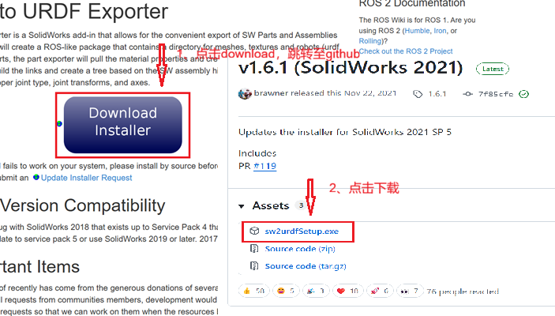 |
| 2. Install locally | Close SolidWorks, run the downloaded installer, and complete the installation following the setup wizard. | 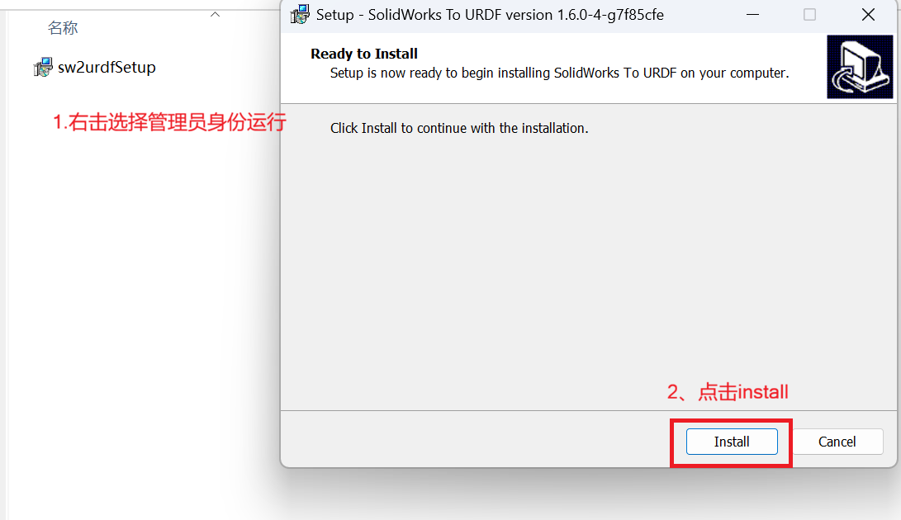 |
| 3. Activate in SolidWorks | Reopen SolidWorks, go to "Tools → Add-Ins", find SolidWorks to URDF Exporter, and select "Active Add-In". To load it automatically at startup, also select "Startup". | 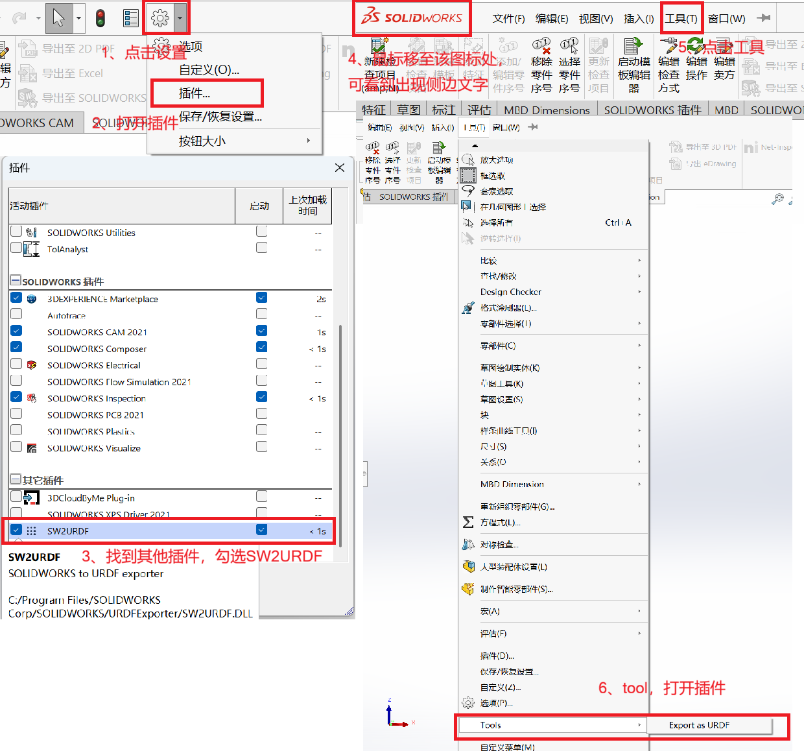 |

After activation, open an assembly and confirm that the `Export as URDF` command appears in the "Tools" menu. If it does not appear, recheck whether the plug-in was installed successfully and enabled.

#### 5.1.3 Saving the zero position and the basis for grouping

Fix the base and adjust the six body joints to the agreed zero position. The gripper uses the closed zero position: the angle of motor 7 and the displacement of both fingers are all set to 0. Save this assembly configuration; subsequent creation of reference geometry and the export both use this pose.

Divide the solid parts according to the method in Section 4.2: the gripper's fixed body goes into `link_end`, the rotor and drive gear of motor 7 go into `link_end1`, and the fingers on both sides and their racks go into `link_end_finger1/2` respectively. Check that each solid belongs to only one link.


**Stage check:** The top-level assembly rebuilds completely; the zero position can be restored; each solid part has exactly one owner. As described in Section 5.5.2, the gripper is divided into a fixed body, rotating drive parts, and two translating fingers, and is not merged entirely into `link6`.

#### 5.1.4 Setting materials and equivalent density

Before exporting, you need to set credible materials and densities for the solids. For materials such as aluminum alloy, you can look up the density for the specific grade and then select or enter it in the SolidWorks material properties. The internal structure, infill rate, and material combination of motors, reducers, and printed parts are relatively complex, so you cannot specify a single solid material based on the external shape alone. For these, you can first weigh the solid, then compute the equivalent density using the CAD model volume:

$$
\rho_{\mathrm{eq}}=\frac{m_{\mathrm{measured}}}{V_{\mathrm{CAD}}}
$$

Here, $m_{\mathrm{measured}}$ is the measured mass in kg; $V_{\mathrm{CAD}}$ is the CAD solid volume in $\mathrm{m^3}$; the equivalent density $\rho_{\mathrm{eq}}$ is in $\mathrm{kg/m^3}$. Note that it should be "mass divided by volume", not volume divided by weight.

| Step | Instruction | Screenshot |
|:---:|:---:|:---:|
| 1. Weigh the solid | Weigh the motor, reducer, or printed part whose equivalent density you need to set separately, and record the mass and its unit. When weighing a combined part, use the total volume of the same group of parts in CAD as well. | 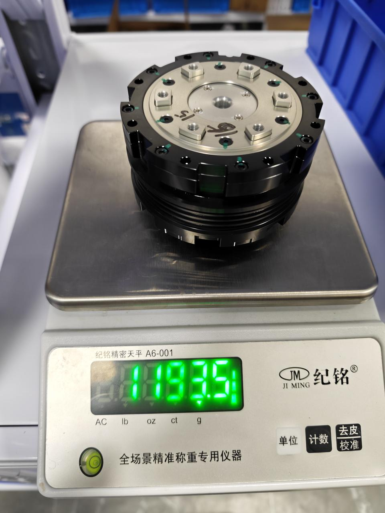 |
| 2. Read the CAD volume | Open the corresponding part or combined part in SolidWorks, go to "Evaluate → Mass Properties", read the volume, and convert it to $\mathrm{m^3}$. | 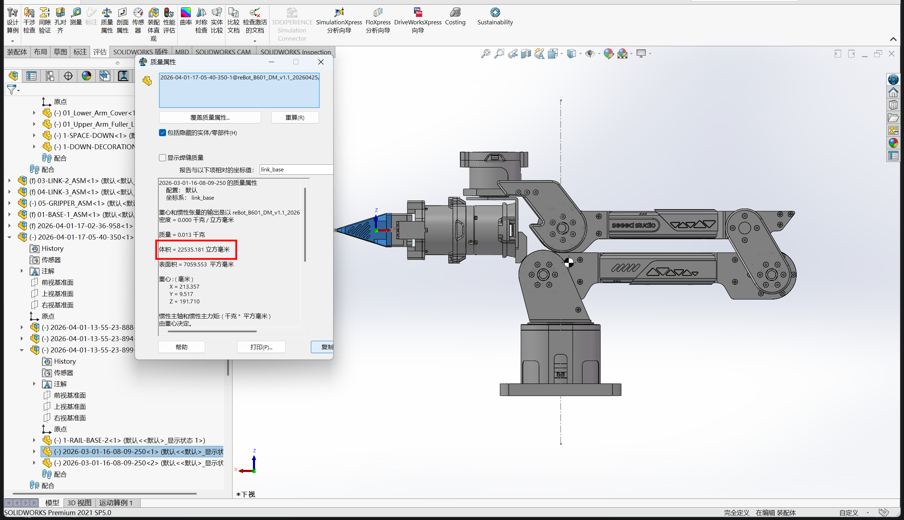 |
| 3. Calculate and set the equivalent density | Divide the measured mass by the CAD volume and unify the units to obtain the equivalent density. Edit the material, enter the calculated density in the material properties, and apply the material to the corresponding part. Do not merely override the mass in the Mass Properties window, because SW2URDF does not use that override when exporting. | 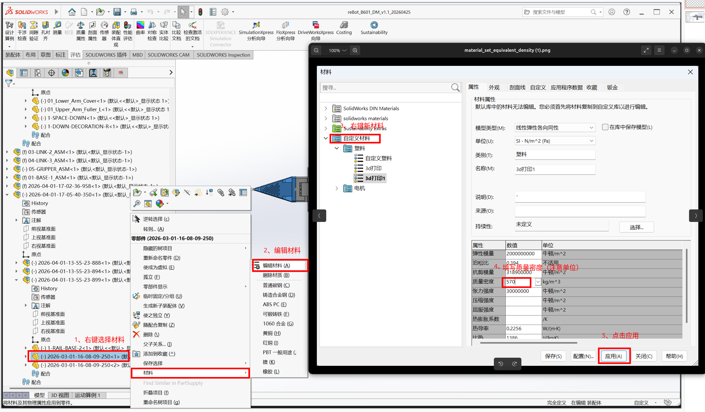 |
| 4. Verify the mass properties | Reopen "Mass Properties", confirm that the calculated mass matches the measured mass, and check the units and part scope. |  |

The equivalent density can make the exported total mass match the physical object, but the internal mass distribution of parts such as motors is usually not uniform, so the center of mass and inertia calculated from the external shape and equivalent density are still approximate values. When dynamics calculations are needed, prefer the center-of-mass and inertia data provided by the manufacturer, or verify them further by measurement.

### 5.2 Finding and naming the joint axes of the body and gripper

#### 5.2.1 Creating the reference axes of the six body joints

First create a reference axis using `joint1` as an example; perform the same steps for the remaining body joints.

| Step | Description | Screenshot |
|:---:|:---:|:---:|
| 1. Find the geometric feature of the rotation axis | Find the cylindrical or conical face on the output shaft of the first joint that is coaxial with the actual rotation axis. If it is hidden by the housing, temporarily hide the covering part. | 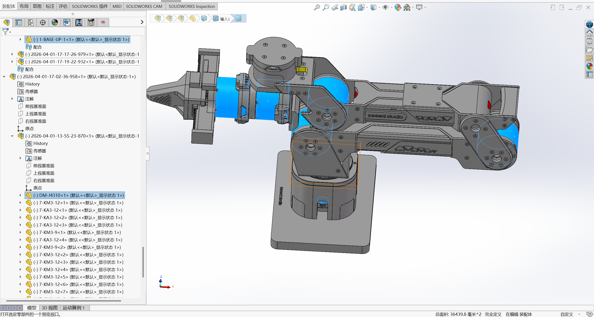 |
| 2. Open the reference axis tool | On the top "Assembly" tab, click the drop-down menu of "Reference Geometry" and choose "Axis". Subsequent creation of reference planes, points, and coordinate frames also starts from the "Reference Geometry" menu. | 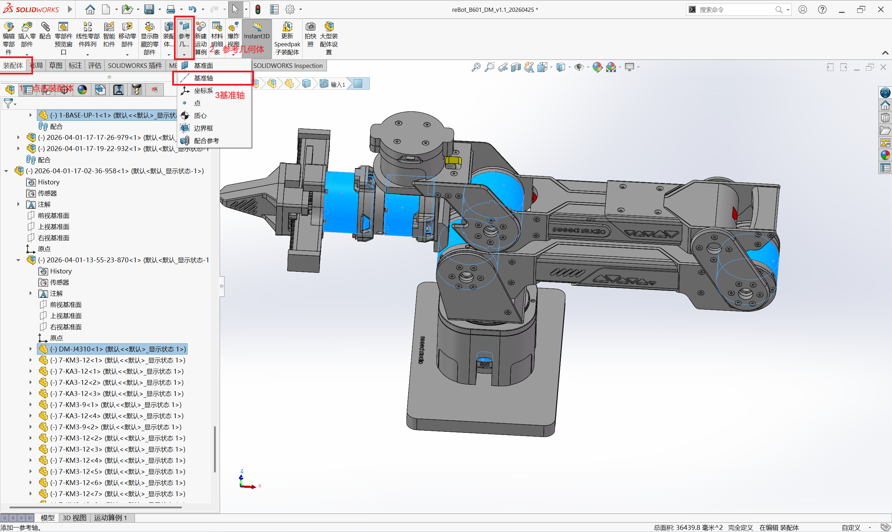 |
| 3. Select the reference face | In the Axis property panel, choose "Cylindrical/Conical Face", then select the corresponding cylindrical or conical face, confirm that the preview axis is coaxial with the real joint rotation axis, and complete the creation. | 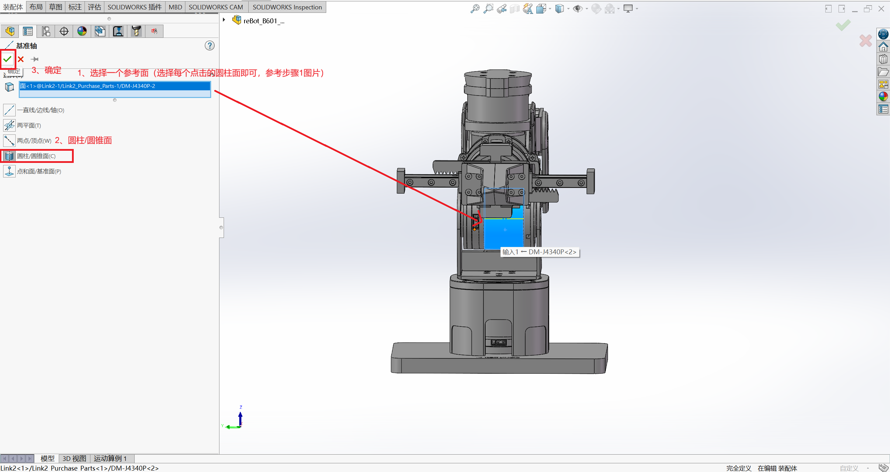 |
| 4. Name the reference axis | Name the first axis `axis_joint1`, then create and name `axis_joint2`–`axis_joint6` in order from the base to the end effector. | 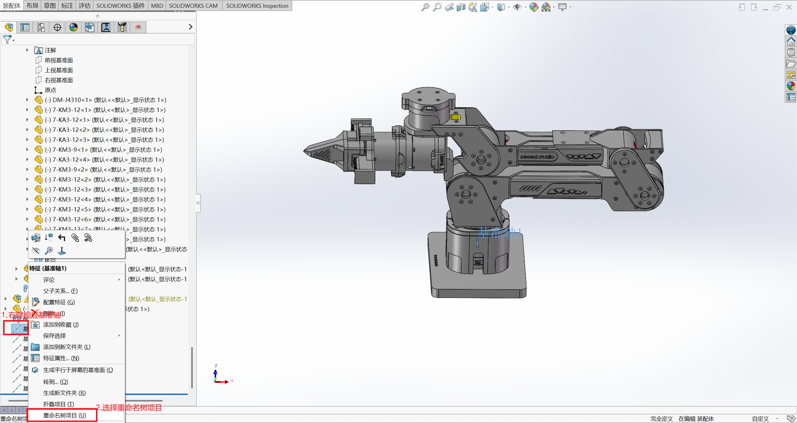 |

When selecting the reference face, confirm that it is coaxial with the real rotation axis; do not select a screw hole that is offset from the axis. When finished, display all reference axes and check which joint each axis corresponds to.


**Final result:**

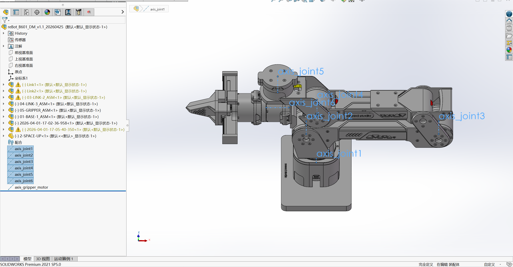

#### 5.2.2 Creating the gripper rotation axis and the two translation axes

The gripper requires one rotation reference axis for motor 7 and two translation reference axes for the fingers on both sides; start from "Assembly → Reference Geometry → Axis".

| Step | Description | Screenshot |
|:---:|:---:|:---:|
| 1. Create the motor 7 rotation axis | Select the cylindrical face coaxial with the motor output shaft or the drive gear shaft, confirm that the axis passes through the transmission center, and name it `axis_joint_end1`. The positive direction is along the positive X of `link_end`. | 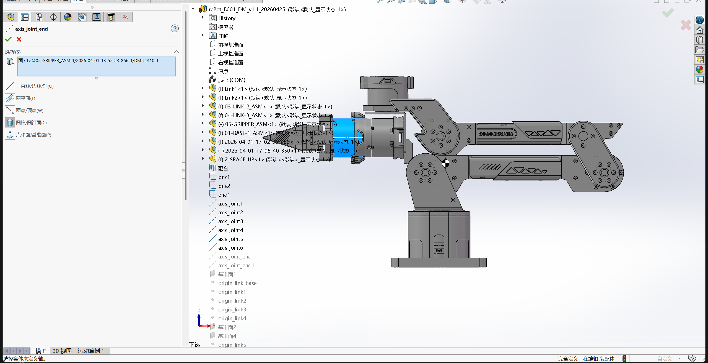 |
| 2. Create the first translation axis | Create an axis using the centerline of the first guide rail, or the intersection line of two intersecting reference planes, and name it `axis_joint_end_pris1`. The positive direction is along the positive Y of `link_end`. | 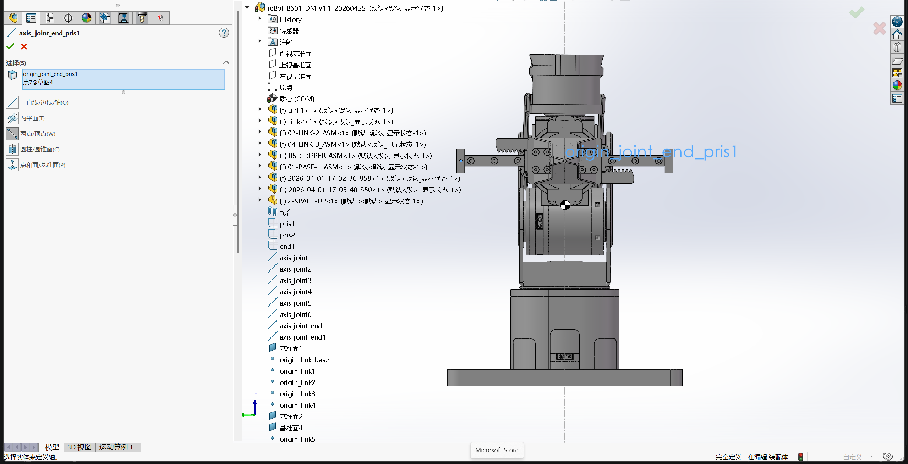 |
| 3. Create the second translation axis | Exit "Isolate" and repeat the operation on the other side, naming it `axis_joint_end_pris2`. The positive direction is along the negative Y of `link_end`. | 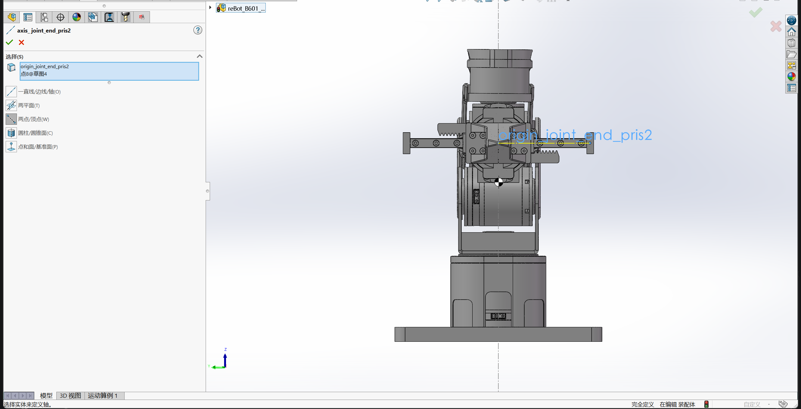 |

The two translation axes coincide with the centerlines of their respective guide rails and point in opposite directions. When configuring the joints, select the corresponding axis and match it with the same-sign `mimic` multiplier in Section 5.5.2.

**Stage check:** Each of the six body joints and the three gripper moving joints has one named axis; the rotation axes are coaxial with the real rotation axes, and the translation axes coincide with the guide rail centerlines. Save the assembly.

### 5.3 Determining coordinate frame origins

#### 5.3.1 Creating three locating reference planes

Go to "Assembly → Reference Geometry → Plane" and create the following three reference planes in sequence, to be used for locating the body origins and the gripper tool reference points.

| Step | Description | Screenshot |
|:---:|:---:|:---:|
| 1. Create `Plane1` | For the first reference, select `axis_joint2` and set it to "Coincident"; for the second reference, select the base direction reference plane and set it to "Parallel". Confirm that the plane contains this axis, then create and name it; it is used to locate `origin_link1`. | 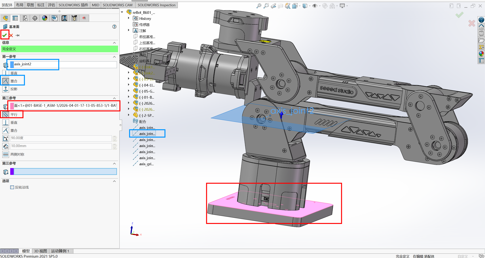 |
| 2. Create `Plane2` | For the first reference, select `axis_joint6` and set it to "Coincident"; for the second reference, select the base direction reference plane and set it to "Parallel". Confirm the position, then create and name it; it is used to locate `origin_link5`. | 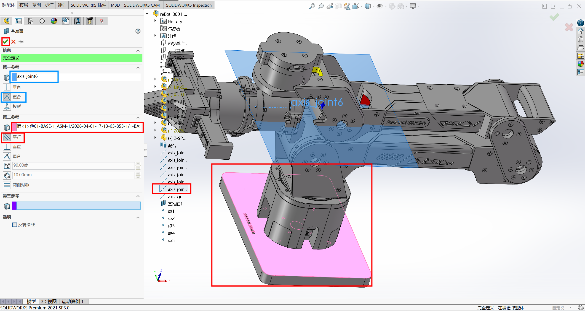 |
| 3. Create `Plane3` | For the first reference, select the geometric midpoint of the gripper and set it to "Coincident"; for the second reference, select the gripper direction reference plane and set it to "Parallel". Confirm the position, then create and name it; it is used to help locate the gripping center. | 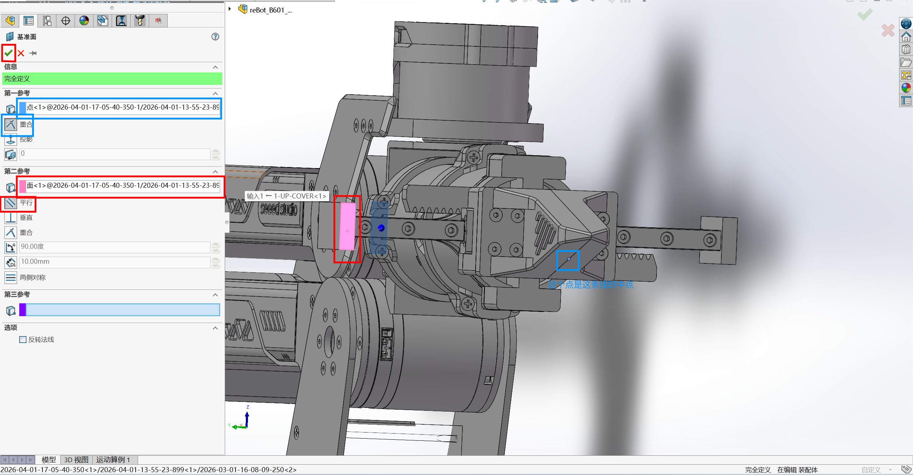 |

The first reference determines the position the plane passes through, and the second reference determines the orientation. After creating them, display the three reference planes, check the names, positions, and constraints, and then continue to create the origins.

#### 5.3.2 Creating the base origin and the six link origins

Go to "Assembly → Reference Geometry → Point", select the geometric references according to the table below, and name each point immediately after creating it.

| Step | Instruction | Screenshot |
|:---:|:---:|:---:|
| 1. Determine the base origin | Assembly → Reference Geometry → Point → select the center of the base bottom mounting face → arc center → OK | 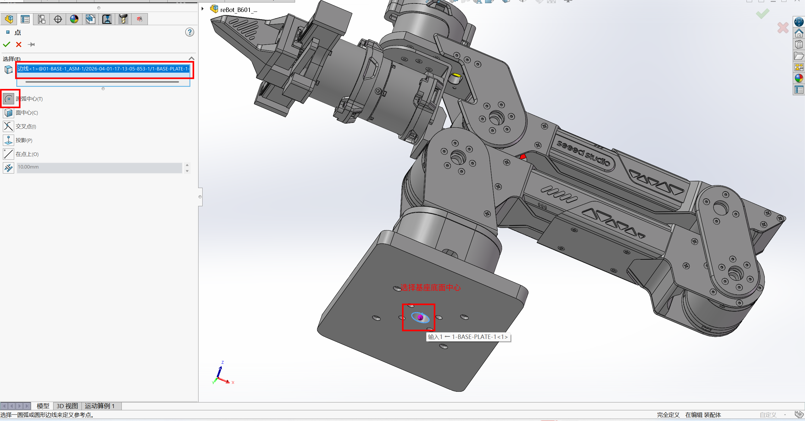 |
| 2. Determine the `origin_link1` origin | Select `axis_joint1` and `Plane1` → select "Intersection" → OK |  |
| 3. Determine the `origin_link2` origin | Select `axis_joint2` and `Top Plane` → select "Intersection" → OK |  |
| 4. Determine the `origin_link3` origin | Select `axis_joint3` and `Top Plane` → select "Intersection" → OK |  |
| 5. Determine the `origin_link4` origin | Select `axis_joint4` and `Top Plane` → select "Intersection" → OK |  |
| 6. Determine the `origin_link5` origin | Select `axis_joint5` and `Plane2` → select "Intersection" → OK |  |
| 7. Determine the `origin_link6` origin | Select `axis_joint5` and `axis_joint6` → select "Intersection" → OK; according to the convention in this chapter, this point coincides with `origin_link5` |  |

The "Top Plane" is the locating datum of the assembly. After finishing the body origins, continue to create the gripper origins and the tool reference points, then check all origins together.

#### 5.3.3 Creating the origins of the gripper parts

Go to "Reference Geometry → Point" and create the reference points with the gripper in the closed zero position. Use "Isolate" when the reference is hidden; if there is no selectable intersection, create an auxiliary plane first.

| Step | Description | Screenshot |
|:---:|:---:|:---:|
| 1. Create the fixed body origin | Select the intersection of the center axis of the gripper motor's bottom flange and the bottom face, and name it `origin_link_end`. |  |
| 2. Create the transmission center origin | Locate the center of the gear-rack transmission, that is, the rotation center of the drive gear, confirm that the point lies on `axis_joint_end1`, and name it `origin_link_end1`. | 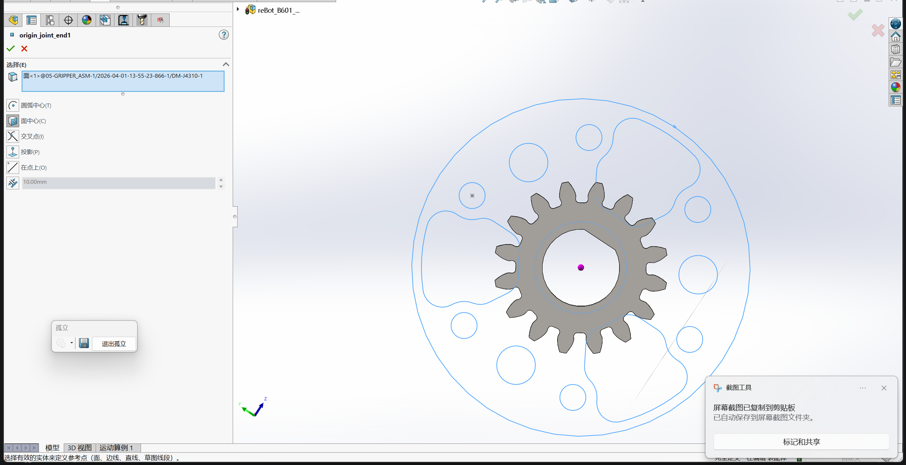 |
| 3. Create the first finger origin | Select the intersection of the first gripping face and the guide rail centerline, and name it `origin_link_end_finger1`. This point moves with the finger. | 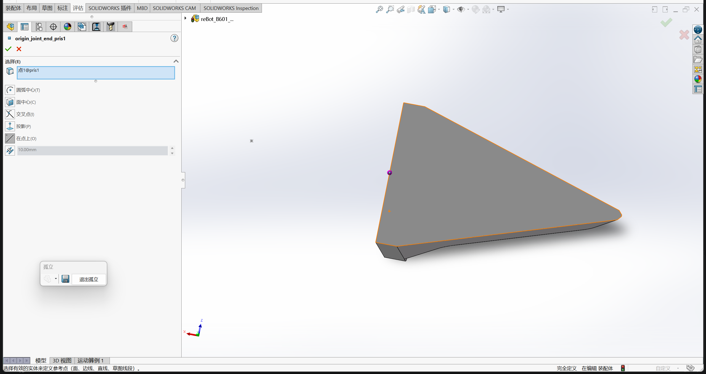 |
| 4. Create the second finger origin | Repeat the operation on the other side and name it `origin_link_end_finger2`; check the symmetry of the origins on both sides. | 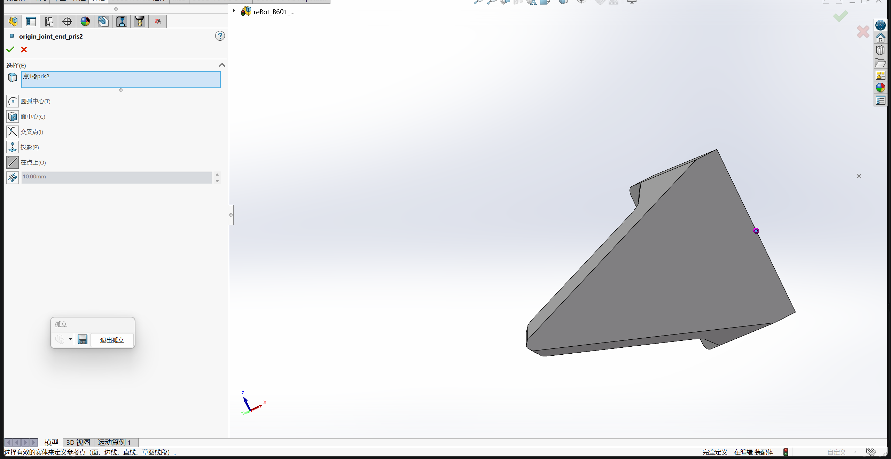 |

#### 5.3.4 Determining the gripping center and the closed fingertip reference point

The TCP corresponds to the agreed center for gripping an object. Keep the gripper at the closed zero position and locate it according to the effective gripping faces and the assembly symmetry plane.

| Step | Description | Screenshot |
|:---:|:---:|:---:|
| 1. Create the gripping center point | Use `Plane3`, the gripping faces, and the symmetry datum to locate the gripping center; go to "Reference Geometry → Point" and name it `origin_frame_end_tcp`. | 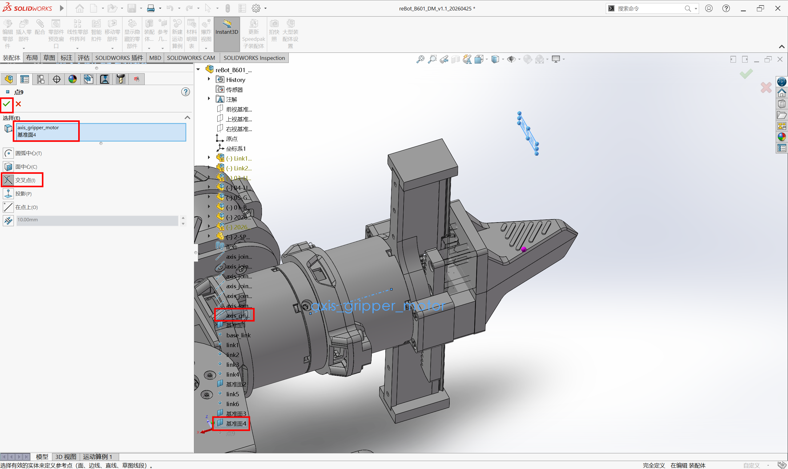 |
| 2. Create the closed fingertip point | Create a point at the fingertip reference position when the gripper is closed, and name it `origin_frame_end_fingertip`. | 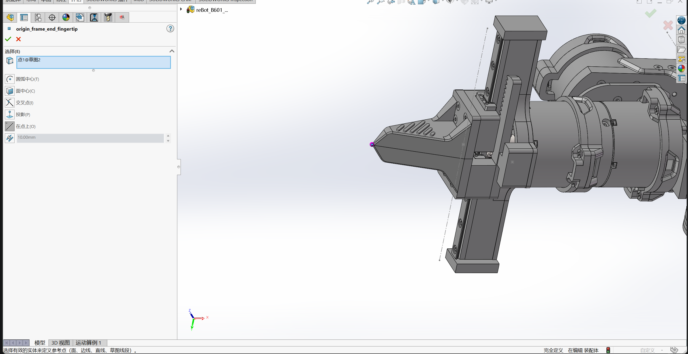 |

The two tool reference frames are fixed to `link_end`, and the closed fingertip reference point does not move with the current finger opening. Record the positions of the two points relative to `link_end`.

| Step | Instruction | Screenshot |
|:---:|:---:|:---:|
| Check all origins | Display all reference points of the body, gripper, and tool, and check the names, positions, and geometric sources against the frame assignment convention. | 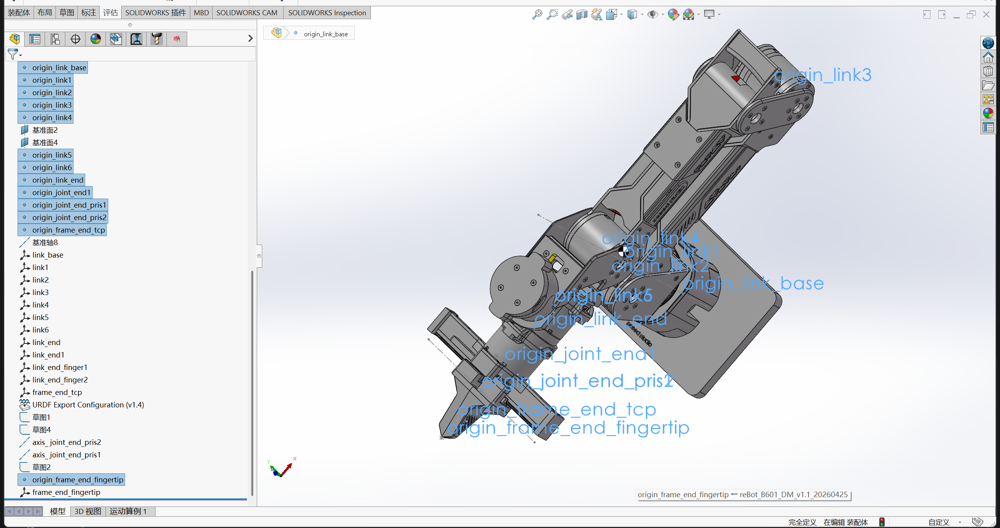 |

**Stage check:** Each origin has a clear geometric source; save the configuration in which the origins have been created.

### 5.4 Creating link coordinate frames

#### 5.4.1 First complete one coordinate frame

| Step | Description | Screenshot |
|:---:|:---:|:---:|
| 1. Create the base coordinate frame | Go to "Reference Geometry → Coordinate System", select `origin_link_base` as the origin, set Z upward and X along the forward direction of the base, and name it `link_base`. | 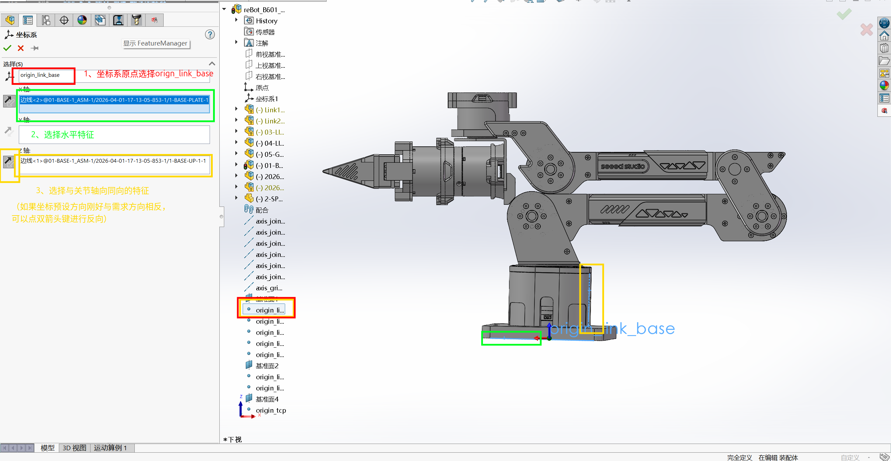 |
| 2. Create the link3 coordinate frame | Select `origin_link3` as the origin, `axis_joint3` as Z, and use the common normal from `origin_link3` toward `origin_link4` as the reference for X; check the right-handed system and name it. | 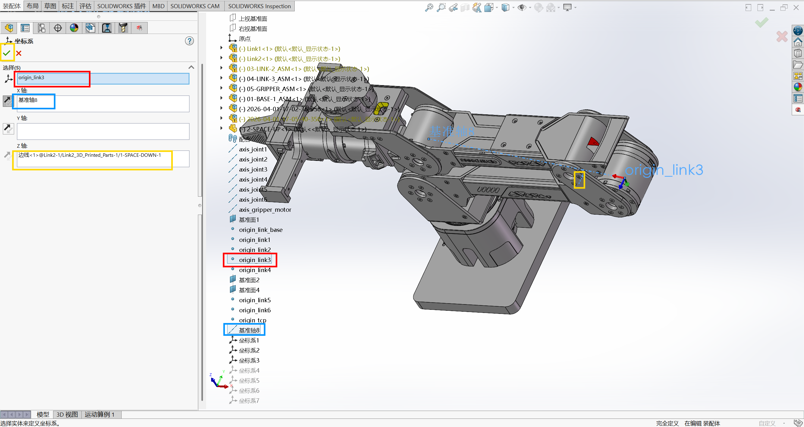 |

Use the named joint axes and the lines connecting origins as direction references. If you use a part edge as a reference, confirm that it is parallel to the target direction.

#### 5.4.2 Creating the remaining body, gripper, and tool coordinate frames

| Coordinate frame | Origin | Z axis | Basis for determining the X direction | Screenshot |
|:---:|:---:|:---:|:---:|:---:|
| `link1` | `origin_link1` | `axis_joint1` | Common normal of the first and second axes, with the direction chosen according to the convention above | 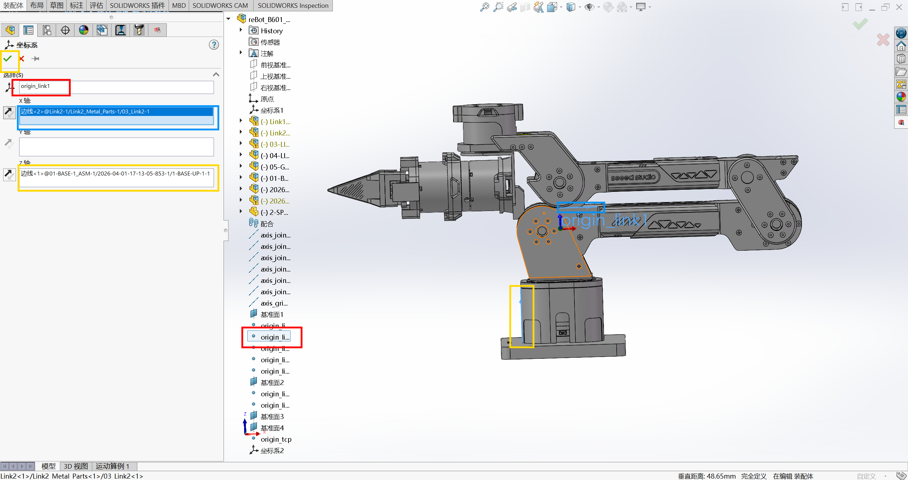 |
| `link2` | `origin_link2` | `axis_joint2`; the stator of motor 2 is mounted on the child link `link2` and the output end is connected to the parent link `link1`, so positive Z is opposite to the forward rotation axis of the motor output shaft | Common normal from the second axis to the third axis | 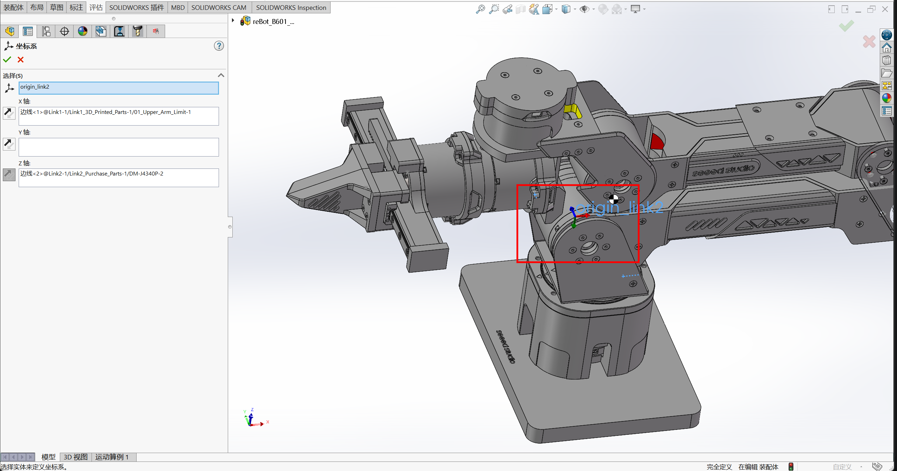 |
| `link3` | `origin_link3` | `axis_joint3` | Common normal from the third axis to the fourth axis |  |
| `link4` | `origin_link4` | `axis_joint4` | Common normal of the fourth and fifth axes | 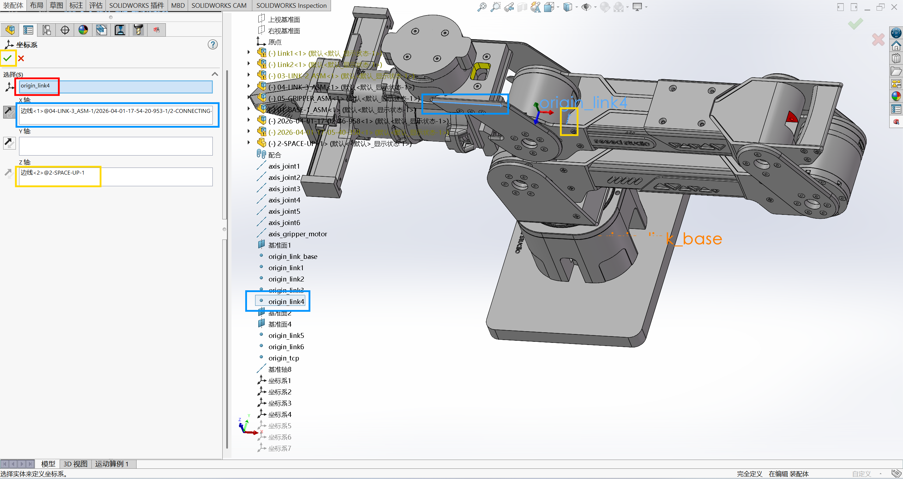 |
| `link5` | `origin_link5` | `axis_joint5` | Normal of the plane formed by the fifth and sixth axes, with the positive direction following the convention in Chapter 2 | 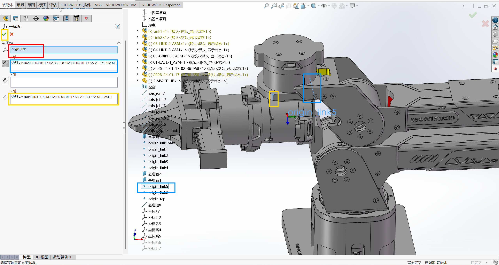 |
| `link6` | Coincides with `origin_link5` | `axis_joint6` | Along the positive X of `link5` at the zero position | 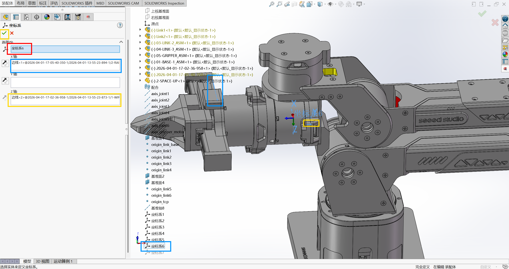 |

For intersecting axes, the normal has two opposite directions; choose according to the agreed positive direction. The direction of the end link is determined by the mounting datum.

**Determining the positive Z direction:** First determine the forward rotation direction of the output shaft (the direction in which the feedback angle increases) from the motor documentation, curl the four fingers of the right hand in the forward rotation direction, and the thumb points along the forward rotation axis of the output shaft. Then set the positive Z of the body joints according to the stator mounting position:

| Motor stator mounting position | Positive Z direction |
|:---:|:---:|
| Parent link, with the output end connected to the child link | Same as the forward rotation axis of the motor output shaft |
| Child link, with the output end connected to the parent link | Opposite to the forward rotation axis of the motor output shaft |

In SolidWorks, select the corresponding joint axis, check the Z-axis arrow according to the table above, and click "Reverse Direction" if necessary. In this way the positive direction of the body joints is consistent with the direction in which the motor feedback angle increases, and all six joints use `axis="0 0 1"`. Note that the forward rotation axis of the output shaft is determined by the rotation direction and is not necessarily the side where the shaft protrudes from the motor.

The positive Z of every gripper coordinate frame points upward and the negative Z downward; the motion axes of motor 7 and the fingers are set separately according to the rotation axis and the guide rail directions.

> 📌 **Direction convention**: "Forward and upward" are based on the gripper assembly datum and do not change with the viewing angle. All coordinate frames use a right-handed system. The X of `link6` being aligned with the X of `link5` refers to the frame assignment relationship at the zero position; after `joint6` rotates, `link6` moves with the rotor. The gripper drive axis is set according to the actual motor axis and is not required to be along the Z of `link_end1`.

**Creating the gripper and tool reference frames**

Go to "Reference Geometry → Coordinate System". At the zero position, the following coordinate frames all use the directions of `link_end`: X forward, Z upward, and Y determined by the right-handed system.

| Step | Description | Screenshot |
|:---:|:---:|:---:|
| 1. Create the fixed body coordinate frame | Select `origin_link_end` as the origin, set the positive X and Z directions using the assembly datum, and name it `link_end`. | 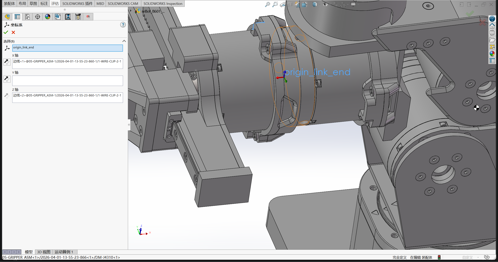 |
| 2. Create the drive gear coordinate frame | Select `origin_link_end1` as the origin, use the same reference as `link_end` for the directions, and name it `link_end1`. For the motion axis, select the motor 7 axis separately, along the local X. | 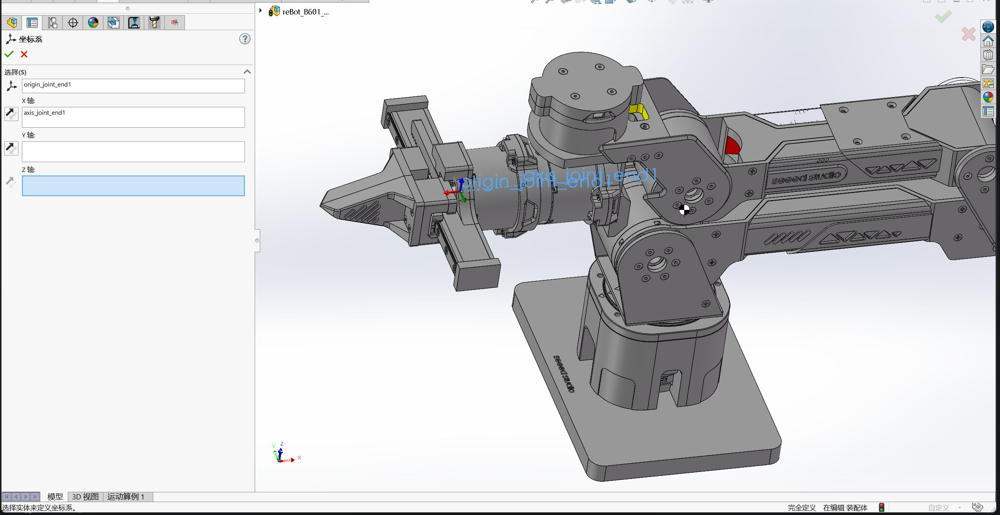 |
| 3. Create the first finger coordinate frame | Select `origin_link_end_finger1` as the origin, use the same directions as `link_end`, and name it `link_end_finger1`. | 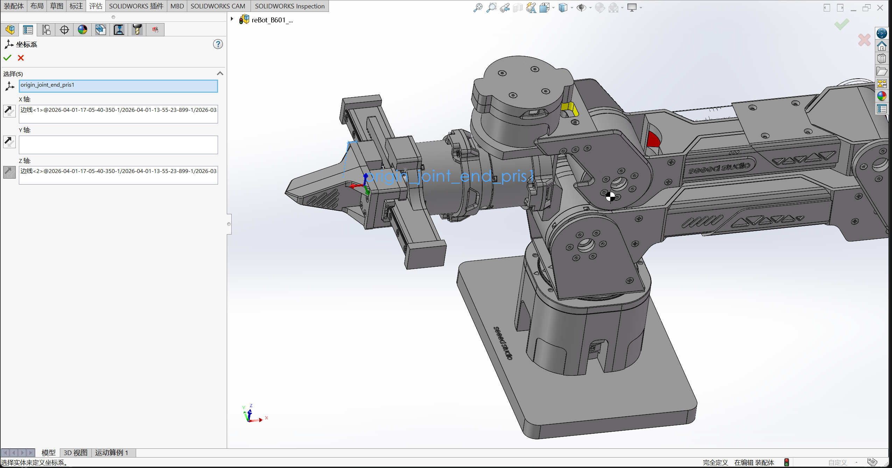 |
| 4. Create the second finger coordinate frame | Select `origin_link_end_finger2` as the origin, use the same directions as `link_end`, and name it `link_end_finger2`. | 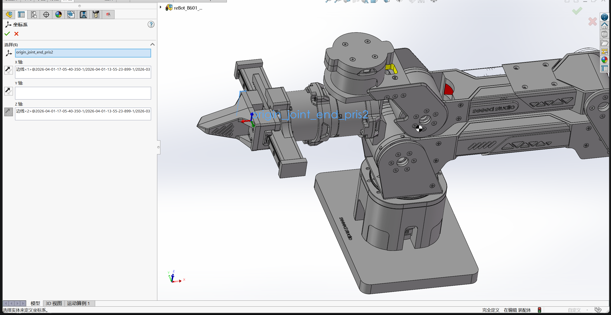 |
| 5. Create the gripping center coordinate frame | Select `origin_frame_end_tcp` as the origin, use the same directions as `link_end`, and name it `frame_end_tcp`. |  |
| 6. Create the closed fingertip coordinate frame | Select `origin_frame_end_fingertip` as the origin, use the same directions as `link_end`, and name it `frame_end_fingertip`. | 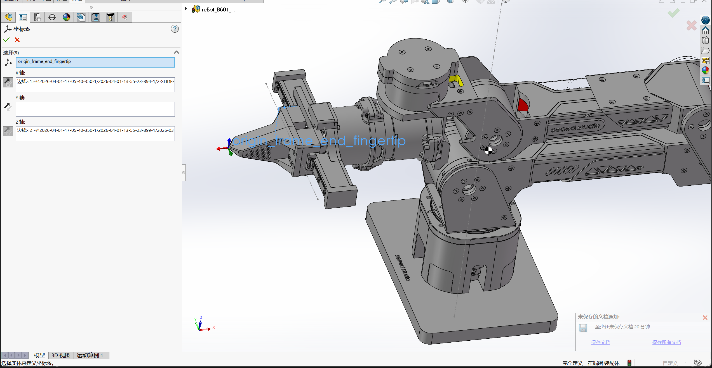 |

When the gripper moves, the drive gear coordinate frame rotates and the two finger coordinate frames translate, while the two tool reference frames stay fixed relative to `link_end`. Save the configuration in which the coordinate frames have been created.

Display all coordinate frames and check one by one whether the origins are located at the reference points created in the previous step. The Z axis of each body coordinate frame coincides with the corresponding joint axis; the gripper coordinate frames use the unified forward and upward directions, with the motion axes taken separately from the corresponding reference axes.


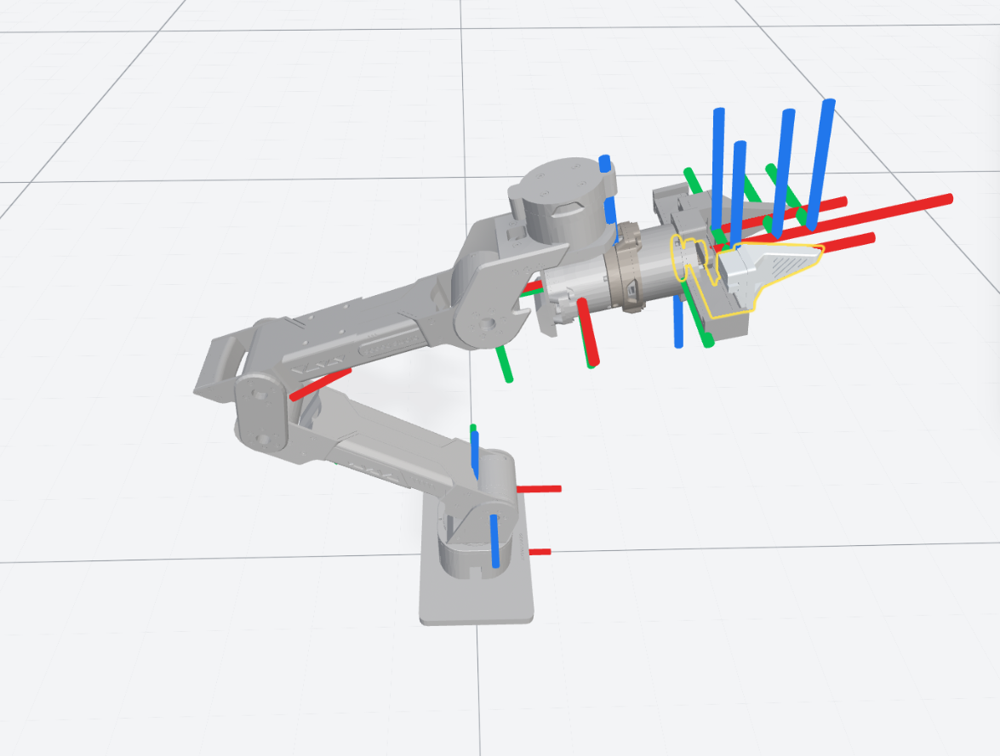

**Stage check:** The positive Z of the body joints is consistent with the actual relative rotation direction when the motor feedback angle increases; the gripper drive and guide rail axes are set according to the actual motion directions. When finished, save the "coordinate frames complete" configuration.

### 5.5 Configuring the kinematic tree in SW2URDF

#### 5.5.1 Selecting the body part groups and reference geometry

Open `Export as URDF` and start configuring from the root link. Enter `link_base` as the root name, select `link_base` as the reference coordinate system, and select all fixed base parts.

For `link3`, select the parent node `link2` in the tree and add a child node, filling in the following in sequence:

| UI item | Value to enter or select | What it determines in the URDF |
|:---:|:---:|:---:|
| Link Name | `link3` | Name of the child link |
| Joint Name | `joint3` | Name of the joint connecting this link |
| Reference Coordinate System | `link3` | Reference coordinate system of this node, used to compute the relative transform |
| Reference Axis | `axis_joint3` | Joint rotation axis and direction |
| Joint Type | `revolute` | Revolute joint with a limited range |
| Part selection area | All solids belonging to `link3` | Source of the grouping for meshes and physical properties |

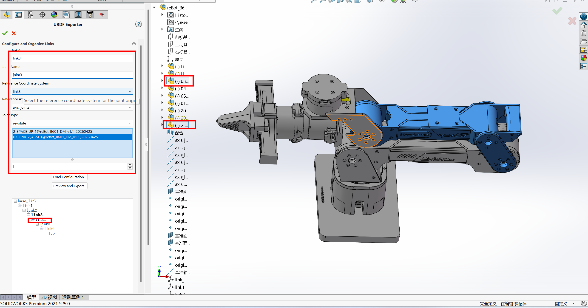

Use the same method for the remaining body nodes and check the parent-child relationships against the table below:

| Child link | Parent link | Joint Name | Coordinate system | Reference axis |
|:---:|:---:|:---:|:---:|:---:|
| `link1` | `link_base` | `joint1` | `link1` | `axis_joint1` |
| `link2` | `link1` | `joint2` | `link2` | `axis_joint2` |
| `link3` | `link2` | `joint3` | `link3` | `axis_joint3` |
| `link4` | `link3` | `joint4` | `link4` | `axis_joint4` |
| `link5` | `link4` | `joint5` | `link5` | `axis_joint5` |
| `link6` | `link5` | `joint6` | `link6` | `axis_joint6` |

Click each node one by one and check whether the highlighted parts match the original grouping. If a housing is selected into two links, it may appear overlapping later and its mass may also be counted twice; fix it here.


#### 5.5.2 Adding the end-effector gripper and tool reference frames

After configuring the body up to `link6`, continue to build the gripper branch. `link6` contains only the rotor of motor 6 and its flange; attach the gripper's fixed body `link_end` to `link6` through `joint_end`.

| Step | Description | Screenshot |
|:---:|:---:|:---:|
| 1. Add the gripper fixed body | Select the parent node `link6` and add `link_end`; set Joint Name to `joint_end`, the type to `fixed`, and the reference coordinate system to `link_end`, and select the stator of motor 7, the connectors, and the remaining non-moving parts. | 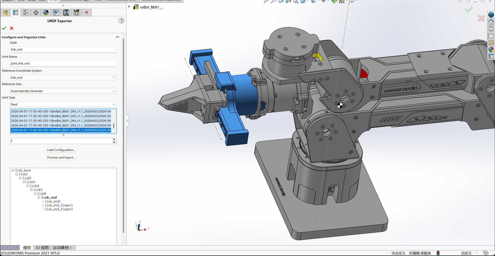 |
| 2. Add the motor 7 drive node | Select the parent node `link_end` and add `link_end1`; set the joint to `joint_end1` with type `revolute`, select the coordinate system of the same name and `axis_joint_end1`, and assign the rotor and gear. |  |
| 3. Add the first finger | Under `link_end`, add `link_end_finger1`; set the joint to `joint_end_pris1` with type `prismatic`, select the coordinate system of the same name and `axis_joint_end_pris1`, and assign the finger and rack. |  |
| 4. Add the second finger | Under `link_end`, add `link_end_finger2`; set the joint to `joint_end_pris2` with type `prismatic`, select the coordinate system of the same name and `axis_joint_end_pris2`, and assign the finger and rack on the other side. |  |
| 5. Add the gripping center reference frame | Skip this empty reference node in the plug-in; after export, add it manually as described in "Adding tool reference frames after export" in Section 5.6. |  |
| 6. Add the closed fingertip reference frame | Skip this empty reference node in the plug-in; after export, add it manually as described in "Adding tool reference frames after export" in Section 5.6. |  |

The kinematic tree of the gripper branch is as follows; the nodes are written with the actual model names (for the mapping to the tutorial names, see Section 5.1.1):

```text
link6
└── joint_end0 (fixed) → link_end0
    ├── joint_end1 (revolute, motor 7) → link_end1
    ├── joint_end_fingerright (prismatic, mimic joint_end1) → link_end_fingerright
    ├── joint_end_fingerleft (prismatic, mimic joint_end1) → link_end_fingerleft
    ├── joint_frame_end_tcp (fixed) → frame_end_tcp
    └── joint_frame_end_fingertip (fixed) → frame_end_fingertip
```

The fingers on both sides are linked to motor 7 through `mimic`; the exported tag is:

```xml
<mimic joint="joint_end1" multiplier="0.00842" offset="0" />
```

The finger displacement satisfies $q_{finger}=0.00842q_{end1}$, and the multiplier unit is m/rad. The multipliers on both sides have the same sign while the axes point in opposite directions, producing symmetric opening and closing.

| Step | Description | Screenshot |
|:---:|:---:|:---:|
| Set the mimic for both fingers | In the joint properties dialog, configure the two prismatic joints in turn: select "Mimic Other Joint", link it to `joint_end1`, and set the multiplier to `0.00842` and the offset to `0`. |  |

**Stage check:** The six-axis body is connected continuously; the parent-child relationships, motion axes, and `mimic` configuration of the gripper branch are correct; the two tool reference nodes are left to be added manually after export. Save the export configuration.

### 5.6 Checking parameters and exporting

Click `Preview and Export` and check in the order "joint parameters → link mass properties → export".

**1. Check axes and motion limits**

Select each body joint one by one and check the joint type, reference coordinate system, and `Axis`. In this tutorial, the local Z axis of each body joint is aligned with the rotation axis, so the axis should be `(0, 0, 1)`, that is, x, y, and z are `0`, `0`, and `1` respectively. If they do not match, go back and check the selected reference axis and the coordinate frame directions.

In the `Limit` area of the same dialog, check `lower` and `upper` (lower and upper position limits), `effort` (force/torque limit), and `velocity` (speed limit). The values in the figure are only UI examples; enter the actual limits according to the corresponding joint and hardware.


Revolute joints use rad, rad/s, and N·m; prismatic joints use m, m/s, and N; when converting CAD lengths from mm to m, divide by 1000; convert angles as follows:

$$
\theta_{\mathrm{rad}}=\theta_{\mathrm{deg}}\frac{\pi}{180}
$$

The following parameters are read from the accompanying model `joyarm_code/joyarm_core/robot_model/rebot_arm_b601_dm/urdf/rebot_arm_b601_dm.urdf`; the joint names are written with the actual model names (for the mapping to the tutorial names, see Section 5.1.1). When checking, verify them one by one against the corresponding joints:

| Joint | Type | Position range (lower–upper) | Speed limit (velocity) | Force/torque limit (effort) |
|:---:|:---:|:---:|:---:|:---:|
| `joint1` | `revolute` | -2.8 to 2.8 rad | 5 rad/s | 30 N·m |
| `joint2` | `revolute` | -3.14 to 0 rad | 5 rad/s | 30 N·m |
| `joint3` | `revolute` | -3.14 to 0 rad | 5 rad/s | 30 N·m |
| `joint4` | `revolute` | -1.57 to 1.57 rad | 8 rad/s | 9 N·m |
| `joint5` | `revolute` | -1.57 to 1.57 rad | 8 rad/s | 9 N·m |
| `joint6` | `revolute` | -1.57 to 1.57 rad | 8 rad/s | 9 N·m |
| `joint_end1` | `revolute` | -5.49 to 0 rad | 8 rad/s | 1.5 N·m |
| `joint_end_fingerright` | `prismatic` | -0.04625 to 0 m | 0.06736 m/s | 178.15 N |
| `joint_end_fingerleft` | `prismatic` | -0.04625 to 0 m | 0.06736 m/s | 178.15 N |

`joint_end0`, `joint_frame_end_tcp`, and `joint_frame_end_fingertip` are fixed joints and do not have motion limits.

Check the gripper joints according to their respective directions: `joint_end1` is `revolute` with its local axis along X and an angle range of `-5.49` to `0` rad; the fingers on both sides are `prismatic` with a displacement range of `-0.04625` to `0` m, and their local axes along the positive Y and the negative Y respectively. Also confirm that the gripper mounting joint `joint_end0` is `fixed`, with parent node `link6` and child node `link_end0`, and that the zero-position transform is correct.

**2. Check the mimic settings for both fingers**

Select `joint_end_pris1` and `joint_end_pris2` in turn, select `Mimic Other Joint`, set `Joint to Mimic` to `joint_end1`, `Multiplier` to `0.00842`, and `Offset` to `0`. The multipliers on both sides have the same sign while the axes point in opposite directions, producing symmetric opening and closing.

| Joint | Screenshot |
|:---:|:---:|
| First finger `joint_end_pris1` |  |
| Second finger `joint_end_pris2` |  |

`mimic` defines only the position coupling; the limits, speed, and force limits of the two joints still need to be set separately.

**3. Check the mass properties and export**

Click `Next` to go to the link properties dialog, select each link one by one, and compare `Mass (kg)` with the mass evaluation result in Section 4.7. If they do not match, first check whether the link has selected extra parts, missed parts, or duplicate parts, then check the material and density settings. Also verify the center of mass, inertia, and collision geometry, and confirm that purchased modules use credible mass properties.


When checking, distinguish the fixed body in `link_end`, the rotor and gear in `link_end1`, and the fingers and racks on both sides, to avoid counting solids twice. The two empty tool reference frames carry no solid mass and are left to be added after export.

After confirming the parameters, click `Export URDF and Meshes`, choose the export directory, and save the URDF and the meshes of each solid.

The export directory should contain the URDF and the corresponding meshes, for example:

```text
rebot_arm_b601_dm/
├── urdf/
│   └── rebot_arm_b601_dm.urdf
└── meshes/
    ├── link_base.STL
    ├── link1.STL
    ├── ...
    ├── link_end.STL
    ├── link_end1.STL
    ├── link_end_finger1.STL
    └── link_end_finger2.STL
```

The directory name and mesh names follow the actual export result; when moving the model, keep the complete directory relationship between the URDF and the meshes.

**Adding tool reference frames after export**

The two empty tool reference nodes are not configured in the plug-in. After export, open the URDF file and add the following before the closing `</robot>` tag at the end:

```xml
<!-- ============================ frame_end_tcp =========================== -->
<link name="frame_end_tcp" />
<joint name="joint_frame_end_tcp" type="fixed">
  <origin xyz="0.12510 0 0" rpy="0 0 0" />
  <parent link="link_end" />
  <child link="frame_end_tcp" />
</joint>

<!-- ======================= frame_end_fingertip =========================== -->
<link name="frame_end_fingertip" />
<joint name="joint_frame_end_fingertip" type="fixed">
  <origin xyz="0.15071 0 -0.00001" rpy="0 0 0" />
  <parent link="link_end" />
  <child link="frame_end_fingertip" />
</joint>
```

The `xyz` values above are positions relative to the `link_end` coordinate frame in this model, in meters; `rpy="0 0 0"` means that the orientation of both reference frames is consistent with `link_end`. Empty links do not get `visual`, `collision`, or `inertial`, and fixed joints do not get `axis`. After replacing the gripper or adjusting the reference points, you need to re-measure and update the corresponding `xyz`.

**Check after adding:** Open the exported URDF and confirm that `frame_end_tcp` and `frame_end_fingertip` are each defined once, that the corresponding joints are both `fixed`, and that the parent link is `link_end` in both cases; verify the `xyz` and `rpy` above and save the file. After re-exporting the model, you need to add these two reference frames again. Then load the model as described in Section 5.7 and check their positions and how they follow the motion.

### 5.7 Loading and checking the model

Load the exported URDF and meshes into [URDF Studio](https://urdf.enkeebot.com/) (drag the whole folder into the page to load it) or a local model viewer, and check the following:


- **Appearance and zero position**: The parts are complete, and the positions of the links, gripper, and tool reference frames match CAD.
- **Joint motion**: Change each joint within its limits and confirm that the motion axis and direction are correct, that the upstream links do not move, and that the downstream links follow.
- **Gripper opening and closing**: Confirm that the fingers on both sides move symmetrically according to the `mimic` relationship and that the stroke is correct; the tool reference frames move with the gripper body and do not move with the finger opening and closing.
- **Forward kinematics**: Unify the base and end-effector reference frames, the joint order, and the zero position, and compare with the calculation result of [Chapter 2](chapt2_fkine.md) using the same joint angles.

If you find an anomaly, go back and check the part grouping, parent-child relationships, coordinate frames, axes, and parameter settings; if the viewer does not implement `mimic`, switch to a tool that supports this relationship. When the check is complete, save the CAD, export configuration, URDF, and meshes for use in later chapters.
