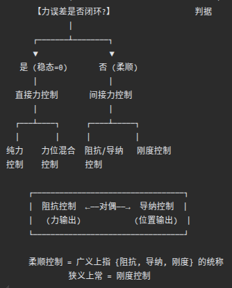

# Chapter 9: Force Control

> 📌 **Overview**: This chapter explains force control methods for robotic arms. Force control is divided into several categories, such as pure force control, hybrid force/position control, impedance control, and admittance control (see the classification diagram below).

<!-- ✍️ Writing guide (HTML comment, not rendered on the site; may be kept or deleted once the draft is complete)

[Chapter positioning] Advanced part · theory chapter, built on the motion control of [Chapter 6](chapt6_control.md) and the dynamics of [Chapter 8](chapt8_dyn.md), covering control in the "force" dimension.
[Reference template] Align with chapt2_fkine.md (the most complete theoretical chapter template): mathematical derivation + block diagrams.
[Fixed skeleton]
  · Line 1: H1 chapter title (chapter number written as 'Chapter N'); line 3 must be a "> 📌 **Overview**: ..." blockquote summary
    (no heading level, a one-sentence summary of the whole chapter, bold keywords, the logical flow of each section, and the practice in the last section).
  · The body expands as ## → ### → ####, with no separator lines between top-level ## headings.
  · 💡 Suggest adding a section "## 5 Chapter practice: JoyArm force control (e.g. constant-force tracking on a contact surface)" to match the "end-of-chapter practice" convention of the whole tutorial, corresponding to the script joyarm_code/chapt/chapt9/chapt9_force_demo.py.
[Global writing conventions] (see AGENTS.md for details)
  · Concise, clear, and beginner-friendly; avoid leaps.
  · Center all tables with `:---:` (write it for every column); no need to confirm with the user.
  · Heading numbering: H2 uses Arabic numerals restarting from 1 in each chapter; H3 is "parent H2.index"; chapter numbers are written as 'Chapter N'.
  · Math: inline $...$ and display $$...$$; use \bm{F}, \bm{x} in the impedance/admittance equations, and $K_d, B_d, M_d$ for stiffness/damping.
  · Code: prefer the "script reference sentence": "The corresponding script is located at `joyarm_code/chapt/chapt9/chapt9_force_demo.py`; see the comments at the top of the script for usage."
  · Reusable core library joyarm_code/joyarm_core/: control / dynamics / joyarm / jacobian / fkine.
  · Figures: place images in docs/assets/joyin-arm/tutorial/images/chapt9_force/.
  · Callouts: > 💡 intuition/mnemonic  |  > 📌 important note/cross-chapter reference  |  > ⚠️ warning/caution (contact/collision safety).
  · Use relative links for cross-chapter references (e.g. [Chapter 8](chapt8_dyn.md), safety protection in [Chapter 11](chapt11_safety.md)).
  · Do not write a "chapter summary"; the overview on line 3 replaces it.
[Scripts/libraries referenced in this chapter] chapt9_force_demo.py (to be built), robotics/control/, robotics/dynamics/, joyarm/joyarm.py, robotics/jacobian/.
-->

## 1 Pure force control

<!-- ✍️ Key points for this section:
  · Goal: explain the principle, applicable scenarios, and limitations of pure force control (directly controlling the end-effector/joint torque).
  · Give the torque control law and the applicable conditions; add .
  · Closing > ⚠️: under pure force control the end-effector pose is unconstrained, so contact must be maintained throughout; otherwise the arm may "run away" — leading into §2 hybrid force/position control.
-->

## 2 Hybrid force/position control

<!-- ✍️ Key points for this section:
  · Goal: explain hybrid force/position control — using a selection matrix to control force along the normal of the contact surface and position along the tangent.
  · Give the definition of the selection matrix $\bm{S}$ and the control law, with a block diagram (mermaid: pose loop + force loop → selection matrix → robotic arm).
  · Closing > 💡: hybrid force/position control is the compromise of "controlling force along some directions and position along the rest", and requires the contact direction to be known.
-->

## 3 Impedance control

<!-- ✍️ Key points for this section:
  · Goal: explain impedance control — making the end effector exhibit equivalent mass-damping-stiffness (spring-damper) behavior, without an explicit force loop.
  · There are already two points (without/with a force sensor); suggest expanding them: give the impedance equation $\bm{M}_d\ddot{e}+\bm{B}_d\dot{e}+\bm{K}_d e=\bm{F}_{ext}$ and compare the two implementations "with/without a force sensor".
  · Add a "comparison table of the two impedance control implementations" (implementation | force sensor required | feedback quantity | accuracy | complexity).
-->

* Without a force sensor
* With a force sensor

## 4 Admittance control

<!-- ✍️ Key points for this section:
  · Goal: explain admittance control — correcting the desired pose based on the measured contact force (force → displacement), which is dual to impedance.
  · There are already two points (with/without a force sensor); suggest giving the admittance equation and adding an "admittance vs impedance" comparison table
    (direction | control law | input and output | requirements on the inner loop | typical application).
  · Closing > 📌: admittance control is often layered on top of the position/velocity inner loop of [Chapter 6](chapt6_control.md), which makes the engineering implementation more flexible.
-->

* With a force sensor
* Without a force sensor

## 5 Chapter practice: JoyArm force control

<!-- ✍️ Key points for this section:
  · Goal: use scripts to run the force control methods of this chapter on JoyArm (e.g. constant-force tracking on a contact surface). The corresponding script is located at `joyarm_code/chapt/chapt9/chapt9_force_demo.py`; see the comments at the top of the script for usage.
  · Suggested structure: problem and goal → script flow (force control outer loop + position/velocity inner loop) → run results (add ).
-->
